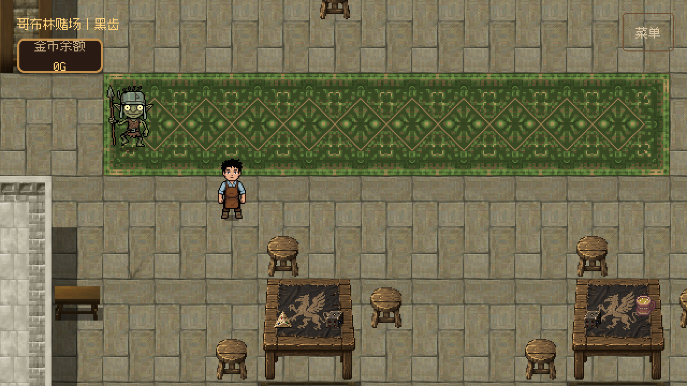
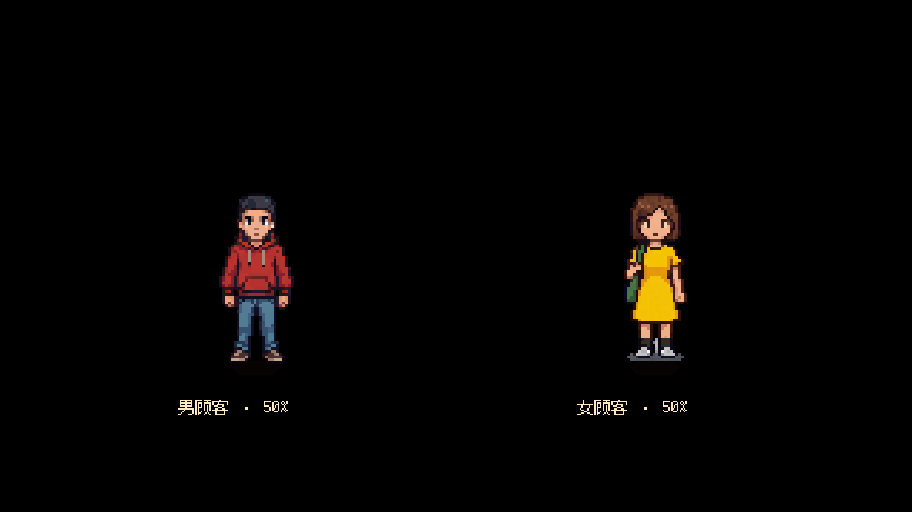
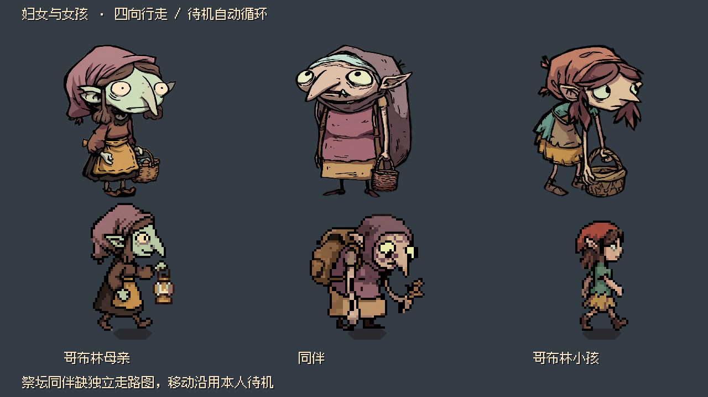

# 游戏人物与美术接入

主角保留 `src/gameplay/player/shop_player.tscn`、现有四向动画与对白立绘。新增 8 个独立 NPC 场景位于 `src/gameplay/characters/`，使用全部 31 张已入库 NPC 图集；原始插画、表情整图和同人物不同表情不另造人物。围裙男子对应主角，哥布林插画对应胖哥布林；现有对白立绘接入保持不变。

身份依据 `docs/design/day_01_story_flow.md` 的第一天人物关系和聚落现有功能区域；不新增对白、任务、剧情顺序或角色真名。

| Actor ID / 场景文件名 | 人物 | 聚落预置位置（世界像素） | 剧情 / 用途 |
| --- | --- | --- | --- |
| `fat_goblin` | 胖哥布林 | (5400, 8620)，奶茶店外 | 提供地图、委托取得格里芬之血的关键人物 |
| `common_goblin` | 普通哥布林 | (5500, 8910)，店外街道 | 居民、背景顾客 |
| `guard` | 守卫 | (4410, 6250)，居所方向道路 | 可复用于夜间醉酒守卫演出；未自动触发剧情 |
| `guard_captain` | 守卫长 | (7130, 3120)，训练区外 | 武装人员，专属剧情尚待设计 |
| `elder` | 长老 | (6410, 1730)，长老居所外 | 格里芬信仰的权威代表 |
| `chef` | 厨师 | (7290, 6650)，厨房外 | 厨房备料人物，专属剧情尚待设计 |
| `tavern` | 酒馆人物 | (3680, 4910)，酒馆外 | 第二天酒水线索的候选人物；未擅自确定姓名和身份 |
| `casino` | 赌场人物 | (6690, 4920)，赌场外 | 第二天食材线索的候选人物；未擅自确定姓名和身份 |

这些是可编辑的聚落常驻展示位置，保存在 `src/core/settlement.tscn` 的 `World/EntityRoot`，不是第一天各阶段的出场排程。正式剧情应按剧情数据决定何时显隐、生成和移动，例如长老夜间外出时由剧情隐藏/移动。NPC 无玩家输入；可见角色脚底占层 3 并阻挡玩家，隐藏时退出该层，自身只与地图墙体 / 家具碰撞。普通来客 AI、巡逻和寻路未实现；专用潜入感知与投掷组件已有，正式配置仍待绑定。

## 动画与源图

`character_catalog.json` 保存人物身份、源图、有效帧数、FPS 与动画映射；`*_frames.tres` 为可在编辑器查看的 SpriteFrames，使用 AtlasTexture 引用原图，不重编码图片。脚底为角色原点，碰撞只覆盖脚部；普通图集 64 像素帧等比放大 2 倍，守卫长 128 像素帧保持 1 倍，默认画布为 128 世界像素，可见人物约 110 像素高；这套基础场景继续供独立奶茶店与角色预览使用。RPG Maker 地图当前使用 `rpg_common_goblin.tscn`、`rpg_guard.tscn`、`rpg_tavern.tscn`、`rpg_casino.tscn` 四个继承场景，将 Visual、阴影、脚部碰撞减半，最终画布为 64 世界像素，脚底锚点与根节点缩放不变。RPG 正式宿主的玩家镜头从 0.5 拉近为 1.0，补偿人物减半后的屏幕尺寸。NPC 演出仍使用既有指令中的世界速度、位置与计时，不把剧情移动距离或时长按美术倍率机械缩放。守卫长待机图与走路图存在原素材的造型差异，保留原图。

- 普通图集为 64×64 帧、88 像素间隔；守卫长走路为 128×128 帧、152 像素间隔。6 列，逐行播放。尾部空格排除，每张有效帧数为 9～16。
- 播放接口沿用 PlayerController 的 `idle_down/left/right/up` 与 `run_down/left/right/up`。走路 8 FPS，待机 6 FPS。原包未给出 FPS，当前为可调的接入值。
- 只有一侧的素材采用左右镜像；普通哥布林和长老的侧面源图朝左，其他侧面源图按右侧使用。守卫长为接近侧面的斜向图，尚缺真正侧面行走图。
- 守卫没有独立待机图，各方向取对应行走首帧。其他人物缺失的方向待机同样取行走首帧。
- 胖哥布林只有待机素材：正面/侧面待机已接入，移动采用对应静帧；背面使用正面 fallback，尚缺四向行走及背面素材。`emote_laugh` 收录第三张表情动画，未自动插入剧情。
- 第 1 天委托流程另用受难集里三套站姿情绪图集：`mood_pleading_sheet.png`（合十拜托）、`mood_worried_sheet.png`（摸额头苦恼）、`mood_happy_sheet.png`（摸肚子满足），各 12 帧、无朝向；由 `Day1WorldController._fat_goblin_mood()` 按阶段投影到 `PLEADING` / `WORRIED` / `HAPPY`，受难状态（`COLLAPSED`、`RESTING`）优先。详见 `assets/characters/npc/fat_goblin/README.md`。
- 普通哥布林在生成时独立以 50% 概率选择背包版或无背包版，实例的行走、转向、待机与显隐保持该外观。`common_goblin.tscn` 及其 RPG 继承场景都适用；`appearance` 默认 `RANDOM`，也可在编辑器固定外观。背包版沿用原图集；无背包版复用 `goblin_actions/goblin_frames.tres` 的走路帧，映射为四向 `run_*`（8 FPS）和对应首帧 `idle_*`，侧面源图朝右，向左镜像。无背包版没有独立待机动画。
- 长老两张待机分别用于正面、侧面；守卫长原待机额外保留 `idle_variant`。所有原图均被引用。

重新生成帧资源（Python 3 标准库）：

```sh
python3 tools/characters/build_character_frames.py
```

生成器只重建 SpriteFrames，不覆盖场景身份、聚落位置或图片。调整源图/帧数先修改 catalog，然后重建资源。

## 场景与演出

主场景组装时将 EntityRoot 中的 SettlementCharacter 按 `actor_id` 注册给现有 ActorDirector。各 NPC 场景根继承 PlayerController，`accepts_player_input = false`，可直接用 `actor_spawn` 实例化到其他宿主。复用同一场景生成多个居民时，为各个实例提供不同注册 ID；聚落预置实例的 actor_id 必须唯一。

Godot F6 打开 `src/debug/characters/character_gallery.tscn`：同时查看 8 类人物，自动循环四向移动、停止待机，观察镜像、脚底和人物比例。F6 打开 `src/core/settlement.tscn`：出生点向右可看到胖哥布林，出门继续向右下可看到普通哥布林；其余人物在表中对应区域外。NPC 不跟随 WASD；行走时应观察脚底碰撞与门口通行，不把动画身体范围当碰撞范围。

## 验证

```sh
/Applications/Godot.app/Contents/MacOS/Godot --headless --path . --fixed-fps 60 --script res://tests/verify_characters.gd
# 带图形环境保存 /tmp/godot_character_gallery.png
/Applications/Godot.app/Contents/MacOS/Godot --path . --fixed-fps 60 --script res://tests/verify_characters.gd -- --capture
```

测试实际加载各场景，核对全部动画帧非空/不越界、31 张源图覆盖、NPC 输入隔离、四向朝向、真实 ActorDirector 移动、聚落注册及出生点地图碰撞。测试不会把缺失方向的 fallback 误报为已有完整美术。

实现核对的 Godot 4.7 官方文档：[SpriteFrames](https://docs.godotengine.org/en/4.7/classes/class_spriteframes.html)（帧序列和 FPS）、[AtlasTexture](https://docs.godotengine.org/en/4.7/classes/class_atlastexture.html)（region 裁取及 filter_clip 防止邻格渗色）、[AnimatedSprite2D](https://docs.godotengine.org/en/4.7/classes/class_animatedsprite2d.html)（flip_h、offset 与动画播放）。

本次在 Godot 4.7.2 验证：人物 headless 1295 项通过；Metal Forward+ 实际渲染 1296 项通过（含截图），中文字体与八类人物画面已检查；ActorDirector 165 项、StoryDirector 163 项回归通过；聚落回归通过，验证 16 个区域、剧情锚点、桥梁、真实移动和墙体（48623 个可达采样点）。headless editor 资源导入成功；退出时存在沙盒外 editor_settings 无法保存和编辑器资源清理提示，未出现本次人物资源解析错误。

## 普通男、女顾客（2026-10-17）

用户附件 `普通顾客走路和待机(1).zip` 中的 12 张 PNG 已逐字节导入
`assets/characters/npc/human_customer/` 和 `human_customer_female/`；忽略
`__MACOSX` 元数据。素材由项目作者本人制作，属作者自有素材，可随本项目及其构建物（含对外试玩包）一并分发。
源图不裁剪、不重编码，原附件路径记录在
`src/gameplay/characters/customer_catalog.json` 的 `source_entry` 中。

`human_customer.tscn` 以各 50% 概率选择红衣男顾客或黄裙女顾客，默认 `appearance = RANDOM`，也可在编辑器固定 `MALE` / `FEMALE`。两种外观都沿用 `human_customer` Actor ID、订单与剧情目标；同一实例的移动、转向、待机和显隐不重选。正式游戏由存档内 `visuals.appearance_seed`、素材族、Actor ID 与天数确定外观，读档和重建相同日期的角色保持一致；旧档使用固定兼容值，独立 F6 仍随机预览。这里的 1:1 是概率比例，不保证短序列人数相等。`human_customer_female.tscn` 仍提供固定女顾客独立场景。普通哥布林使用自己的素材，并采用相同的外观持久化规则。

两套资源均提供 `run_*`（8 FPS，现有 NPC 行走接口）和 `idle_*`（6 FPS）四向循环，
左右共用侧面图，由 `SettlementCharacter` 镜像左向。每格 64×64、步长 88，
逐行取有效帧，排除末尾透明格；保持原有 2 倍等比显示及脚底锚点。

| 角色 | 走路 下 / 右 / 上 | 待机 下 / 右 / 上 |
| --- | --- | --- |
| 男顾客 | 8 / 11 / 12 | 7 / 7 / 9 |
| 女顾客 | 16 / 16 / 8 | 13 / 9 / 11 |

从原 ZIP 重新导入并生成（Python 3 标准库；将附件路径替换为实际路径）：

```sh
python tools/characters/build_character_frames.py --catalog src/gameplay/characters/customer_catalog.json --archive "普通顾客走路和待机(1).zip"
```

只重建两套帧资源时省略 `--archive`。默认不加参数仍只重建原 NPC catalog。
已有源文件内容与 ZIP 不同会拒绝覆盖。

F6 打开 `src/debug/characters/character_gallery.tscn`，右下角两位顾客自动循环
右、上、左、下行走与停止待机；观察朝向、左右镜像、完整循环与脚底位置。
`tests/verify_characters.gd` 同时检查这两位顾客的帧边界、非空帧、输入隔离、
四向朝向与镜像、ActorDirector 真实移动。

此次切帧依据官方 4.7 [AtlasTexture](https://docs.godotengine.org/en/4.7/classes/class_atlastexture.html)
的 `region`、`filter_clip`，循环与帧率沿用
[SpriteFrames](https://docs.godotengine.org/en/4.7/classes/class_spriteframes.html)，
侧向镜像沿用 [AnimatedSprite2D](https://docs.godotengine.org/en/4.7/classes/class_animatedsprite2d.html) 的 `flip_h`。

## 赌场侍卫（2026-10-19）

用户附件 `侍卫2(1).zip` 已接入独立 `casino_sentry`，按[最新聚落补充稿](../design/settlement_dialogue_supplement_revised.md)的“赌场：侍卫”确定身份，正文别名为“护卫”。基础场景 `src/gameplay/characters/casino_sentry.tscn`、RPG 场景 `rpg_casino_sentry.tscn`、独立 `sentry_catalog.json` 和 SpriteFrames 均已配置；不改变 `guard`、`guard_captain` 或四个潜入守卫的身份和素材。

正式赌场继承场景在已有 `casino_guard_a` 锚点 `(120, 552)` 放置一名侍卫，随宿主注册到 ActorDirector，使用 RPG 人物比例。三向行走图分别为下 13、右 15、上 10 帧，左向镜像，待机使用对应首帧；保留原始插画并生成仅裁透明边的显示立绘。“侍卫”“护卫”均绑定这张立绘；原守卫两种说话人仍绑定原立绘。

素材来源、SHA-256、裁切矩形与重建命令见[侍卫素材说明](../../assets/characters/npc/casino_sentry/README.md)。补充稿的分支对话尚未编排到运行时，本次接入 NPC 与素材；普通交互沿用忙碌反馈。

试玩：F6 打开 `src/core/casino.tscn`，从入口向左上走到地毯左端，应看到独立侍卫，角色不受 WASD 控制，脚部可阻挡玩家且不与墙或家具重叠。F6 打开 `src/debug/characters/character_gallery.tscn`，第二排最右侧的侍卫自动循环四向行走、镜像和停止待机。



实际验证（Godot 4.7.2）：`verify_casino_sentry.gd` headless 263 项通过，OpenGL 图形 264 项通过（含正式赌场截图）；覆盖逐帧非空与边界、镜像、输入隔离、真实 ActorDirector 移动、隐藏退出碰撞层、原守卫素材隔离、正式注册、锚点和站位碰撞。未运行全项目回归，本次没有更改通用逻辑或剧情状态契约。首次导入新 PNG 时已有 autoload 提前解析产生预导入报错，完成导入后运行时验证通过；再次 editor 导入无脚本解析错误，退出时仍报告 495 个 ObjectDB 实例与 10 个资源未清理。

实现沿用 Godot 4.7 [AtlasTexture](https://docs.godotengine.org/en/4.7/classes/class_atlastexture.html) 的 `region` / `filter_clip` 与 [SpriteFrames](https://docs.godotengine.org/en/4.7/classes/class_spriteframes.html) 的动画序列，不重编码行走图。

## 角色素材使用盘点（2026-10-19）

这里以正式店铺、外景、酒馆、赌场和长老宅的场景引用、实际角色组装为准；角色预览或帧资源引用不等于正式出场。原图、派生图和同角色不同表情不按新角色计数。上文早期“所有源图均被引用”是资源接入覆盖记录，不代表当前主线使用了所有角色。

| 角色 / 素材 | 当前状态 | 路径与说明 |
| --- | --- | --- |
| 守卫长 | 有基础场景、动画和画廊预览，未进入正式流程 | `assets/characters/npc/guard_captain/`，4 张；不把它自动认定为补充稿中的侍卫 |
| 厨师 | 有基础场景、动画和画廊预览，未进入正式流程 | `assets/characters/npc/chef/`，4 张 |
| 长老本人 | 有基础场景、动画和画廊预览，正式长老宅尚未实例化本人 | `assets/characters/npc/elder/`，5 张；地图中的长老宅不等于长老本人已出场 |
| 守卫长、厨师、守卫的攻击动画 | 有动作资源与独立预览，尚未接入正式战斗 / 行为 | `assets/characters/goblin_actions/` 的 `captain_attack_*`、`chef_attack_*`、`guard_attack_*`，各 3 张；不代表守卫整个角色没用 |
| 普通哥布林攻击动画 | 资源被无背包哥布林读取，但正式外观只提取行走 / 待机，未触发攻击 | 同目录 `goblin_attack_*`，3 张；`goblin_walk_*` 已实际用于无背包哥布林 |

已在正式场景使用的角色包括：主角、胖哥布林、普通哥布林（有 / 无背包）、原守卫、人类顾客（男 / 女各 50%）、酒馆老板、赌场老板，以及本次新增赌场侍卫。侍卫立绘已绑定，等待其补充稿对白的运行时编排。各类原始插画、旧像素头像和待机候选图属于来源或备选版本，不额外统计为未使用角色。

未使用角色的原因：当前前两天主线未安排守卫长、厨师的独立出场；长老已在故事中被提及，但首夜潜入明确利用他外出的时机，当前没有本人出场演出。男女顾客现已通过正式人类顾客的 1:1 概率外观接入。攻击动画未触发属于行为尚未接入，不意味着对应人物没有出场。

用户于 2026-10-19 确认，原按附件名误称“猫鸡”的 19 张图片属于**格里芬剧情物品素材**，已移到 `assets/story/griffin/`，候选图改用 `griffin_<hash>.png`，不再计入未使用人物。前两天剧情已经涉及格里芬与格里芬之血，但这批图片尚未绑定具体物品或场景；“没有使用这批图”不能解释成“前两天没有格里芬相关内容”。来源和当前路径见[格里芬素材说明](../../assets/story/griffin/README.md)。

## 人类顾客男女比例（2026-10-19）

正式店铺的 `human_customer.tscn` 已接入 `human_customer.gd`，生成时男、女各 50% 概率；女顾客素材不再属于未使用人物。角色画廊保留固定男、女两位，便于同时比较外观。

局部验证：`tests/verify_human_customer_appearances.gd` 无图形 4362 项、OpenGL 图形 4363 项通过；固定种子的 256 次生成得到男 115、女 141，检查动画资源、四向行走与镜像、显隐碰撞、玩家输入隔离、稳定 Actor ID 和真实 ActorDirector 移动。未运行全项目回归，本次只改角色外观选择。

F5 新游戏，第一位人类顾客可出现男或女；同一实例出入场不会变换外观。F6 打开 `src/debug/characters/character_gallery.tscn` 可同时观察两种外观的四向行走和待机。生命周期及随机选择沿用 Godot 4.7 [Node._ready](https://docs.godotengine.org/en/4.7/classes/class_node.html#class-node-private-method-ready) 与 [randf](https://docs.godotengine.org/en/4.7/classes/class_@globalscope.html#class-globalscope-method-randf)。



## 2026-10-20 聚落补充角色

六个用户 ZIP 中的 46 张 PNG 保留原始字节，并为八类人物生成基础场景、RPG 半尺寸继承场景及 SpriteFrames。新增集市母亲为成年女哥布林美术的独立实例，不与祭坛同伴共享 Actor；儿童使用新提供的男孩、女孩素材。九组补充对话均已接线，流程与画面见[实施记录](../development/story_supplement_2026_10_20.md)。

| 素材目录 / 场景名 | 来源 | 用法及缺帧边界 |
| --- | --- | --- |
| `warehouse_sentry` | `侍卫3(1).zip` | 仓库两卫，四向待机 / 行走与非循环倒地，左右镜像。 |
| `prayer_man` | `祈祷者(1).zip` 男 | 祭坛祈祷者，四向；左右镜像。 |
| `prayer_woman` | `祈祷者(1).zip` 女 | 祭坛同伴、独立集市母亲；“待机3”为背向，正面行走退回正面待机，不假作正面走路。 |
| `prayer_elder` | `祈祷者(1).zip` 老头 | 静坐展示，方向 / 行走接口退回现有待机。 |
| `tavern_drunk` / `tavern_drinker` | `酒鬼（改后(1).zip` | 正式外景醉鬼 / 室内买醉者均使用修订版；仅静止使用，旧版 `酒鬼.zip` 原图仍保存。 |
| `goblin_boy` | `小男孩.zip` | 集市小男孩，四向行走；侧面待机用侧走首帧，另保留坐姿、弹弓、抛石子。 |
| `goblin_girl` | `女孩.zip` | 居民区小孩，原 4×2 混合方向图集按方向分组；侧图朝左，向右镜像。坐姿原图保留，未插入剧情。 |

每个目录的 `source/sources.json` 记录原包条目、原文件路径与 SHA-256；酒鬼新原件位于 `source/revised/`。`supplement_npc_catalog.json` 记录 active_archive、帧数、原帧尺寸、透明包围框、等比倍率及女孩源格索引。原件不被派生图覆盖。素材为项目作者自制，可随本项目及其构建物一并分发。

派生图采用 NEAREST 等比生成 64px 格、88px 步距、6 列图集，脚底 y=62；成年人可见高度不超过 58px，男孩 44px、女孩 50px。基础人物约两倍，`rpg_*.tscn` 还原到地图半尺寸。待机 6 FPS、行走 8 FPS 是接入参数，原包未指定。所有人物缺少的帧均按表内回退，不声称补出了新美术。

复现命令（Python 3 + Pillow，source-dir 同时包含上述六个 ZIP，含旧酒鬼包）：

```powershell
python tools/characters/import_supplement_npcs.py --source-dir '<用户附件目录>'
```

Godot 导入后可在编辑器打开各 `rpg_*.tscn` 查看动作。正式 F5 进入游戏并完成胖哥布林委托对话后，分别前往集市、居民区、祭坛、仓库及酒馆 / 赌场按 E 交谈。`verify_supplement_content.gd` 覆盖全部派生动画帧非空、地图真实交互、选项、儿童尺寸 / 通路、修订包选择、采集与实购；本轮最终 1001 项通过。

## 妇女与女孩更新（2026-10-20）

本次附件 `妇女(1).zip`、`女孩(3).zip` 更新下列三位角色，覆盖上节对应外观映射。角色身份与对白内容保留；集市母亲现使用独立场景，不再与祭坛同伴共用 SpriteFrames。

| 角色 | 立绘与原图 | 正式动画与回退 |
| --- | --- | --- |
| 集市母亲 `market_mother` | 妇女1立绘、待机、走路，共3张 | 侧向待机8帧；背向走路源格 `[0,1,7]`，正面 `[3,4,6]`，侧向 `[2,5]`。侧图统一朝左，源格5镜像；正、背待机使用对应走路首帧。 |
| 祭坛同伴 `prayer_woman` | 立绘与动画均取妇女2；重复走路只归档，共4张 | 正面挥手与侧向待机各8帧，侧图朝左。背向和移动使用本人待机回退。`妇女2走路.png` 与妇女1走路原件 SHA-256 相同，不用于同伴，避免移动时串角色。 |
| 居民区小孩 `goblin_girl`，Actor `village_child` | 女孩立绘、走路、三张待机，共5张 | 待机/走路分别取背向 `[0,1,4]`、正面 `[3,6,7]`、侧向 `[2,5]`。待机源格2、走路源格5镜像后统一朝右；修复侧向周期中途翻面。另保留8帧扫地、8帧张望循环，不新增剧情触发。 |

全部12张 PNG 原始字节保存在 `assets/characters/npc/<角色>/source/update_2026_10_20/`，各 `source/sources.json` 记录 ZIP 条目与 SHA-256；旧源图仍保留。新女孩包的部分图片与旧包相同，正式立绘继续复用相同内容。素材为项目作者自制，可随本项目及其构建物一并分发。

新动画源图均为无间隔4×2网格。各帧先按实际朝向选取、必要时镜像；原图中单元内位置有明显偏移，派生图按各帧透明包围框居中、脚底对齐 y=62，同一段共用等比倍率并用 NEAREST 采样，消除打包位置造成的漂移。输出仍为64px格、88px步距、6列；成人最高58px，女孩最高50px。catalog 记录源格、镜像格、原始包围框、倍率与对齐规则。基础/RPG场景沿用既有倍率、碰撞和输入隔离，左右由控制器镜像。

母亲在 Day 1 / Day 2 各7句对白中的立绘引用，先修改 `docs/story_authoring/day*_project.json`，再由 StoryProject 生成运行时对白和清单散列。祭坛同伴、女孩沿用原立绘路径，分别加载妇女2与女孩的更新立绘。

祭坛同伴曾恢复为旧祈祷者女立绘，但世界精灵保留妇女2动画，造成两种外观不一致。按最新反馈，现统一使用 `source/update_2026_10_20/portrait.png` 的妇女2立绘，保留旧祈祷者原图作来源记录。`update_women_and_girl.py` 同步按妇女2原件重建，重跑不会恢复为旧绿皮角色。

对白右侧的朝右原画使用 `TextureRect.flip_h` 镜像朝向对话内容；已核对原守卫、赌场侍卫、集市母亲、女孩、年迈祈祷者及两名集市小贩。正面和原本朝左的原画保持原朝向。

```powershell
# 首次从附件导入；后续不带参数即可从仓库保留原图重建这三位角色。
python tools/characters/update_women_and_girl.py --source-dir '<附件所在目录>'
python tools/characters/update_women_and_girl.py
```

若重跑旧版 `import_supplement_npcs.py`，需随后运行上述更新工具以恢复本次外观。Godot重新导入后，F6运行 `src/debug/characters/women_and_girl_preview.tscn`，可比较三张立绘并观察真实 ActorDirector 四向移动与待机循环。正式 F5 接受胖哥布林委托后，到集市母亲、祭坛同伴、居民区小孩处按 E，对话应显示对应立绘；女孩保持比成人矮。同伴移动仍为本人待机，这是附件缺少独立行走图的回退。

Godot 4.7.2 OpenGL 图形运行 `tests/verify_women_and_girl.gd -- --capture`，508项检查通过，覆盖帧边界、非空、脚底、镜像、输入隔离、四向移动、显隐碰撞、正式角色、真实交谈和对白接线。已检查[集市母亲](captures/market_mother_updated_2026_10_20.png)、[祭坛同伴](captures/prayer_woman_updated_2026_10_20.png)、[居民区小孩](captures/village_child_updated_2026_10_20.png)的正式对话画面（祭坛同伴现与图中的妇女2外观保持一致）。两份 StoryProject 生成校验通过；12张原件逐字节校验通过，生成工具仅更新这三位角色，使用保留原图重建得到相同字节。本次不运行全项目回归，未改共享控制器或剧情状态契约。编辑器导入仍出现既有495个 ObjectDB 实例 / 10个资源未清理诊断，与上节历史记录一致。

提交前工作区出现并行的对白标点修改（`......`→`……`），直接 CLI 一致性复检因此报告两份运行时对白与工程不同。该改动保留在工作区，未混入本次提交；已将本次暂存的工程、对白和清单复制到 `.godot/`，使用同一 StoryProject 编译器核对对白、Beat映射和工程散列，两份均通过。

实现核对 Godot 4.7 官方 [SpriteFrames](https://github.com/godotengine/godot/blob/4.7/doc/classes/SpriteFrames.xml) 的帧序列/循环/FPS，以及 [AtlasTexture](https://github.com/godotengine/godot/blob/4.7/doc/classes/AtlasTexture.xml) 的 `region` / `filter_clip`；不改变运行时 API。



## 集市三个摊贩（2026-10-20）

用户附件 `哥布林npc：有特定对话，不能重复利用的npc(1).zip` 的 `其他可对话npc/小贩/小贩1-3` 已接入，替换 `chapter_cave.tscn` 里原先借用 `rpg_common_goblin.tscn` 的三个占位摊主。摊位位置、Actor ID、显示名与商品清单不变，所以 `chapter_actions.json` 的 `market_vendors`、`supplement.vendor_1-3` 对白和既有购买按钮无需改动。

| Actor ID | 显示名 | 商品（原价格规则不变） | 对白 |
| --- | --- | --- | --- |
| `market_vendor_1` | 吆喝的摊主 | 炽舌椒、蜜珀晶、萤火伞 | `supplement.vendor_1` |
| `market_vendor_2` | 懂行的摊主 | 苔痕青、窟窟糖芋、醒神菇 | `supplement.vendor_2` |
| `market_vendor_3` | 老练的摊主 | 炽舌椒、蜜珀晶、醒神菇 | `supplement.vendor_3` |

- 附件每家只给一张单帧像素图（64×64、128×128、64×64）与一张立绘，没有行走图：八个方向动画全部复用同一帧，摊主在集市里不移动。派生图按项目统一的 64px 帧、88px 步距、脚底 y=62、成人可见高度 58px 用最近邻生成，因此与同场普通哥布林同高、同地线；`market_vendor_2` 原图带一圈浅灰烘焙投影，派生时去掉，场景自身的地面阴影保留。
- 立绘本身已是透明底，只做了 4px 余量的边界清理，未缩放、未重绘；接管 `DialogueManager.speaker_portraits` 的三个说话人名（吆喝的摊主 / 懂行的摊主 / 老练的摊主）。
- 原件逐字节保存在各家 `source/`，来源与 SHA-256 见 `source/sources.json`；帧资源由 `market_vendor_catalog.json` 生成。

```sh
python tools/characters/import_market_vendors.py --archive '<附件路径>'
python tools/characters/build_character_frames.py --catalog src/gameplay/characters/market_vendor_catalog.json
```

F6 运行 `src/core/settlement.tscn`，走到集市（三个摊位在 (1272, 2328)、(1416, 2328)、(1560, 2376)）按 E，即可看到各自立绘与台词。与既有普通哥布林的同地线尺寸对比见 `artifacts/market_vendors_preview.png`。

## 具名可对话 NPC：诗人 / 哲人 / 军人（2026-10-20）

同一附件里此前完全缺美术的三位已接入，替换 `chapter_casino.tscn` 的 `Poet`（原借用 `rpg_common_goblin.tscn`）与 `chapter_cave.tscn` 的 `Philosopher`（原 `rpg_common_goblin.tscn`）、`BarracksSoldier`（原 `rpg_guard.tscn`）。位置、Actor ID、场景里的显示名不变；只有诗句、哲思与口号这三种站桩人物，附件也只给单帧，因此八向动画共用一帧。

| Actor ID / 场景 | 场景显示名 | 对白说话人（新增立绘绑定） | 对白事件 |
| --- | --- | --- | --- |
| `casino_poet` | 哥布林诗人 | 诗人 | `supplement.poet` |
| `signature_philosopher` | 酒馆外的哥布林哲人 | 哥布林哲人 | `supplement.philosopher` |
| `barracks_soldier` | 哥布林军人 | 军人 | `supplement.soldier` |

- 三张像素图原件本身就是 64×64 单帧，派生图沿用成人 NPC 规格（脚底 y=62、可见高度 58px）；艺术上人物宽窄不同（诗人 36px、哲人 41px、军人 55px），窄的那位在原图里就是瘦，没有额外缩放。
- `诗人` 的立绘本来就是透明底；`哲人`、`军人` 两张被压平到一张渲染出来的透明棋盘上（RGB，无 alpha）。第一版用噪声与中性高亮抠棋盘，并把“轮廓内整体为高亮中性色的空洞”一并去掉——但眼白与牙齿同样是高亮中性色，于是两张立绘的眼睛被一起扣掉，哲人耳朵旁还留着没抠干净的棋盘格。
- 2026-10-20 用户重新导出这两张（923×1224，纯白底、眼睛完整），改由 `tools/characters/repair_white_matte_portraits.py` 重抠：只去掉**与画面边框连通**的近白区域，封闭在轮廓内的眼白、牙齿、书页自然保留；四肢之间与两腿之间这类封闭但属于背景的白块按坐标点名清除（`INTERIOR_BACKGROUND_SEEDS`），每个种子先校验必须是纯白才动手；再削掉贴着切口的一圈浅色描边，避免在深色对话面板上出现白边。原件逐字节存为 `source/portrait_2026_10_20.jpg`，派生方式与裁切记录追加进各自 `source/sources.json`。
- `import_talkable_npcs.py` 的棋盘抠图同时收紧：封闭空洞只有在“均值 > 230 且标准差 > 12”时才算棋盘（棋盘约 203/σ25+，眼白 253/σ9），避免从原始 zip 重跑时再次吃掉眼睛。
- 原件逐字节保存在 `source/`，来源、SHA-256 与派生方式见各家 `source/sources.json`；帧资源由 `talkable_npc_catalog.json` 生成。

```sh
python tools/characters/import_talkable_npcs.py --archive '<附件路径>'
python tools/characters/build_character_frames.py --catalog src/gameplay/characters/talkable_npc_catalog.json
```

F6 运行 `src/core/casino.tscn` 找诗人、`src/core/settlement.tscn`（集市）找哲人与军人，按 E 触发对话即可看到立绘；三人与普通哥布林的同地线尺寸对比见 `artifacts/talkable_npc_lineup.png`。

## 附件重复素材核对（2026-10-20）

`哥布林npc：有特定对话，不能重复利用的npc(1).zip` 里除本页已记录的接入项外，其余目录
（哥布林母亲、小男孩、女孩、祈祷者男女、酒鬼两套、仓库侍卫 2/3、小贩之外的部分）与先前
各自独立 zip 的接入文件**逐字节一致**（比对 `source/sources.json` 的 SHA-256），因此没有重复
覆盖，也没有新增副本。

唯一例外是 `赌场护卫/守卫长.png` 与 `image-1791819548672-skpfy6dzwtf.png`：前者是 2048×1870
立绘、后者是 256×256、4×2 共 8 帧（64px 帧）的像素图集。它与现有 `guard_captain`（504×240 待机 + 888×432
走路 + `goblin_actions/captain_attack_*` 攻击帧）是两套不同设计，且没有四向行走与攻击帧，
未替换；`guard_captain` 当前在主线未出场，专属剧情仍待设计。
