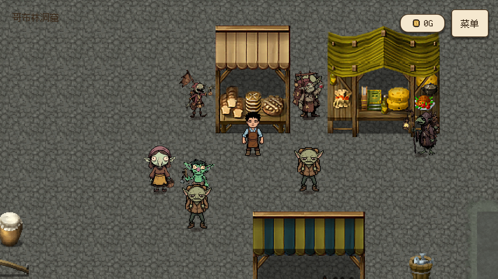
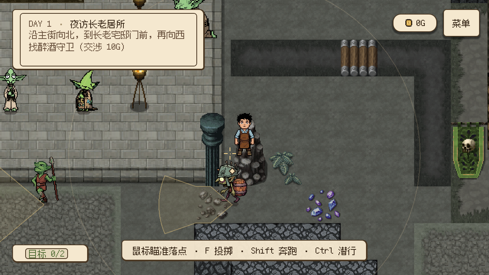

# 像素人物清晰度与分辨率修正（2026-10-24）

本次对应人物模糊、醉酒守卫外观与立绘不符、不同窗口分辨率画面利用不足三项问题。

## 人物素材

上一批补充素材把 128px 原始帧等比压到 64px，再由角色放大，导致人物眼睛、轮廓和衣服细节丢失。现在 `import_pixel_supplement.py` 保留 64px／128px 原生帧，只重排格子、平移脚底锚点及必要的左右镜像，不缩放或重绘原始像素。128px 帧使用 152px 步距，64px 帧使用 88px 步距；脚底锚点统一为帧高减 2。

覆盖集市母亲、小女孩、诗人、三个摊贩、普通哥布林两套外观及赌场侍卫。小女孩的手工混合方向帧也直接裁切到 128px 画布，不缩放原始像素。各角色原件和 SHA-256 仍保存在原 `source/supplement_2026_10_24/`；重建仍使用 `python tools/characters/import_pixel_supplement.py --from-retained`。逐帧测试确认 377 帧与原图有效区域的全部 RGBA 像素一致；规整图集的脚步起伏随整段统一平移保留。小女孩另用 `python tools/characters/update_women_and_girl.py --only goblin_girl` 重建，逐帧消除原图手工排格的偏移并对齐脚底。

醉酒守卫改用独立的铁桶盔、酒桶小人，来源、提示词、处理过程及重建见 [素材说明](../../../assets/characters/npc/drunken_guard/README.md)。正面待机及三个方向行走各 4 帧，左右镜像，侧背面待机保留首帧。地图绑定 `rpg_drunken_guard.tscn`，原剧情 ID、位置、显隐、交涉及交付流程保留。

## 窗口画面

当前策略见 [显示适配](../../systems/display_scaling.md)。768p、900p 等窗口按整数倍率扩展逻辑视野，消除原先固定 640×360 留下的大黑边；1280×720、1920×1080 等整倍分辨率保留原有基准。小窗口以构图及可读性为先，保留设计布局并允许 fractional 缩放；极端宽高比限制最大视野。

## 实际验证

- `python tests/verify_native_npc_pixels.py`：377 帧全部通过，验证原始像素完整保留。
- 三个重建工具从保留源图再次生成后，全部派生图、图集和 catalog 散列保持一致。
- 局部统一运行器：display_scaling、pixel_supplement、common_goblin_idle、women_and_girl、casino_sentry、camera_director、shop_camera、touch_controls，以及独立的醉酒守卫外观检查全部通过。
- 新的 `verify_drunken_guard_visuals.gd`：67 项通过，覆盖正式场景绑定、独立图集、方向、行走、显隐碰撞。
- 原有 `verify_drunken_guard.gd`：46 项通过，覆盖原交涉、跨场景、存档恢复、路线与真实 E 键交付。
- OpenGL 实际运行 `verify_visual_resolutions.gd -- --capture`：77 项通过，生成 6 档分辨率的两张地图及小窗口对话截图。已观察实际截图中的人物、黑边、完整房间、HUD 和立绘。
- 编辑器导入退出码 0；仍有既有的 495 个 ObjectDB 实例／10 个资源退出清理诊断，与上一批导入记录相同。原交付测试退出另有 2 个 ObjectDB 实例提示。
- 未运行完整业务回归；4K 为布局计划验证，手机为尺寸／触摸检查，未声称实际设备验收。

试玩：F6 运行 `src/core/settlement.tscn`，在集市看母亲及三个摊贩；到赌场看诗人／侍卫。醉酒守卫需推进到第一天长老居所交涉任务，或第二天守卫特调交付任务；观察铁桶盔及酒桶并测试转向、交互。拖动窗口或切换分辨率，观察地图利用完整窗口、HUD 按钮保持可见、小窗口对话可读。
