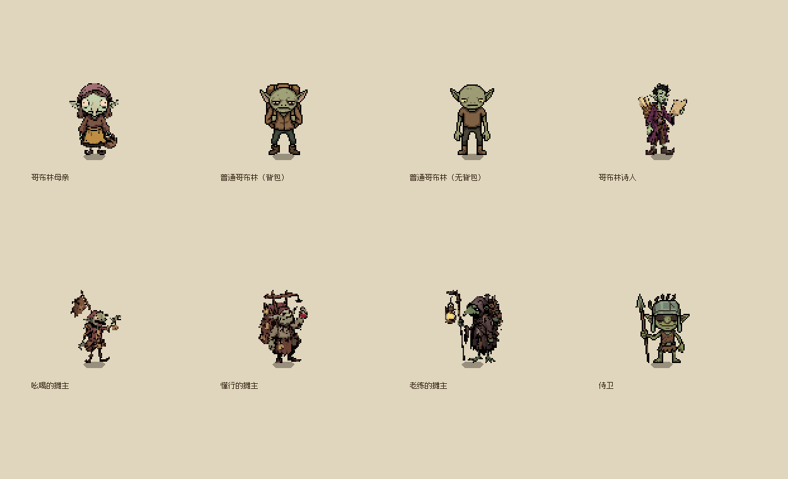

# 2026-10-24 像素小人补充接入

用户附件 `像素小人补充.zip`，24 张有效 PNG，跳过 `__MACOSX` 元数据。原件按原始字节保存在各角色的 `source/supplement_2026_10_24/`，旧原图及立绘保留。附件未附独立许可证。

压缩包 SHA-256：`ef4407af2c983fed21e7dd6624c867601a5a61e5ce27a9835c43b3c6e0e0cbc8`。

| 角色 | 场景 ID | 原图数 | 来源清单 |
| --- | --- | --- | --- |
| 集市母亲 | `market_mother` | 6 | [原件条目与 SHA-256](../../../assets/characters/npc/market_mother/source/sources.json) |
| 普通哥布林（背包／无背包） | `common_goblin` | 7 | [原件条目与 SHA-256](../../../assets/characters/npc/common_goblin/source/sources.json) |
| 诗人 | `casino_poet` | 1 | [原件条目与 SHA-256](../../../assets/characters/npc/casino_poet/source/sources.json) |
| 摊贩1 | `market_vendor_1` | 1 | [原件条目与 SHA-256](../../../assets/characters/npc/market_vendor_1/source/sources.json) |
| 摊贩2 | `market_vendor_2` | 1 | [原件条目与 SHA-256](../../../assets/characters/npc/market_vendor_2/source/sources.json) |
| 摊贩3 | `market_vendor_3` | 1 | [原件条目与 SHA-256](../../../assets/characters/npc/market_vendor_3/source/sources.json) |
| 赌场侍卫 | `casino_sentry` | 7 | [原件条目与 SHA-256](../../../assets/characters/npc/casino_sentry/source/sources.json) |

## 正式接入

- 集市母亲：正面／背面／侧面行走各 10 帧；正面待机 11 帧、背面和侧面各 16 帧。妇女的侧面待机朝右、行走朝左，派生时镜像待机以匹配现有 `side_faces_left = true`。此套只用于集市母亲，不替换祭坛女祈祷者。
- 普通哥布林：背包正面／背面待机各 16 帧，侧面 14 帧；无背包三向待机各 16 帧，另接入 16 帧侧面行走。左右共用侧图，由角色按自身外观镜像；无背包新侧图先转为朝右，保留原控制器约定。外观选择及存档种子逻辑未改动。
- 三个摊贩与诗人：各 16 帧待机，替换原单帧。仍然站桩，所有朝向复用同一段待机；未把这些图冒充行走或增加巡游。
- 赌场侍卫：正面／侧面／背面行走 13／15／10 帧；新增正面 13 帧、背面 16 帧待机，侧面待机保留对应行走首帧。大笑 16 帧、坐姿 15 帧接为非循环 `emote_laugh`／`emote_sit`，可通过 ActorDirector 播放，不擅自新增剧情触发点。
- 哲人与军人目录为空，没有可导入图片，保留现有角色图。

原图为 6 列，64px 帧／88px 步距或 128px 帧／152px 步距。逐行提取非空格；派生到项目统一 64px 帧／88px 步距，使用最近邻等比缩放、整段共用包围框及脚底锚点 y=62，保留行走原有至多两像素起伏。待机 6 FPS、行走 8 FPS；没有改动角色场景的尺寸、碰撞、身份、立绘或正式地图站位。

## 重建与试玩

```powershell
python tools/characters/import_pixel_supplement.py --archive '<像素小人补充.zip>'
# 之后不再需要外部压缩包：
python tools/characters/import_pixel_supplement.py --from-retained
```

工具只重建本批角色，并同步对应 catalog。历史旧包导入工具重建旧版后，需再次执行本工具恢复本批新素材。

正式 F5 流程进入集市观察母亲、摊贩与普通居民，到赌场观察诗人和侍卫。站桩角色应持续播放待机；普通哥布林转向、移动、停止后应保持同一外观。独立渲染预览使用：

```powershell
godot --path . --rendering-method gl_compatibility --resolution 1250x760 --script res://tests/verify_pixel_supplement.gd -- --capture
```



## 实际验证

- 24 张原图 SHA-256 全部通过；从保留源图重建后，24 张派生图和 7 份 SpriteFrames 的散列保持一致。
- Godot 4.7.2 编辑器导入退出码 0；退出仍有既有 495 个 ObjectDB 实例／10 个资源未清理提示。
- 局部运行器：`python tests/run_all.py --filter 'common_goblin_idle|casino_sentry|women_and_girl|pixel_supplement' --jobs 3 --timeout 90`，4 项全部通过。覆盖真实移动、镜像、NPC 输入隔离、显隐碰撞、逐帧非空、待机播放和侍卫非循环动作完成。
- `verify_pixel_supplement.gd` OpenGL 实际渲染 1593 项检查通过，已观察截图；`verify_women_and_girl.gd` 结束仍有资源清理诊断。
- 未运行完整玩法回归，本次不改变剧情或业务契约。

动画与左右镜像用法依据 [Godot 4.7 SpriteFrames](https://docs.godotengine.org/en/4.7/classes/class_spriteframes.html) 与 [AnimatedSprite2D](https://docs.godotengine.org/en/4.7/classes/class_animatedsprite2d.html)。非循环演出会发出完成信号，待机循环保持播放。
