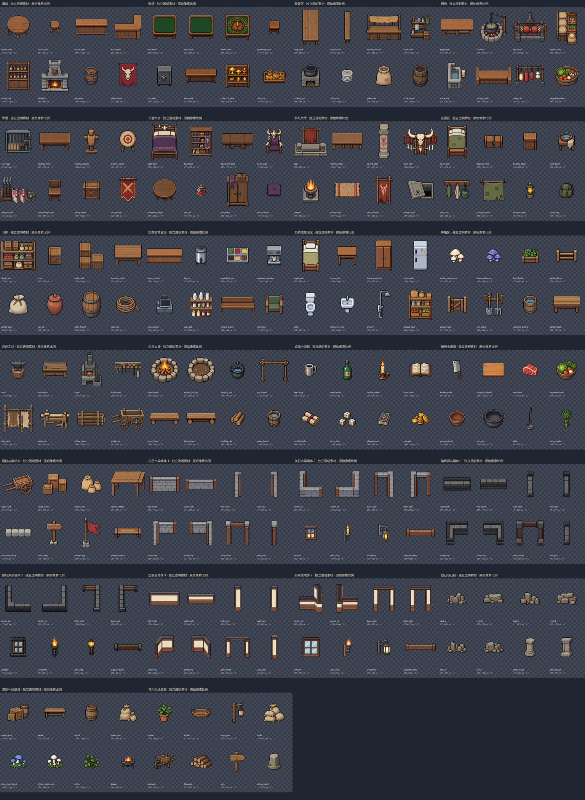
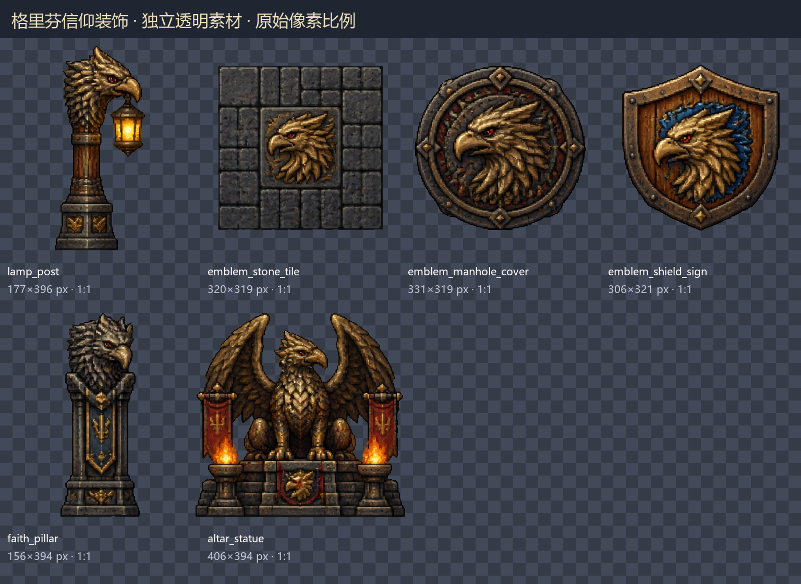

# 独立家具、道具与墙体素材库

当前素材库包含 **214 张独立透明 PNG + 214 个独立 Godot 场景**，共 27 组：原有聚落家具与墙体 208 件，以及 2026-10-20 导入的用户格里芬信仰装饰 6 件。原整图保留；本次交付素材库，没有改变正式地图布局。



## 包含内容

| 分类 | 数量 | 内容 |
| --- | --- | --- |
| 区域家具与小道具 | 136 | 酒馆、赌场、聚餐区、厨房、军营、长老房、祭坛、宿舍、仓库、奶茶店、种植、工坊、火塘、庭院，以及独立桌面物品和厨具 |
| 墙体与附属组件 | 48 | 灰石木梁、赌场深灰石、奶茶店粉刷墙三种材质，各含四向墙段、转角、门框、支柱、窗框、墙灯与横梁 |
| 原有通用道具 | 24 | 石块、石柱、箱桶、长凳、蘑菇、草药、灯杆、板车等，从已有透明图集中原尺寸提取 |
| 格里芬信仰装饰 | 6 | 用户提供的路灯、徽记石砖、铸铁井盖、盾牌木牌、信仰石柱与祭坛圣像 |

桌子、凳子、柜台和墙体已分开；杯子、瓶子、烛台、书卷、骰子、卡牌、金币、菜刀和砧板等另有独立小道具。轮盘桌保留家具本身的轮盘机构，储物架保留其库存陈设，火盆保留火焰；这些属于完整道具组合，而不是可逐零件拆开的模型。

原图是平面合成图，无法恢复原本不存在的图层。家具轮廓与背景粘连、被遮挡的位置，采用 imagegen 按原场景造型与新版奶茶店线条进行提取、补画，再透明化；这些图片不保证与原图逐像素相同。常用道具的 24 张则直接来自原有透明图集。

## 使用位置

- 透明图片：`assets/map/settlement/modular/<组名>/<物品名>.png`
- 可拖入场景的对象：`src/levels/settlement/modules/<组名>/<物品名>.tscn`
- 全部文件、真实尺寸与来源索引：`assets/map/settlement/modular/catalog.json`
- 每组带棋盘背景的检查图：`assets/map/settlement/modular/previews/`
- 原始图集与选用提示词：`assets/map/settlement/modular/source/`、`prompts/`

例如酒馆：

```text
modules/tavern/round_table.tscn
modules/tavern/wood_stool.tscn
modules/tavern/bar_straight.tscn
modules/tavern/bar_corner.tscn
modules/tavern/bottle_rack.tscn
modules/tavern/fireplace.tscn
modules/tavern/ale_barrel.tscn
modules/tavern/skull_banner.tscn
```

这些场景直接引用各自独立 PNG，不使用旧房间底图的 region 裁片。可分别移动、复制、删除和组合。每个对象以底部中心为落点，包含 `GroundAnchor`；桌台提供 `SurfaceAnchor`，墙直段提供端点参考。端点与桌面标记可在具体搭建时编辑。

图片主体像素经过透明化与完整轮廓裁切，不做拉伸或重采样；PNG 带 2 像素透明边距。所有对象的根节点和 Sprite2D 默认均为 scale=(1,1)，真实像素尺寸在索引中记录。预览海报的缩略显示不影响运行素材。

这批 PackedScene 是视觉组件，尚未配置每件物品的碰撞、交互、门动画或灯火动画。墙体是独立构件，尚未配置自动拼接 TileSet；摆放时使用位置与定位点对齐，不通过拉伸弥合接缝。正式替换地图时仍需结合主角校准布局、脚底碰撞和遮挡。

## 格里芬信仰装饰（2026-10-20）



来源为用户在本次会话提供的 1536×1024 RGBA PNG，原文件逐字节保存在 `assets/map/settlement/modular/source/griffin_faith.png`。SHA256 为 `59c757b2117085f85bfb5651417ca6127596a0bc9e29c1d21d2bd3cc6b807bc7`。用户要求导入本项目，未提供独立许可证，不据此声明外部来源或额外授权。

透明图片在 `assets/map/settlement/modular/griffin_faith/`；可拖入场景的组件在 `src/levels/settlement/modules/griffin_faith/`。每件裁片保留源图的真实像素比例；原图上的 48×48、48×144、144×144 仅记录为 `source_annotation_size`，不作为缩放指令。实际 PNG 尺寸如下，均含四周 2px 透明边距：

| 文件名（PNG / TSCN 同名） | 内容 | 实际尺寸 |
| --- | --- | --- |
| `lamp_post` | 格里芬信仰路灯 | 177×396 |
| `emblem_stone_tile` | 格里芬徽记石砖 | 320×319 |
| `emblem_manhole_cover` | 格里芬徽记铸铁井盖 | 331×319 |
| `emblem_shield_sign` | 格里芬徽记盾牌形木牌 | 306×321 |
| `faith_pillar` | 大型格里芬信仰石柱 | 156×394 |
| `altar_statue` | 大型格里芬祭坛圣像 | 406×394 |

处理复用已有连通域提取：在每件的指定区域内保留 alpha≥170 的最大连通轮廓，排除尺寸箭头、文字和孤立噪点，将 alpha 转为 0 / 255；没有重新生图或重采样。RGB 来自原图。路灯的 `GroundAnchor` 对齐石质底座中心，避免被右侧灯笼偏移；其余对象以底部中心落点。图中火焰和灯光是静态绘制，没有添加实际光源或动画。

复现命令为 `python tools/art/import_griffin_faith.py`，初次归档可用 `--source <原图路径>`。工具写入裁片、独立场景、预览和目录索引；重复运行替换同一组，不累加重复条目。通用提取工具重建其他组时会保留 `source_kind=user_supplied` 的补充组。`catalog.json` 中本组的来源与处理元数据优先于顶层历史生成模型字段。

在下方画廊按 Tab 可切到最后一组“格里芬信仰装饰”；也可在画廊根节点将 `initial_pack` 设为 `griffin_faith` 后 F6，观察六件独立物体与约 110px 高的主角参考。当前素材尺寸大于原图标注，正式摆入关卡前仍需评估比例、通行与遮挡，未将这些视觉组件配置为碰撞或可交互物体。

本次验证：6 件 PNG 的硬透明、2px 边距、来源散列及每个保留像素的原图 RGB 一致性通过；`verify_modular_assets.gd` 在 Godot 4.7.2 headless 下检查 214 对 PNG / PackedScene，0 failures。D3D12 / Forward+ 实际画廊显示第 27 组，六件素材与主角参考均可见，截图见[格里芬画廊实拍](captures/griffin_faith_godot.png)。没有改变正式地图或玩法，未执行整仓回归和正式关卡通行验收。编辑器导入成功退出，但仍有与此前导出相同的退出资源释放诊断（495 ObjectDB / 10 resources）；模块检查与本次图形画廊均正常退出。

## Godot 检查场景

打开 `src/debug/modular_assets/modular_assets_gallery.tscn`，按 F6：

- Tab：下一组。
- WASD：平移视野。
- PageUp / PageDown：统一缩放查看。
- M：当前组居中。

画廊实际实例化独立对象，右侧放置现有主角作尺度参考。图库的相机缩放不改变 PNG 或对象比例。项目 F5 进入标题菜单，新游戏进入奶茶店；画廊独立 F6，不替换正式地图。

## 生成、透明化与复现

采用用户已授权的 CLI/API 模式，模型显式为 `gpt-image-2.5-sunburst`。图片请求由系统 imagegen 技能原 CLI 完成；`tools/art/imagegen_guarded_cli.py` 仅在当前进程接入本地配置及共享请求门禁，不修改系统脚本文件。

适配器每次读取 CODEX_HOME 下的 config.toml，按 model_provider 取得服务和凭据；当前进程注入 OPENAI_BASE_URL / OPENAI_API_KEY，SDK 自动重试设为 0。每个同步图片请求通过 CODEX_HOME/tools/api_concurrency.py 的 guarded_call，共用同一状态库；不吞掉 RequestUncertainError、不自动回收占用、不自动重试不明请求。该门禁仅覆盖通过此适配器发出的本机同步请求，不代表直接运行原 CLI、其他语言、远端设备或 Codex 客户端聊天已被限流。

`prepare_modular_briefs.py` 生成按原场景分类的图集提示词和布局参考。`extract_modular_assets.py` 根据真实透明轮廓进行连通域分组，完整保留跨过图集分格的物品，避免矩形裁切混入邻件或切断桌腿。原生透明度清理为硬边，裁出独立 PNG，同时写出对应场景和索引。

已保存选用源图集，重新提取无需再次请求图片 API：

```powershell
python tools/art/extract_modular_assets.py
```

如需选用外部生成目录，可显式传 `--raw-dir`。`guides/` 只用于生图布局参考，`previews/` 只用于检查；它们和原始图集、提示词已从游戏导出中排除。

## 验证

```powershell
godot --headless --path . --script res://tests/verify_modular_assets.gd
godot --path . --script res://tests/verify_modular_assets.gd -- --capture
```

初始素材库的上述测试已在 Godot 4.7.2 / Windows 上通过：208 个 PNG / PackedScene 对、26 组目录，0 failures；加入格里芬组后的 214 件检查见上节本次记录。验证索引数量、每个独立场景的加载、每张独立贴图的实际尺寸、透明边角、原生比例、落点和画廊分组切换。另经像素检查，全部 PNG 的 alpha 仅为 0 或 255，四周留有透明边距；人工检查每组预览，没有相邻家具残片或切断的轮廓。检查图的棋盘背景不属于物品 PNG。

已保存酒馆、赌场与灰石墙体的实际 Godot 画廊截图。原聚落的 48,623 个可达采样点、入口、路线、桥梁、碰撞与交互回归检查亦通过。

实现参照 [Godot 4.7.2 Sprite2D 官方说明](https://github.com/godotengine/godot/blob/4.7.2-stable/doc/classes/Sprite2D.xml)：使用独立 Texture2D、centered=false 和整数锚点偏移，保持素材定位明确；[Node2D 官方说明](https://github.com/godotengine/godot/blob/4.7-stable/doc/classes/Node2D.xml) 定义实例的局部位置与变换。未执行游戏整包导出。
