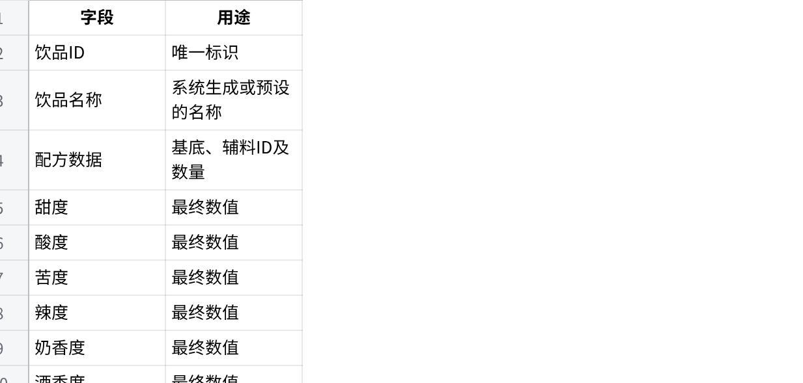
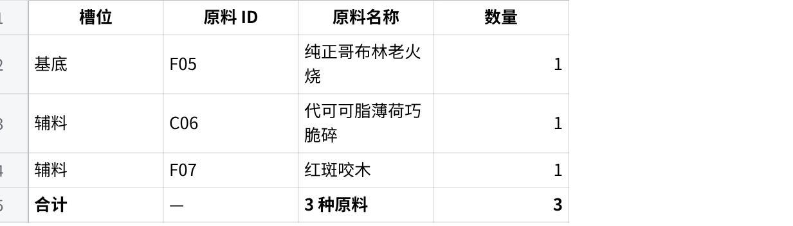
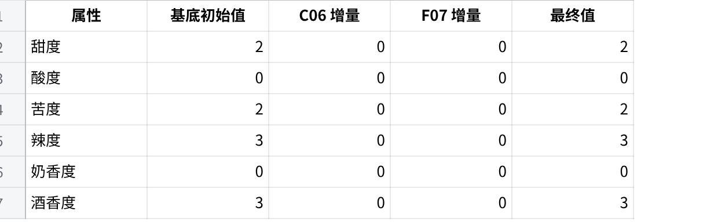
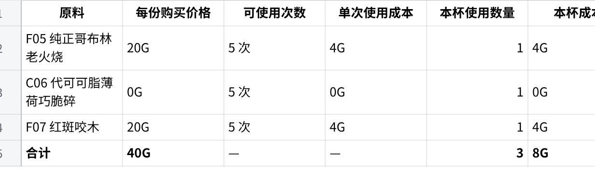
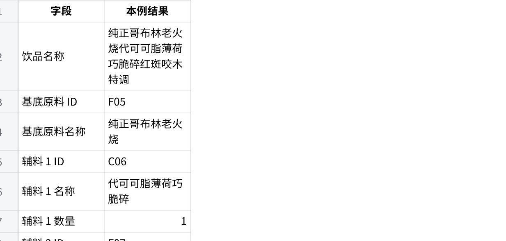
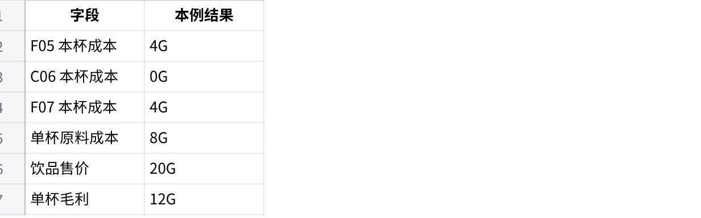

# 奶茶配方系统设计文档

> 现行规则更新（2026-10-19）：下文保留为 V0.1 原文转录。普通统一 20G、爆品固定专属售价以及“所有原料购买获取”等旧口径已由[经营与战斗经济规则](milk_tea_economy_revised.md)替代；人类菜单为固定六款 3G，哥布林配方采用保存的槽位加价，爆品首次发现奖励 150G。原料以 [2.0 配置](recipe_ingredients_revised.md)为准；未冲突的配方计算规则继续适用。[实现方案](milk_tea_economy_implementation_plan.md)区分现状与待开发内容。

> 爆品资料补充（2026-10-19）：[开发可视版](signature_recipes_revised.md)已提供 S01–S10 十款完整配置与部分发现原文。下文“完整配方待核对”保留为 V0.1 历史状态；专属售价、加冰匹配和发现／领奖时点与经济方案的差异见新文档，用户确认以新表为准后已接入运行时，当前行为以新文档及[自由调配](../gameplay/free_tea_recipes.md)为准。

> 2026-10-18 导入。来源：[原始 DOCX](source/milk_tea_recipe_system_revised_2026_10_18.docx)，V0.1 阶段性设计稿。下文按正文顺序转录，保留重复标题、原文备注和图片表格；每张预览后附原 DOCX 内嵌 Excel 的完整单元格转录，补足原预览中未显示的行，不改数据。附件里的待办与程序流程属于设计内容，不表示已经实施。版本关系、字段差异和待确认项见[更新说明](milk_tea_recipe_update_2026_10_18.md)。

版本： V0.1（阶段性设计稿）项目：《我的奶茶店连通异世界》用途： 团队设计同步、程序开发与联调参考

## 一、系统目标

奶茶配方系统是店铺经营玩法的组成部分。玩家选择基底和辅料，制作饮品，系统根据原料配置计算饮品属性、生成名称、判断是否命中预设爆品，并展示制作结果。

玩家还可以通过饮品图鉴查看已经发现的饮品。

本系统第一版以规则明确、实现简单、便于联调为原则，不依赖 AI 生成配方或名称。

## 二、数据表设计

### 2.1 原料配置表 Recipe_Ingredients

当前状态： 已有原料数据，共 22 种原料。

现有字段包括：

原料ID、原料名称

原料来源、原料类别

是否可作为基底、是否可用于普通配方

甜度、酸度、苦度、辣度、奶香度、酒香度

风味标签、质地标签、特殊效果标签

加工方式、单份成本

数值属性范围为 0–3。饮品最终数值允许超过 3。

原料来源分为人类与哥布林；原料类别分为液体、固体、胶体与粉末。

### 2.2 预设爆品配方表 Signature_Products

当前状态： 已有表及爆品设计方案，完整配方数据仍需核对。

该表用于保存预设爆品的固定信息，包括：

产品ID与专属名称

基底及辅料组成

各辅料的使用数量

专属售价及其他已确定的产品信息

爆品配方必须能够被程序精确读取与比较。具体字段名称以现有表结构为准，不应在没有核对的情况下重复创建字段。

### 2.3 饮品图鉴表 Drink_Encyclopedia

当前状态： 待建立。

该表用于保存玩家制作并发现的饮品。建议第一版包含：

原内嵌工作表完整内容：

| 字段 | 用途 |
| --- | --- |
| 饮品ID | 唯一标识 |
| 饮品名称 | 系统生成或预设的名称 |
| 配方数据 | 基底、辅料ID及数量 |
| 甜度 | 最终数值 |
| 酸度 | 最终数值 |
| 苦度 | 最终数值 |
| 辣度 | 最终数值 |
| 奶香度 | 最终数值 |
| 酒香度 | 最终数值 |
| 风味标签 | 合并后的标签 |
| 质地标签 | 合并后的标签 |
| 特殊效果 | 合并后的效果 |
| 饮品类型 | 普通饮品／预设爆品 |

点击图片可查看完整电子表格

首次发现时间可作为后续补充字段。

## 三、配方制作规则

### 3.1 基本限制

每杯饮品必须选择一个基底。

每杯最多使用 3 个原料槽位，基底也占用一个槽位。

剩余槽位可添加符合普通配方使用条件的辅料。

饮品可以少于 3 个槽位，但必须有基底。

同种辅料允许重复使用。

基底资格与普通配方使用资格是两个独立条件。

不能作为普通配方原料的特殊原料，不得通过普通自由配方加入。

因此，普通饮品最多包含一个基底和两份辅料。

### 3.2 原料选择界面

玩家选择原料时，界面展示原料名称与风味描述，不直接展示原料的内部数值。

第一版不要求玩家手动选择加工方式。

## 四、饮品数值计算规则

饮品包含六项数值属性：

甜度

酸度

苦度

辣度

奶香度

酒香度

计算过程如下：

基底提供六项属性的初始值。

对每一份辅料，分别检查其对应属性。

如果辅料在某项属性上的数值达到 3，则将该数值加到饮品对应属性上。

辅料属性低于 3 时，不增加该项数值。

各属性独立判断，同一份辅料可以同时影响多个属性。

多份符合条件的辅料可以累计。

最终数值不设上限。

示例：

基底甜度为 2，添加两份甜度均为 3 的辅料，则最终甜度为：

2 + 3 + 3 = 8

基底自身的属性只作为初始值，不会触发辅料加值规则。

## 五、标签合并规则

风味标签、质地标签与特殊效果分别处理。

收集所有已选原料对应的标签。

合并相同类别的标签。

删除重复标签。

保留合并后的标签作为饮品结果。

例如，一杯饮品的多个原料都具有“甜味”标签，最终只显示一次“甜味”。

六项数值属性以外的风味标签不参与数值计算。

## 六、饮品命名规则

## 六、饮品命名规则

第一版不使用 AI 生成名称。

普通饮品采用程序可实现的固定命名规则，优先保证玩家能够理解配方与名称的对应关系。

普通饮品命名： 按照配方中原料的选择顺序，将原料名称依次拼接，并根据基底原料的「基底命名类型」追加对应后缀。

基底命名类型与后缀对应关系：

奶茶 → 奶茶

茶 → 茶

咖啡 → 咖啡

特调 → 特调

同种辅料重复： 名称中应体现数量，例如“双重薄荷糖浆”。

原料限制： 每杯饮品最多使用 3 个原料槽位。「是否可作为基底」决定原料能否作为基底；「是否可用于普通配方」决定原料能否加入普通配方，两项独立判断。

预设爆品： 使用 Signature_Products 中配置的专属名称，不使用普通饮品自动命名规则覆盖。

以上规则由程序实现。具体示例名称仅用于说明命名逻辑，不视为已经锁定的正式名称。

## 七、爆品匹配规则

程序将玩家实际选择的配方与预设爆品配方进行完整匹配。

以下信息必须一致：

基底

辅料种类

各辅料数量

只要基底、辅料或数量任一项不一致，就不能认定为命中该爆品。

普通配方即使没有命中任何预设爆品，也可以正常制作与出售。

当前需要补充核对完整的预设爆品数据，才能验证实际匹配结果。

## 八、售价与原料成本

### 8.1 普通饮品

当前暂定统一售价为 20G／杯。

### 8.2 预设爆品

预设爆品使用固定专属售价。以最终确认的爆品表为准。（这个我暂时还没做）

### 8.3 成本核算

饮品原料成本为所有已使用原料单份成本之和，再乘以对应数量。

目前存在一项需要注意的经济平衡问题：部分哥布林原料成本较高，普通饮品售价为 20G 时，可能出现单杯原料成本高于售价的情况。

第一版暂不擅自修改售价规则，但需要在联调和经济测试中记录这一问题。

## 九、饮品图鉴规则

玩家制作饮品后，系统生成饮品名称与属性结果，并将新发现的饮品写入 Drink_Encyclopedia。

图鉴至少应展示：

饮品名称

配方组成

六项数值

风味标签

质地标签

特殊效果

普通饮品／预设爆品类型

相同配方再次制作时，应检查是否已经存在对应记录，避免重复创建图鉴条目。

具体的配方唯一标识方式与图鉴保存逻辑，仍需与程序实现方案对接。

## 十、当前进度与待完成事项

已确定

原料配置表的字段结构与现有原料数据

配方槽位限制

辅料重复使用规则

六项数值计算逻辑

标签合并规则

普通饮品暂定售价

预设爆品完整匹配原则

图鉴需要保存的基本信息

待完成

核对 Signature_Products 中所有爆品的完整配方和售价。

建立 Drink_Encyclopedia 表。

与程序负责人确认数据读取、名称生成、配方匹配和图鉴保存方式。

使用典型配方进行联调，验证数值、标签、爆品匹配及售价。

检查高成本原料与普通售价之间的经济平衡问题。

说明： 本文记录的是当前已确定的设计规则和待开发事项，不代表所有功能均已完成程序实现。

## 十一、配方计算示例

本节通过一个完整实例，说明程序如何接收玩家选择的原料，完成配方校验、饮品属性计算、标签合并、自动命名、爆品匹配、售价与成本计算，并最终生成饮品图鉴记录。

本例使用 3 个原料槽位。示例中的数值和标签用于展示程序处理流程，正式实现时应读取 Recipe_Ingredients 中的实际配置。

### 11.1 输入配方

玩家选择以下原料制作饮品：

原内嵌工作表完整内容：

| 槽位 | 原料 ID | 原料名称 | 数量 |
| --- | --- | --- | --- |
| 基底 | F05 | 纯正哥布林老火烧 | 1 |
| 辅料 | C06 | 代可可脂薄荷巧脆碎 | 1 |
| 辅料 | F07 | 红斑咬木 | 1 |
| 合计 | — | 3 种原料 | 3 |

点击图片可查看完整电子表格

本配方共使用 3 个原料槽位，符合每杯饮品最多使用 3 个原料槽位的限制。

所有原料暂定通过购买获取，每份原料均可使用 5 次。程序在制作前应检查：

F05 是否允许作为基底。

C06、F07 是否允许用于普通配方。

玩家是否拥有足够的原料可使用次数。

本次配方是否符合槽位数量限制。

全部校验通过后，程序才进入计算流程。

### 11.2 六项数值属性计算

饮品的六项数值属性以基底的初始值为基础，再按照已确定的属性增量规则计算辅料的影响。

原内嵌工作表完整内容：

| 属性 | 基底初始值 | C06 增量 | F07 增量 | 最终值 |
| --- | --- | --- | --- | --- |
| 甜度 | 2 | 0 | 0 | 2 |
| 酸度 | 0 | 0 | 0 | 0 |
| 苦度 | 2 | 0 | 0 | 2 |
| 辣度 | 3 | 0 | 0 | 3 |
| 奶香度 | 0 | 0 | 0 | 0 |
| 酒香度 | 3 | 0 | 0 | 3 |

点击图片可查看完整电子表格

本例暂按两种辅料均未触发数值增量处理。

程序应根据原料配置表中的实际属性值和统一的增量规则计算最终值，不应将本例中的数值直接作为所有配方的固定结果。

### 11.3 标签合并

程序读取基底与辅料的标签，将三种原料的对应标签合并，并对重复标签去重。

风味标签

辛辣、酒香、可可香、薄荷、苦味、咸味、甜味、木香。

质地标签

液态、颗粒感、酥脆、坚韧耐嚼。

特殊效果

醉酒、灼热感、强烈清凉感。

以上是本例的预期结果。正式运行时，具体标签应以原料配置表为准；相同标签只保留一次。

### 11.4 自动生成饮品名称

第一版不使用 AI 生成普通饮品名称，而是使用固定规则。

命名步骤：

按照配方中的原料顺序，依次拼接原料名称。

读取基底的「基底命名类型」。

根据命名类型追加对应后缀。

如果同种辅料重复使用，名称中应体现数量。

基底命名类型与后缀的对应关系如下：

原内嵌工作表完整内容：

| 基底命名类型 | 名称后缀 |
| --- | --- |
| 奶茶 | 奶茶 |
| 茶 | 茶 |
| 咖啡 | 咖啡 |
| 特调 | 特调 |

点击图片可查看完整电子表格

本例假定 F05 的基底命名类型为「特调」，因此自动生成的饮品名称为：

纯正哥布林老火烧代可可脂薄荷巧脆碎红斑咬木特调

该名称由原料名称和后缀组成，不使用另行创作的宣传性名称。

### 11.5 预设爆品匹配

程序将本例配方与 Signature_Products 表中的所有预设爆品进行匹配。

匹配时，应比较：

基底原料；

辅料种类；

各原料的使用数量。

只有符合预设配方匹配条件，才能认定为命中爆品。使用了特殊原料或产生特殊效果，不代表自动成为爆品。

处理规则：

命中爆品： 使用 Signature_Products 中配置的专属名称与固定售价。

未命中爆品： 使用普通饮品自动命名规则，售价暂定为 20G／杯。

为了展示后续的普通饮品处理流程，本例暂以「未命中预设爆品」作为演示前提。实际运行时，匹配结果必须由程序根据完整的爆品表确定，不能将这一假设写死。

### 11.6 售价与原料成本

所有原料暂定通过购买获取，每份原料均可使用 5 次。

原料成本计算规则：

单次使用成本 = 每份原料购买价格 ÷ 5

单杯原料成本 = 各原料单次使用成本 × 实际使用数量之和

单杯毛利 = 饮品售价 − 单杯原料成本

本例的成本计算如下：

原内嵌工作表完整内容：

| 原料 | 每份购买价格 | 可使用次数 | 单次使用成本 | 本杯使用数量 | 本杯成本 |
| --- | --- | --- | --- | --- | --- |
| F05 纯正哥布林老火烧 | 20G | 5 次 | 4G | 1 | 4G |
| C06 代可可脂薄荷巧脆碎 | 0G | 5 次 | 0G | 1 | 0G |
| F07 红斑咬木 | 20G | 5 次 | 4G | 1 | 4G |
| 合计 | 40G | — | — | 3 | 8G |

点击图片可查看完整电子表格

本例假设普通饮品未命中预设爆品，因此：

原内嵌工作表完整内容：

| 项目 | 结果 |
| --- | --- |
| 饮品售价 | 20G |
| 单杯原料成本 | 8G |
| 单杯毛利 | 12G |

点击图片可查看完整电子表格

单杯毛利暂不扣除其他经营支出。

需要注意：原料购买价格是每份原料的购买成本，而不是每杯饮品的成本。购买一份原料后可以使用 5 次，因此应按实际消耗次数分摊成本。

### 11.7 原料消耗

制作成功后，程序应扣减本次使用的原料次数。

原内嵌工作表完整内容：

| 原料 | 制作前可使用次数 | 本次消耗 | 制作后可使用次数 |
| --- | --- | --- | --- |
| F05 纯正哥布林老火烧 | 5 次 | 1 次 | 4 次 |
| C06 代可可脂薄荷巧脆碎 | 5 次 | 1 次 | 4 次 |
| F07 红斑咬木 | 5 次 | 1 次 | 4 次 |

点击图片可查看完整电子表格

以上假设玩家制作前每种原料均有一份未使用的库存，且各份原料均剩余 5 次可用次数。

原料消耗应与制作结果保持一致：制作成功才扣减对应次数；如果配方校验失败或制作未成功，不应直接扣减原料次数。

### 11.8 饮品图鉴最终记录（程序版）

制作成功后，程序应将饮品的计算结果写入图鉴。以下为本例最终应生成的完整饮品记录。

A. 基本信息

原内嵌工作表完整内容：

| 字段 | 本例结果 |
| --- | --- |
| 饮品名称 | 纯正哥布林老火烧代可可脂薄荷巧脆碎红斑咬木特调 |
| 基底原料 ID | F05 |
| 基底原料名称 | 纯正哥布林老火烧 |
| 辅料 1 ID | C06 |
| 辅料 1 名称 | 代可可脂薄荷巧脆碎 |
| 辅料 1 数量 | 1 |
| 辅料 2 ID | F07 |
| 辅料 2 名称 | 红斑咬木 |
| 辅料 2 数量 | 1 |
| 原料槽位总数 | 3 |
| 配方类型 | 普通饮品 |
| 爆品匹配状态 | 本例假设未命中 |
| 饮品售价 | 20G |

点击图片可查看完整电子表格

B. 数值属性

原内嵌工作表完整内容：

| 字段 | 本例结果 |
| --- | --- |
| 甜度 | 2 |
| 酸度 | 0 |
| 苦度 | 2 |
| 辣度 | 3 |
| 奶香度 | 0 |
| 酒香度 | 3 |

点击图片可查看完整电子表格

C. 标签与效果

原内嵌工作表完整内容：

| 字段 | 本例结果 |
| --- | --- |
| 风味标签 | 辛辣、酒香、可可香、薄荷、苦味、咸味、甜味、木香 |
| 质地标签 | 液态、颗粒感、酥脆、坚韧耐嚼 |
| 特殊效果 | 醉酒、灼热感、强烈清凉感 |

点击图片可查看完整电子表格

以上标签均应按原料表的实际数据计算，并在保存前去重。

D. 经济数据

原内嵌工作表完整内容：

| 字段 | 本例结果 |
| --- | --- |
| F05 本杯成本 | 4G |
| C06 本杯成本 | 0G |
| F07 本杯成本 | 4G |
| 单杯原料成本 | 8G |
| 饮品售价 | 20G |
| 单杯毛利 | 12G |

点击图片可查看完整电子表格

E. 图鉴记录状态

原内嵌工作表完整内容：

| 字段 | 本例处理结果 |
| --- | --- |
| 是否首次发现 | 若该配方此前不存在，则为是 |
| 是否已有记录 | 若此前已记录该配方，则为是 |
| 图鉴处理方式 | 新配方创建记录；已有配方按既定规则更新或保留 |
| 配方识别依据 | 基底 ID、辅料 ID 及各原料数量 |
| 记录数据来源 | 原料配置表、配方计算结果及爆品匹配结果 |

点击图片可查看完整电子表格

图鉴应将配方作为识别依据，避免同一配方因重复制作而被无条件创建成多条相同记录。若游戏还要记录首次发现时间、发现次数或玩家评价，应以实际图鉴字段设计为准，不在本例中擅自增加这些字段。

### 11.9 异世界饮品图鉴（玩家可见版）

纯正哥布林老火烧代可可脂薄荷巧脆碎红斑咬木特调

饮品类型： 普通饮品

售价： 20G

配方

纯正哥布林老火烧 ×1

代可可脂薄荷巧脆碎 ×1

红斑咬木 ×1

风味标签： 辛辣、酒香、可可香、薄荷、苦味、咸味、甜味、木香

口感特征： 液态、颗粒感、酥脆、坚韧耐嚼

特殊效果： 醉酒、灼热感、强烈清凉感

### 11.10 程序预期执行流程

程序处理本例时，执行顺序如下：

接收玩家选择的基底、辅料及数量。

校验槽位数量、基底资格、普通配方使用资格及原料可用次数。

读取原料配置表中的数值属性和标签。

计算六项最终数值属性。

合并风味标签、质地标签和特殊效果，并去重。

根据基底命名类型生成普通饮品名称。

将完整配方与 Signature_Products 中的预设配方匹配。

根据匹配结果确定专属名称和售价，或使用普通饮品名称及 20G 售价。

根据每份原料的购买价格和 5 次可使用次数，计算单杯原料成本与毛利。

制作成功后扣减相应原料可使用次数。

根据配方识别结果创建或处理饮品图鉴记录。

向玩家展示制作结果，包括饮品名称、数值属性、标签、特殊效果、售价及图鉴状态。

测试目的： 验证从配方输入到饮品图鉴记录的完整流程，确保原料读取、属性计算、标签合并、名称生成、爆品匹配、成本计算、原料消耗和图鉴写入均符合规则。
