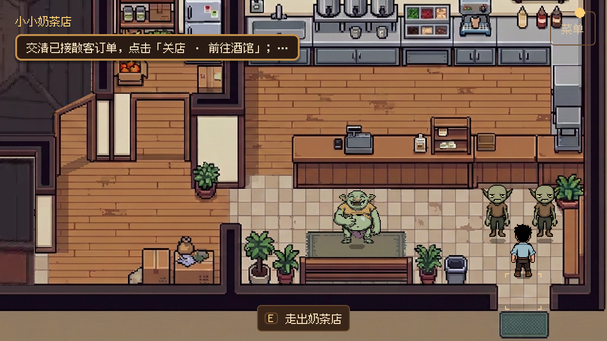
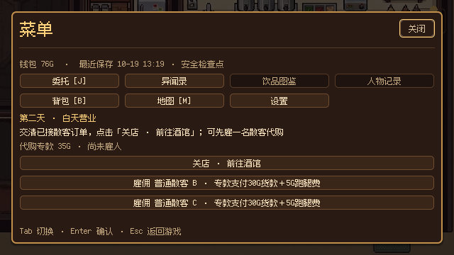

# 轻量常驻 HUD 与统一菜单（2026-10-19）

用户确认制作入口与基础设置后，要求常态减少占屏，将适合按需查看的内容并入右上角菜单。本轮调整已有 UI 的组织与入口，不修改剧情、配方、价格或存档格式。

## 玩家可见变化

- 常态保留地点名、一行当前目标、右上角“菜单”和靠近对象时的交互提示。目标超长显示省略，完整文字保存在菜单里。
- 钱包余额、最近保存时间、代购专款、采集缺口、雇佣、关店与取消试饮均移入菜单。正常保存时间不常驻屏幕；保存失败仍显示，收支变化仍短暂提示。
- 菜单同时提供委托、异闻录、饮品图鉴、人物记录、背包、地图和设置。未解锁页面保持禁用，基础菜单在新游戏初期也可使用；J／B／M／P 保留原有操作。
- 从菜单进入子页面后，Esc 返回菜单，再 Esc 返回游戏。直接通过原快捷键打开的页面仍直接返回游戏。设置复用现有页面和偏好文件，菜单内设置不自动暂停世界，P 暂停中的设置保持原暂停行为。
- 关店、雇佣等动作继续由 ChapterGameplay／既有服务提交。菜单作为模态锁住玩家输入；仅当前菜单拥有输入时可以执行它的章节操作，暂停、演出和其他弹窗不能穿透触发业务。

实现沿用 `ChapterActionsHUD` 的稳定屏幕 ID `chapter_actions`，将它从常驻 HUD 改为 PopupLayer 中按需打开的菜单。MainGame 只注入数据和路由入口；手册仍复用一个 HandbookPanel，没有复制任务、库存或经营状态。

## 验证

Windows Godot 4.7.2；图形使用 Compatibility。真实存档来自前一轮隔离流程，全部复制到测试目录后恢复，没有修改玩家正式存档。

| 检查 | 结果 |
| --- | --- |
| `verify_compact_menu.gd` | 最终 headless／图形各 32 项通过，检查 640×360／1280×720 及保存错误提示 |
| 第二天真实键盘／步行 | 图形 245 项通过，含菜单内雇佣、关店、制作、吧台、赌桌、守卫交付与返店 |
| 前两天专项 | 47 项通过，覆盖试饮、取消、赌场、便捷返程、回顾及暂停设置 |
| 手册／任务面板／UIManager | 46／94／47 项通过；旧“点击图标直接打开手册”的断言已迁移到菜单导航 |
| MainGame／保存集成 | 74／45 项通过；保存检查包含真实标题、继续、跨进程制作与交付 |
| 收支反馈／设置 | 32／11 项通过 |
| 编辑器导入／文本 | 无脚本解析错误；Git diff、改动文档链接与格式检查通过 |

未计为通过的旧检查：UI Theme 248 项中 `inventory_body.tscn` 缺共享主题一项失败，与此前记录一致。库存屏幕 36 项中三项仍把条目数写死为 6；独立 WarehouseInventory／InventoryPanel 实际列出 16 条，这些组件和测试本轮未修改，其余交互断言没有失败。没有为此改动旧库存数量预期。

部分测试退出仍报告 ObjectDB／资源存活诊断。未重复全项目历史 Demo、完整两天或 Release 导出；本轮采用直接相关 UI 模块、真实第二天操作、保存集成与前两天专项验证。真人手感与听感仍需单独验收。

## 试玩与画面

F5 → 继续游戏／新游戏。自由操作时点击右上角“菜单”，检查完整目标、钱包、存档与可用操作；进入背包、地图或设置，Esc 应回到菜单。第二天营业结束后从菜单雇佣或关店，操作成功后回到游戏。

相关 API：[Label.max_lines_visible／省略行为](https://docs.godotengine.org/en/4.7/classes/class_label.html)、[Control 焦点和 size_flags](https://docs.godotengine.org/en/4.7/classes/class_control.html)。一行目标仅限制显示，不截断原始目标文字；菜单内容页使用垂直展开与滚动，避免小视口中出现零高度内容区。
