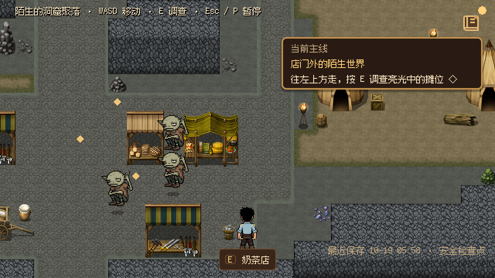
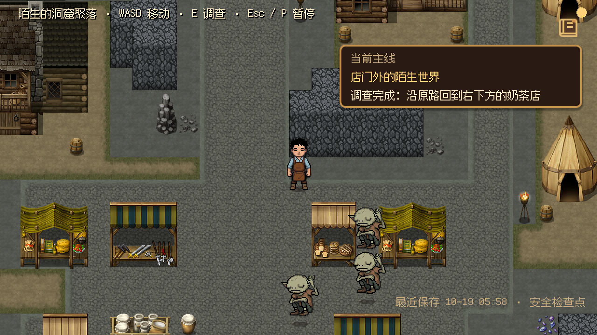
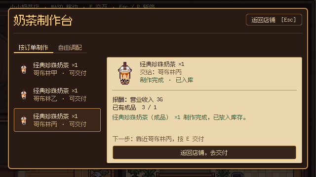

# 首日可玩性修复（2026-10-19）

这轮针对实际试玩反馈修复接单、连续制作和出店调查阻断。此前[体验打磨](experience_polish_2026_10_19.md)的两天测试主要验证后台事务，不能证明玩家能找到、走到并操作正确目标。

## 改动与可观察结果

| 问题 | 修改 | 玩家可观察结果 |
| --- | --- | --- |
| 顾客交互范围伸进柜台，抢走订单板 | 收银台和店内顾客使用同一交互分组。先按位置和朝向选择设备／分组，再按真实订单状态决定组内目标；待接单优先收银台，有成品优先顾客 | 在柜台重叠位置按 E 可以接单；制作后同处可交付。面向制作台时不被顾客抢走操作 |
| 三单共用一杯库存，做一杯便不能继续 | OrderBoardModel 计算所有已接未交同款订单的总需求与库存差额，保留每位顾客的独立交付资格 | 三单可连续制作三杯；提示同款待交数、库存数和还需制作数；够量后才出现返回交付按钮 |
| 主角说话与内心均用默认图 | 主角正常对话默认 talking，内心仍为 neutral；金币反应自言自语、第二晚制作后的自言自语、沉默行显式使用 neutral | 台词与自言自语区分；已有坏笑等情绪立绘继续覆盖默认值，没有新增表情素材 |
| 初遇哥布林和出店缺少表现 | 初遇段压低 BGM、镜头放大并短暂停留；出店段拉远并扫过摊位与岔路，结束恢复跟随 | 保留原对白和事件完成条件，给玩家时间辨认异样角色与新环境 |
| 出店后无目标、无人、调查点不可辨认 | 新增基于已有事实的主线任务；三个调查点显示未完成菱形标记；将刚离店的哥布林甲乙丙配置在白天摊位区；外景标题改为洞窟聚落 | 目标按“出店→摊位→街道→岔路→返店”更新；调查完移除对应标记；返店后接上胖哥布林剧情 |
| 隐藏守卫仍有付款交互 | 共享付款点绑定两名真实守卫引用，并校验实际可见性；场景重挂角色后引用保持有效 | 白天守卫未出场，付款点不可选；没有强行提前显示夜间守卫 |
| 店内仍露出原料补给开发标记 | 奶茶店统一隐藏交互点开发标签 | 不再将“人类原料补给 · 0G”大字盖在场景上，靠近时仍有正式交互提示 |

业务库存、扣料、交付、奖励和存档 Schema 沿用原实现。新增探索任务消费既有 `day1.stages_01_02_completed`、三个 `observed_*` 和 `returned_shop` 等事实；不伪造调查完成。调查仍须打开内容并关闭后提交。

剧情编辑正式来源为三个 `docs/story_authoring/*_project.json`，使用 `tools/story/edit_story_project.gd -- <project> --save` 生成运行时内容和 Beat 清单。未改原始地图 TileMapLayer；白天角色与提示配置均位于继承的 `chapter_cave.tscn`。

## 截图

出店后，右上目标与场上菱形标记同时可见，摊位有刚离店的哥布林：

三处调查完成后明确提示返店：

三张同款订单全部备好，库存为三杯，此时才提示返回交付：

## 实际验证

环境为 Godot 4.7.2 / macOS；图形测试使用 Compatibility。新测试的存档写入独立 `/tmp` 目录。

| 检查 | 最终结果 |
| --- | --- |
| `verify_day1_playability.gd -- --capture`，图形模式 | 74 项通过：正式新游戏、柜台真实重叠、E 打开订单、键盘接单／制作／交付、制作台焦点、出店、白天角色、隐藏守卫交互、目标卡、三个调查点的实际输入步行与 E 调查、步行返店及下一段剧情 |
| `verify_order_ui.gd -- --capture`，图形模式 | 41 项通过：三单先连续制作三杯、够量后停止、返回与交付、窗口尺寸与键盘行为 |
| `verify_order_board.gd` | 62 项通过：交互优先级、同款总需求、共用库存、交付与恢复投影 |
| `verify_interaction_feedback.gd` | 46 项通过：目标选择、输入锁与反馈 |
| `verify_dialogue.gd` | 154 项通过：talking 与内心默认图、显式情绪覆盖、清除和输入锁 |
| `verify_rpg_chapter_maps.gd` | 105 项通过：保留原始图层、通行及宿主绑定 |
| `verify_two_day_flow.gd -- --ordinary-order`，headless | 198 项通过：两天完整业务流程、夜间潜入、跨场景及可选订单 |
| 三个结构化工程生成校验 | 均通过，保持稳定步骤 ID、更新 Beat 区间与工程散列 |
| headless 编辑器导入 | 无脚本解析错误，生成新测试脚本 UID |

步行测试从店外实际出生点出发，用原生通行查询选择路线，使用 InputMap 移动，不以传送或直接 `resolve()` 完成三个调查。店内测试将角色定位到柜台／制作台，再走真实输入分发；其余前置顾客订单沿用既有后台回归辅助方法，由独立订单 UI 测试补上三杯连做。以上是自动输入验证，尚未进行真人完整试玩或主观听感评估。

验证中修正了测试自身的两个问题：旧对话测试仍期待“打开订单板自动接单”，现改为只记录查看；新步行脚本等待切场景时曾读到已释放宿主，已改为等待有效的新宿主。图形步行最终执行无脚本错误。

地图与对话模块测试退出时仍分别报告 2 对象／1 资源、8 对象／4 资源存活，未在本轮定位，不将其描述为干净退出。编辑器退出的 495 对象／10 资源诊断与上一轮记录一致。没有运行全仓 Demo、Release 导出和完整跨进程存档回归：本轮验证覆盖直接修改模块及两天整合流程，没有修改存档格式。

## 复测入口

F5 → 新游戏。第一位顾客到柜台后按 E 接单；到制作台制作，再回柜台交付。三名哥布林到场后接三单，可先制作三杯再逐个交付。五杯营业结束后出店，按右上目标走到三个菱形标记旁调查；全部完成后按提示沿原路返回右下方奶茶店。

若从已有首日调查存档继续，探索目标按保存的调查事实恢复，不要求重开；首次出场镜头属于一次性事件，已经播过的存档不会重播。

## 官方 API 依据

本轮查阅 [Godot 4.7 Area2D](https://docs.godotengine.org/en/4.7/classes/class_area2d.html)：重叠集合按物理步更新，传送后不能立即假定触发区域已同步。因此交互测试等待真实物理帧，继续复用既有 body_entered／body_exited 信号维护范围；没有用另一个检测区域绕过统一分发。
