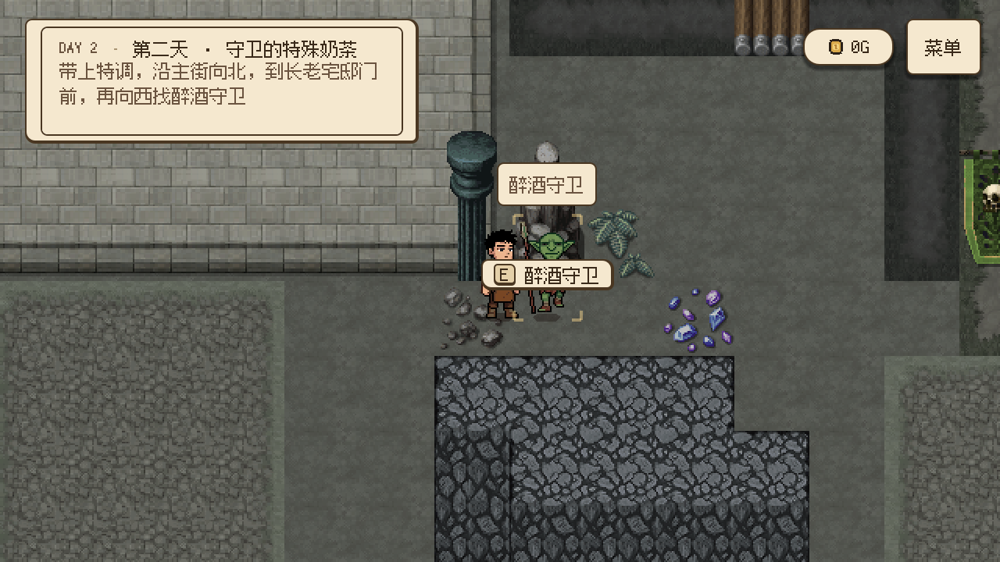

# 醉酒守卫出场、导航与交付修复（2026-10-24）

玩家反馈找不到醉酒守卫。本次修复正式剧情角色 `drunken_guard`，位置仍为长老宅邸双卫西侧的既有锚点 `(1416, 456)`；酒馆外的 `signature_drunk` 是另一角色。

## 改动

- 第二天 `day2.s05.deliver_guard`、`day2.s05.wait_guard_delivery` 的聚落 `scene_setups` 明确让守卫出场，覆盖普通 `active_phase = night` 的默认显隐。第一天付款后的离场事件保持不变。
- Day1WorldController 订阅演员的 `visibility_changed`，在章节布置改变显隐后重新投影交互点，修复“角色可见、交互仍禁用”的初始化时序问题。不增加新的交互入口。
- 送守卫及等待交付两个明确阶段允许第二天白天出店；不强行改成夜晚，其他第二天阶段保留原出店门控。保留夜间检查点，补齐送货、等待交付、送完返店相关的白天检查点。
- 任务、当前目标和现场提示统一按“沿主街向北，到长老宅邸门前，再向西找醉酒守卫”描述。第一天不再指向含糊的“北侧观察位”。
- 两天的找人目标通过现有 `target_point` 绑定真实 NPC 交互点，指针随角色位置更新；第一天交涉后转向宅邸双卫，第二天交付后转回奶茶店出口。
- QuestPointer 在当前任务 NPC 入画时显示屏幕空间姓名牌，离屏时保留带名字的方向提示。靠近时导航箭头收起，姓名牌与原有 E 提示分别显示在角色上方；隐藏角色、模态界面和非当前任务目标不挂名字。
- 实际醉酒守卫仍使用其原守卫小人，未借用赌场侍卫或酒馆醉鬼的素材。现有同造型资源没有专属醉态动作，本次以任务姓名牌区分身份。

本次只修改关卡／任务／恢复配置及只读表现，不调整 Story／Dialogue 事件内容、顺序、金额或饮品配方。`*_setup.json` 的场景布置独立于 StoryProject 的演出产物，本次无需改写正式编排工程。

## 验证结果

- `verify_quest_pointer.gd`：28 项通过，包含任务姓名牌、近距离 E 提示接管、隐藏角色不留悬空标记。
- `verify_save_store.gd` 通过，检查点及保存格式仍可解析。
- `verify_day_phase.gd`、`verify_day1_world_flow.gd` 通过。
- `verify_drunken_guard.gd`：无头 46 项、OpenGL 实际渲染 47 项通过。使用隔离存档目录，覆盖第一天任务前不出现／任务中出现／付款后恢复离场；第二天真实手调、出店及往返旅行、白天保存并继续游戏、沿存储地板路径实际行走、按 E 交谈及交付、只扣一杯、不重复结算、转回奶茶店指引。
- `verify_two_day_flow.gd`：409 项通过，新增实际可见、可接近和 E 键交谈断言，防止仅直接调用 StoryDirector 而漏掉不可见角色。
- 路线验证发现守卫南侧相邻格不可通行；采用有真实通路的西侧接近，不改地图碰撞或守卫站位。新专项会沿路径走到实际交互范围，而不是传送进障碍格。
- 未运行完整项目回归；本次没有改变共享快照格式或场景生命周期。测试／编辑器退出仍有资源清理诊断；功能断言和截图均通过。

实际执行的局部运行器范围：`quest_pointer|save_store` 与 `drunken_guard|day_phase|day1_world_flow|two_day_flow`。新增隐藏角色标记检查后只重跑了受影响的 QuestPointer 专项。

## 试玩

1. 第一天接受委托进入夜间，沿主街向北、到宅邸门前再往西。任务指针应写明“醉酒守卫”，入画后有姓名牌。完成交涉后守卫离场，目标切到双卫。
2. 第二天做好守卫特调后出店，沿同一路线回到守卫处。途中返回店里再出来，或保存后继续游戏，他都应保持可见、可交互。
3. 从西侧走近，按 E 交谈，再按 E 交付。只消耗一杯特调，钱包不增加报酬，当前目标切回奶茶店。

API 核对：[Godot 4.7 CanvasItem](https://docs.godotengine.org/en/4.7/classes/class_canvasitem.html) 的显隐信号与继承可见性、[Control](https://docs.godotengine.org/en/4.7/classes/class_control.html) 的屏幕空间布局及忽略鼠标输入。姓名牌复用现有主题，不拦截交互输入。
