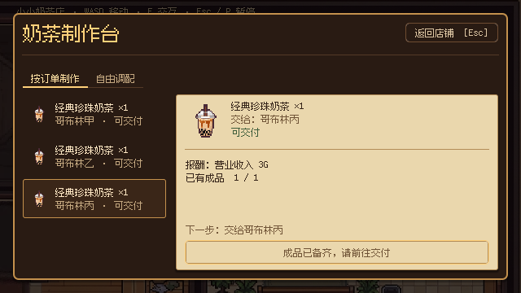
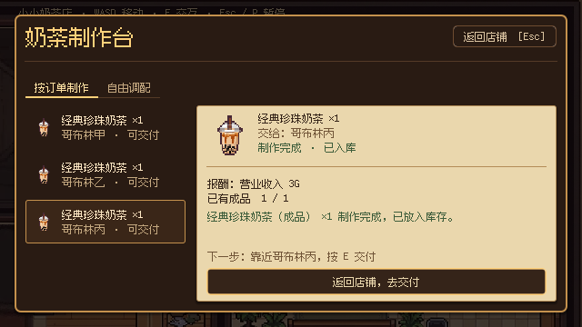
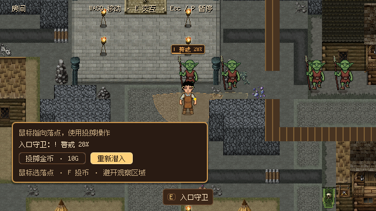
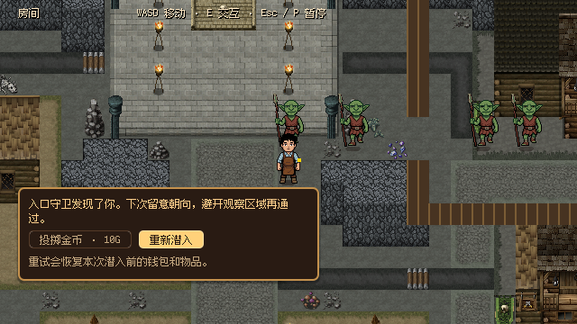

# 前两天体验打磨（2026-10-19）

本次在已打通的两天流程上优化操作与表现。没有新增剧情、订单、经济规则或存档字段。原有两天范围见[整合记录](two_day_integration_2026_10_19.md)。

## 问题与结果

| 检查到的原表现 | 本次结果 | 主要实现 |
| --- | --- | --- |
| 按单制作后按钮失效，仅提示成品备齐 | 成功后杯子轻弹，订单笺显示真实入库结果；可直接选择“返回店铺，去交付”，提示指定顾客和 E 键 | OrderCraftingPage、OrderTicket、ShopPage／ShopPopup |
| 钱包只显示当前余额 | 店内收支短暂显示 +3G／-10G 等实际变化；读档、新游戏清除旧反馈 | Day1BusinessHUD |
| 正常守卫没有观察方向提示；警戒主要靠色点 | 使用与检测相同的原点、角度、距离和世界碰撞层绘制观察区域；墙体裁切轮廓；文字同时展示警戒百分比与分心剩余秒数 | Day1GuardResponse |
| 被发现只显示通用失败文字；守卫状态列表持续占据左上区域 | 失败显示发现者与避开视野的建议；明确重试恢复范围；左下 HUD 只列活跃警戒／分心状态 | Day1StealthService、Day1StealthHUD |
| 正式宿主未启用已有环境循环和行走采样 | 店内木地脚步、洞窟石地脚步、场景环境底声；夜间底声更轻，暂停／切场景正确释放 | SceneSoundscape 与五个正式 MainGame 宿主 |

制作反馈发生在实际提交成功之后，动效不承担扣料或入库，也不强制等待。返回按钮只关闭现有弹窗并追踪所选订单，不自动交付。重复制作防护仍由当前库存和订单状态决定。

观察区域是检测范围的视觉提示，边缘用 24 段射线近似绘制；实际检测继续使用原来的精确玩家射线。守卫的发现时间、投币消耗、分心时长、付款与整次重试均沿用原值。状态文字使用现有像素字体，成功放行后移除危险区域。

音景复用已有素材与 AudioManager 的八声部池，不引入 autoload 或新音频资源。步声按距离触发，不对站立／传送／锁定／演出移动发声；它不参与守卫感知。音量差异与最终听感仍需真人试听。

## 画面对比

制作完成前：

制作完成后：

真实入口守卫进入警戒：

被发现后的重试提示：

## 实际验证

环境：macOS、Godot 4.7.2，图形检查使用 Compatibility。代码和素材由正式宿主加载；图形脚本使用自动输入、自动推进对白和目标定位，不等于真人完整步行试玩。

| 检查 | 实际结果 |
| --- | --- |
| 改前订单图形基线 `verify_order_ui.gd -- --capture` | 33 项通过，保存改前截图 |
| 改后订单图形 `verify_order_ui.gd -- --capture` | 37 项通过；键盘返回、移动锁恢复、不重复制杯／交付、收款变化；640×360 与 1280×720 |
| 新反馈 `verify_experience_feedback.gd` | headless 32 项通过；图形含正式守卫接近／发现／重试和截图，共 40 项通过 |
| 潜入 `verify_day1_stealth.gd` | 100 项通过 |
| 交互声音 `verify_interaction_audio.gd` | 65 项通过；退出仍有 5 个对象／2 个资源存活诊断，本轮未定位该诊断 |
| 两天图形 `verify_two_day_flow.gd -- --ordinary-order` | 272 项通过；覆盖可选订单、跨室内重试、真实制作交付与两天收支，保存完整截图 |
| 主题 `verify_ui_theme.gd` | 231 项中 1 项失败：旧 inventory_body.tscn 未显式引用主题；使用 HEAD 的 UI 源文件副本重新审计，同一项失败，本轮未改该文件 |

新反馈测试另外验证了恢复余额不显示虚假收入、失败支付无增减、世界声随暂停、脚步和环境清理不影响别人的声音、声音不改游戏状态，以及视野绘制遇墙裁切。

导入检查没有脚本解析错误，编辑器退出仍有插件对象／资源存活诊断。没有运行全仓历史 Demo 回归、旧剧情编排负例、Release 导出或跨进程存档全套：本轮未修改剧情数据、经济事务或快照格式，采用直接相关模块和两天集成验证。未进行真人完整步行、听感或新玩家测试，不将“更舒服／更有趣”写为已经验证的结论。

## 试玩入口与观察点

1. F5 → 新游戏，或 F6 `src/core/main.tscn`。接取饮品订单后到制作台完成一杯，观察杯子轻弹、入库结果与“返回店铺，去交付”；用 Enter 确认返回，靠近指定顾客按 E，钱包应短暂显示 +3G。
2. 店内行走后停止，听木地脚步是否随移动停止；夜间出店听洞窟底声与石地脚步，暂停后世界声音应停，关闭暂停继续。店内夜间环境更轻，音乐仍由原剧情管理。
3. 首夜接近入口守卫，观察扇形与墙体边界；进入视线观察百分比上升，投币成功后观察分心秒数减少。被发现时确认发现者与重试说明；重试恢复原有经费、库存和任务进度。
4. 已有存档继续游戏时，余额应直接显示恢复后的值，不闪出一次虚假的收入或支出。

自动截图入口为 `tests/verify_experience_feedback.gd -- --capture`，结果写入 `/tmp/goblin_experience_20261019/captures/`；它使用明确的首夜测试检查点，不跳改正式剧情。

## Godot 4.7 依据

本次实际查阅 [Tween](https://docs.godotengine.org/en/4.7/classes/class_tween.html)：`Node.create_tween()` 绑定节点，释放节点时自动清理；显式使用 `TWEEN_PAUSE_STOP`，避免暂停菜单期间制作动效和金额提示继续计时。场景音景沿用现有 AudioManager 的 SFX 暂停与 owner 清理契约。
