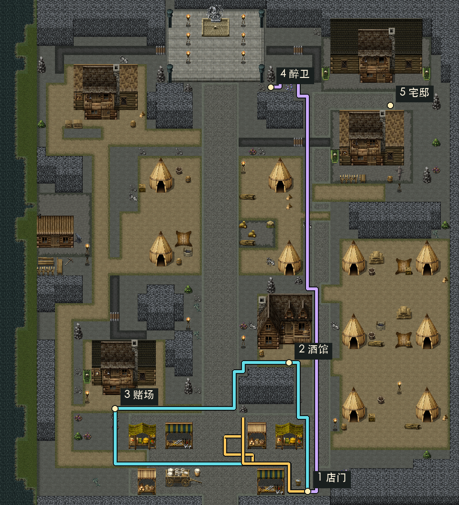
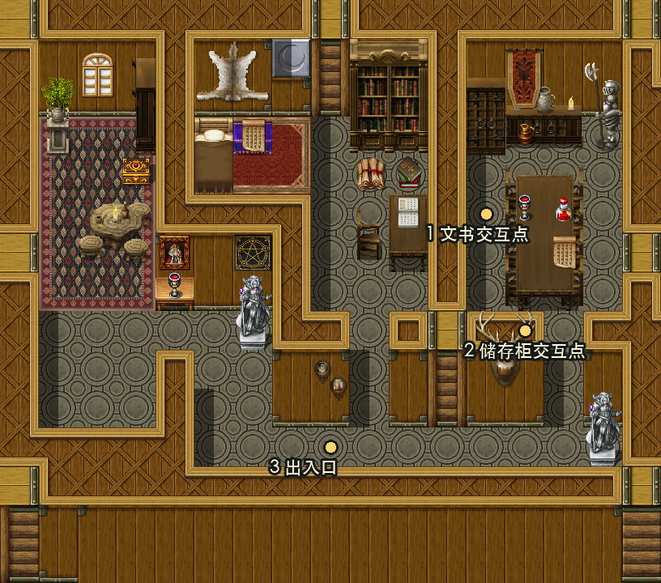
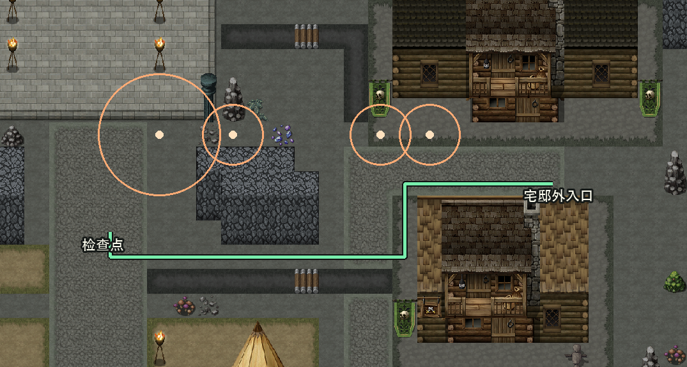

# 前两天流程体验与地图关卡审查（2026-10-19）

## 结论与审查范围

当前流程已经有空间分区、教学顺序和叙事地理，但关卡中的观察、判断和路线取舍仍偏弱。可以作为完整剧情试玩继续打磨；现阶段最需要补的是“场景里的东西为什么值得看、走哪条路有什么区别、做完之后发生什么变化”。

地图不用推倒重做。南侧集市、中段居民区、西南赌场、中部偏南酒馆、北端祭坛和东北长老居所，已经能承载从日常经营进入陌生社会、再进入权力区域的递进。主要问题是实际交互集中在南端与北端，室内的房间和家具尚未充分承担玩法职责。

本次从 `0826735` 开始审查，收尾复核至 `9337cd2`；期间新增的场景名 / 紧凑 HUD 与角色比例调整已纳入现状，本文涉及的地图点位、方向通行、剧情条件和正式步速未改变。核对范围为正式宿主、已保存 TileMapLayer、剧情 / 任务数据、角色配置和现有截图。本文所有优化均为提案，没有修改玩法、地图或正式剧情。本次没有启动引擎、执行项目测试或完成真人全程试玩，因此不将静态推断写成实测体验结论。

### 现行约定与已有改进

- 正式入口是 F5 标题页 → 新游戏；外景是 `chapter_cave.tscn` 继承的 `map_001.tscn`，不是旧聚落 Demo 或第五阶段概念图。
- 依据[场景连接约定](../design/scene_connections.md)及当前场景，长老区三段附加路障已经移除，侧路与原生地形通行保留。部分旧模块说明仍提到“单一入口、灰路封闭”，不用于本次方案。
- 主线卡、三处调查菱形标记、连续制作三杯、柜台目标优先级、第二天关店指引和配方键盘操作已经存在，不再作为缺失功能提出。
- 首夜已有守卫观察范围、警戒百分比、分心倒计时、失败原因和整次尝试恢复；正式流程不要求放火。本文不以新增这些功能充当关卡优化。
- 场景名与任务 HUD 已在本次收尾前调整，角色比例也已适配 RPG Maker 地图；本提案聚焦交互与空间职责，不把这些既有改动列为待办。

## 地图证据与路线估算

下图从当前保存的地图图块离线合成，叠加场景配置的交互位置与静态最短路线。黄色是首日三个调查点的环线，青色是第二天“店 → 酒馆 → 赌场 → 店”的商业路线，紫色是店门到醉卫的路线。图中不显示运行时 NPC、HUD 或昼夜效果。

### 关键点位

原点在左上，单位为世界像素，每格 48 像素。下表使用外景返回 / 出生落点，门的交互点通常在其上方一格。

| 地点 | 当前位置 | 空间职责与观察 |
| --- | --- | --- |
| 奶茶店外落点 | `(1608, 2568)` | 南侧集市边缘，适合作为安全据点；外景入口需要更强的奶茶店身份识别 |
| 三处调查 | `(1320, 2376)`、`(1176, 2280)`、`(1272, 2184)` | 聚集在南侧小范围，能引导按 E，但尚未带玩家认识主要分流点 |
| 酒馆外落点 | `(1512, 1896)` | 居民区右下，和赌场构成可理解的商业环线 |
| 赌场外落点 | `(600, 2136)` | 西南，适合与沿路采集形成顺路选择 |
| 潜入检查点 | `(1176, 648)` | 北侧任务前沿，已经能避免失败后重走整段南北路线 |
| 醉卫 | `(1416, 456)` | 与入口卫、宅邸双卫处于同一北侧横带；第二天重访有记忆价值 |
| 长老宅外落点 | `(2040, 552)` | 东北目的地，侧路可接近，正式入内仍要求首夜支付事实 |
| 三种夜间采集 | `(1128, 2136)`、`(840, 2136)`、`(888, 1896)` | 位于西南商业路线附近，已有与酒馆委托结合的基础 |

### 距离不构成首要瓶颈

从已保存 `Ground0..3` 的 `passage` / `star` 数据重建四邻接通行关系，按双方方向允许通行计算最短路径。正式 `shop_player.tscn` 将步速覆盖为 **240 像素 / 秒**，跑步倍率为 **1.6**；不能采用控制器脚本默认的 122 像素 / 秒。

| 路段 | 四邻接路线长度 | 步行理论时间 | 跑步理论时间 |
| --- | --- | --- | --- |
| 店门 → 三调查点 → 店门 | 1632 像素 | 6.8 秒 | 4.3 秒 |
| 店门 → 酒馆 | 768 像素 | 3.2 秒 | 2.0 秒 |
| 酒馆 → 赌场 | 1152 像素 | 4.8 秒 | 3.0 秒 |
| 赌场 → 店门 | 1440 像素 | 6.0 秒 | 3.8 秒 |
| 店门 → 潜入检查点 | 2352 像素 | 9.8 秒 | 6.1 秒 |
| 店门 → 醉卫 | 2496 像素 | 10.4 秒 | 6.5 秒 |

这些是指定格子中心之间的静态距离 / 恒定速度估算，未模拟脚底碰撞体、NPC、加减速、转弯、自由斜走、交互距离、对白或迷路；不是最短真人通关时间，也不是自动步行验收。第二天商业环线加送守卫往返，单计上述外景路线约 34.8 秒步行。仅凭地图尺寸，不能认定需要缩图、提速或快速传送。

真正需要观察的是停下来的原因：如果只是辨认不到门、找不到实体目标、反复确认下一步，即使路线很短也会显得拖沓。

## 当前流程：哪里有设计，哪里仍然单薄

| 段落 | 已有设计价值 | 当前薄弱处 |
| --- | --- | --- |
| Day 1 首客 → 异样顾客 → 三人组 | 从基础操作到异世界异常，再到多单组织，递进成立 | 前五杯和后续胖哥布林订单均为 H01，熟练后操作变化主要来自数量与对白 |
| 首次出店 → 三处调查 → 返店 | 安全范围内发现世界变化，回到店铺接委托，形成小闭环 | 三次都是“靠近 → E → 读说明 → 关闭”；空间集中，地点识别和观察内容没有形成明显递进 |
| 首夜北行 → 守卫 → 宅邸 → 撤离 | 用经营所得处理社会阻碍，取物后返回据点，有完整任务结构 | 守卫在同一横带且当前均朝左；侧路与门的支付条件之间，缺少清楚的空间解释 |
| 宅内文书 + 血液 | 两目标顺序自由，提供少量自主规划 | 交互点与物件对应较弱，书房、陈列区和卧室的差异尚未转成调查职责 |
| 血液特调 → 胖哥布林反应 | 探索所得回流经营，闭环清楚，是应保留的核心 | 玩家收益主要由剧情说明，配方 / 人物 / 世界变化的连接还可更直接 |
| Day 2 四组五杯 → 手动关店 | 客人传闻将酒馆、赌场和社会信息引入主线；可选散客与雇佣已有取舍 | 又连续五杯 H01，且剧情客按序进入；接制交容易成为对白之间重复的手续 |
| 酒馆 → 赌场 → 回店特调 | 两材料来自不同社会地点，商业环线合理 | 进入室内即可触发长段剧情，购买和两局开始经屏幕按钮操作，吧台与赌桌的空间价值不足 |
| 再访醉卫 → 返店换日 | 将首夜障碍变为关系节点，是很好的空间复用 | 熟悉路线的第二次经过，需要可观察的关系变化与顺路机会支撑 |

## 优先优化方案

### P0：先让画面、目标与实际规则一致

#### 1. 把长老宅两个目标绑定到玩家能看懂的物件

当前文书交互点为 `(600, 264)`，位于右侧桌台西侧；“圣物储存柜”交互点为 `(648, 408)`，位于右侧房间门口附近。中部明明有书架、书桌和纸页，却不承担文书目标。下图是地图图块与正式交互坐标的直接叠加，黄色点表示交互原点，不表示玩家唯一可站位置。

建议将文书明确对应中部书房的书桌 / 纸页，将血液明确对应右侧房间中的实际瓶子或新配置的柜体。目标原点可设在物件旁的可站位置，但轮廓提示应指向物件，名称也应与画面一致。不能只把交互点叫作“储存柜”，却让玩家在门口空地完成取物。

入门处先看到书房和右室两条支路；玩家自行决定先取血还是先读文书。左侧陈列区可保留为一处可选观察，提供已确认的信仰信息，不再增加必须读完的第三份文书。目标完成后明确显示“文书已取得 / 血液已取得 → 前往撤离点”，保留现有双目标与真实撤离条件。

预期改变：玩家通过物件和房间用途判断行动，不再靠扫过交互范围寻找文字提示。首轮只需要调整继承场景内的目标绑定、物件反馈和显示；具体新坐标须按实际可站位置预检。

#### 2. 解释开放侧路与守卫交涉的关系

当前四名守卫都在 `y = 456`，视距为入口卫 120、其余 60 像素，发现时间均为 0.6 秒、分心时间均为 6 秒。用完整圆形视距代替朝向扇形，再向外增加 24 像素安全边距，静态地图仍存在一条从检查点到宅邸外落点的 22 格路线；增加 48 像素边距仍可达，路线为 40 格。

橙圈表示完整视距圆，绿色路径按“视距圆 + 24 像素”避让计算。图中不是实时视锥，也没有模拟守卫身体和事件触发。它证明的是**地形层面不必经过守卫面前就能接近门口**；不证明可以绕过正式任务。宅门明确要求醉卫与双卫的支付事实，撤离也再次检查放行和醉卫事件。

建议保留全部原生侧路，用两种清楚的接近方式组织它们：主街便于发现守卫和交涉，侧路提供观察位置与绕开感知的机会；两路共享已确认的入门交涉条件。玩家绕到门前时，应能看见双卫或看到明确的“先与守卫交涉”反馈，并知道交涉地点。避免空间已经放行、目标却只因未见过的事件标记被拒绝。

入口投币作为一种可理解的应对手段，不把“投了几次”做成隐藏通关要求。若希望它承担必学技能，应在安全观察位用清楚的落点提示引出首次操作，再在后续位置给可选应用；尊重玩家通过合法侧路避免消耗。首轮不改既有 10G 投币、醉卫与双卫支付规则，也不恢复路障。

当前 0.6 秒发现时间约等于正常步行 3 格或跑步 4.8 格的移动时间，但并不代表玩家实际拥有这么多反应空间。是否增加首次教学的容错，必须用真人观察确认；不能只因参数小就统一放宽所有守卫。

#### 3. 让入口状态与当前操作在世界中可读

南侧奶茶店入口增加稳定可辨认的招牌 / 门口标识，第一次出店与北行返回都能凭画面认出。酒馆、赌场和宅门根据当前真实阶段，呈现可进入、稍后可用或需先交涉的状态；继续使用现有主线卡和交互提示，不同时堆叠多组箭头。

主线卡尽量表达“动作 + 对象 + 去处”，例如“回店制作守卫特调”“前往北侧醉卫，先交谈再交付”。制作完成后明确是杯子入库、接下来需要交付；这些事实已有时只调整显示，不新增推进剧情的开关。

潜入阶段给两项物品的短清单和撤离地点；第二天出店前给特调是否持有、目标地点与当前委托的顺路材料提示。地图继续按已知地点显示，不公开宅内秘密物品坐标。

### P1：让现有路线产生观察和选择

#### 4. 将首日调查改为三个不同的空间任务

保留“发现生活痕迹 → 判断街道异常 → 看见深处风险 → 返店”的剧情目的，避免只是把三个菱形挪远。

| 调查 | 建议落点职责 | 玩家获得的具体认识 |
| --- | --- | --- |
| 摊位区 | 店门附近的明确摊位 / 物件 | 这里有人生活，店是安全返回点 |
| 街道 | 南侧商业横路与主街的分流位置 | 认出酒馆方向与西南赌场方向，为第二天建立路线记忆 |
| 昏暗岔路 | 能看到北行主路变化的南侧岔口 | 察觉公共生活区与深处区域的差别，决定先回店 |

三处不必强制固定顺序；主线给一个推荐目标，其他可见。每处的灯光、物件或声音先于文字提示让玩家注意到它，调查后再补信息。首轮只在南侧可用范围寻找合适点位，不将初次出店扩成全图打卡，也不提前开放室内剧情。

需要调整正文信息或对白时，另按结构化剧情工程与来源规范编排；本审查没有扩写台词。尤其不能在存在三名返回哥布林的可见范围内，直接把“空荡荡的街道”解释为整片聚落无人。

#### 5. 将中段居民区用作一次可观察的变化

主街南北距离适中，不需要一路塞事件。选择一处居民区岔口，放置与七日祭准备有关的既有角色活动或环境变化：首夜是远处动静 / 准备痕迹，第二夜是可辨认的祭典准备。具体角色与信息采用已经确认的来源，不让环境演出夺走移动权。

河岸工坊、仓库、军营和祭坛暂不全部开放。优先用外部可读的用途和一两处可选观察建立世界边界；每加一条支路，都必须回答它提供的是线索、资源还是替代通行。没有收益的绕路可以保持为背景空间。

#### 6. 用采集让商业路线出现一次顺路决策

现有三处夜间采集就在酒馆与赌场附近，先用好这些位置：接到酒馆七日祭委托后，手册列真实缺口，回赌场或返店途中可选择顺路取齐；已采过的则直接显示持有量，承认提前探索。

每种原料对应可辨认的场景物件；第一次采集的反馈连接到委托用途与次日交付，后续缩短重复说明。首轮不挪成三个远角落，不增加随机刷新和强制额外跑图，也不把普通采集与醒神菇代购混成同一任务。

### P1：让经营与室内场景承担新的动作

#### 7. 保留订单与经济，降低重复操作负担

首日六杯 H01、第二天剧情五杯 H01，共十一杯同配方常规单，另有两晚的剧情特调。已有三杯连续制作和逐人真实交付，是可保留的基础。

建议教学按熟练程度收起：第一单完整指引；第二单保留目标；三人组强调当前总需求和备齐后交付。第二天默认突出尚未满足的操作，不再重新解释完整制作流程。

可评估“按当前同款缺口制作”的明确数量确认，复用已有库存与订单需求。每杯仍按真实规则扣料、入库，指定顾客仍需真实交付；不改变杯数和奖励，也不将一杯视为完成多人订单。它优化的是重复点击，不替代经营规则。

第二天雇佣散客已经是有效选择，应把它产生的次日回报展示清楚。额外自由调配可在安全阶段作为可选尝试，首轮不增加强制试错成本、配方门槛或会影响 48G 购酒预算的新消费。

#### 8. 把酒馆与赌场的关键按钮放回场景对象

酒馆目前有吧台、桌椅与老板，但 `day2.s03.amber_wine` 在抵达后自动触发；赌场 `day2.s04.casino` 同样在抵达后触发。到达事实和自动事件使玩家无需先走到吧台或赌桌，房间利用因此偏弱。

建议入口只保留简短抵达信息，玩家走到吧台与裂牙交谈、确认购酒，再自行走向出口；赌场从最近的一张可操作赌桌开始，入座 / 确认赌注 / 揭示结果都在该对象上反馈。保留原有剧情顺序、两局结算与债务取消，先让动作有空间落点。

两局目前是第一局输、第二局赢的固定剧情。可以做成有节奏的互动演出，但不应展示没有实际作用的概率、下注策略或虚假获胜选项。若以后加入真正赌博玩法，需作为独立设计处理。

长信息段建议在自然话题边界恢复一次玩家操作。比如酒馆 `day2.s03.tavern_commission_common` 当前有 24 条对白，可按“材料委托”和“令牌线索”分段，让玩家有机会查看任务或再询问。对白删改、可选化与先后变化均须另做剧情编排，不在界面层自行截断。

#### 9. 让第二次北行体现关系变化

醉卫原址重访值得保留，不宜直接改成店门口交付。第一次是阻碍，第二次应看得出对方认出了玩家，并在交谈与收杯后给出明确的人物关系反馈。当前人物记录已接入，可以用简短提示连接到该记录，避免交付 0G 被误读为“这次没有回报”。

返店沿途若已取齐材料，就显示次日可交付；未取齐则提供顺路机会。章末独白与实际返店条件保留。是否增加回程快捷方式，等真人计时证明必要后再定。

## 推荐实施顺序与验收

| 顺序 | 可独立交付的改动包 | 主要涉及 | 验收重点 |
| --- | --- | --- | --- |
| 1 | 宅内目标与物件对齐、入口身份与状态反馈 | 继承地图、交互显示、当前目标投影 | 无需扫空地即可定位文书和血液；两种取得顺序都成立；错误准入说明可理解 |
| 2 | 首夜开放路线与交涉反馈 | 守卫 / 触发区配置、任务提示 | 正面与侧面接近均不软锁；不靠新增路障迫使玩家走固定路线；失败仍恢复整次尝试 |
| 3 | 首次调查分工、商业路线顺路采集 | 南侧点位、采集物件、任务材料显示 | 三处分别教会一个地点或判断；第二天能认出地点；提前采集获得正确承认 |
| 4 | 教学收起、同款数量确认、重复制作交互 | 订单 / 制作 UI 与服务接口 | 两天杯数、扣料和收款准确；重复点击不多扣、不多发；制作与交付仍分开 |
| 5 | 酒馆吧台、赌场赌桌的主动交互 | 正式剧情工程、宿主交互、室内点位 | 入门有观察与行走时间；交互对象明确；原剧情与结算不丢失、不重复 |

后续实施按[测试分级](../../tests/AGENTS.md)选直接相关检查；地图修改补通行 / 目标可达验证，剧情触发变化补对应工程与恢复检查，交易操作变化补库存与回执检查，不照搬历史全套回归命令。

### 真人体验验收建议

使用 F5 → 新游戏，请未熟悉开发内容的玩家完成以下观察；不先教路线，不替玩家按键。至少记录几名玩家的具体卡点，再判断提案效果，不将小样本数字当统计结论。

1. 首次出店：记录看到场景到知道调查动作的时间、能否说出店门和商业分流的位置、三次调查是否觉得内容有区别。
2. 首夜：分别观察主街与侧路接近；记录第一次发现守卫、第一次被发现、第一次理解支付条件的位置与原因。确认绕到门口时能自行找到交涉对象。
3. 宅内：暂不口头提示物件位置，观察能否依靠家具用途找到两件物品，以及是否知道拿齐后还要撤离。分别尝试两种取得顺序。
4. 第二天：记录玩家是否主动组织同款制作、是否理解关店、是否知道买酒和赌博要操作哪个世界对象；分开记录读对白、走路、找目标和重复点击的时间。
5. 送守卫：观察是否提前备杯、是否知道交谈后再交付、是否察觉人物关系变化、返店是否只是机械往返。

优先关注“为什么停下”和“为什么失败”。若操作理解清楚而仍觉得无聊，再调整决策与节奏；若主要卡在目标识别，先修画面与规则的一致性。

## 证据入口与本次核验

- 地形与图块：[外景](../../src/levels/rpg_maker/map_001.tscn)、[酒馆](../../src/levels/rpg_maker/map_004.tscn)、[赌场](../../src/levels/rpg_maker/map_005.tscn)、[长老宅](../../src/levels/rpg_maker/map_006.tscn)。
- 正式点位：[洞窟继承场景](../../src/levels/rpg_maker/chapter_cave.tscn)、[长老宅继承场景](../../src/levels/rpg_maker/chapter_elder_house.tscn)、[地图公开地点](../../src/levels/rpg_maker/rpg_world_map_data.gd)。
- 通行与运动：[地形方向规则](../../src/levels/rpg_maker/rpg_maker_map.gd)、[正式玩家速度](../../src/gameplay/player/shop_player.tscn)、[运动倍率](../../src/gameplay/player/player_controller.gd)。
- 首夜条件：[守卫感知](../../src/gameplay/stealth/day1_guard_response.gd)、[潜入与撤离](../../src/gameplay/stealth/day1_stealth_service.gd)、[后四阶段事件](../../src/resources/story/day1_stages_03_06.json)。
- 第二天：[事件](../../src/resources/story/day2_stages_01_05.json)、[抵达后自动事件](../../src/resources/story/day2_stages_01_05_setup.json)、[对白](../../src/resources/dialogue/day2_stages_01_05.json)、[当前操作指南](../gameplay/day_02_flow.md)。
- 已有体验修复：[首日可玩性](day1_playability_fixes_2026_10_19.md)、[反馈与音景](experience_polish_2026_10_19.md)。

本次只做静态审查、保存图块离线合成、方向通行路径计算与文档核验。三个插图均由源图块和场景坐标叠加生成，没有运行游戏截屏，也没有修改地图源文件。没有实际验证守卫绕行、首次玩家反应时间、听感、输入手感或主观趣味；上述相关结论明确保留为待试玩验证的风险与提案。

实际文档核验：本文 24 处本地文件 / 图片引用全部存在；本文与文档索引符合 UTF-8、LF、单个末尾换行和无行尾空白要求。路线表按正式 240 / 384 像素每秒重新核算，调查环线为 6.8 秒、第二天所列外景路线合计为 34.8 秒。三个插图均已打开检查点位与标注可读性。
