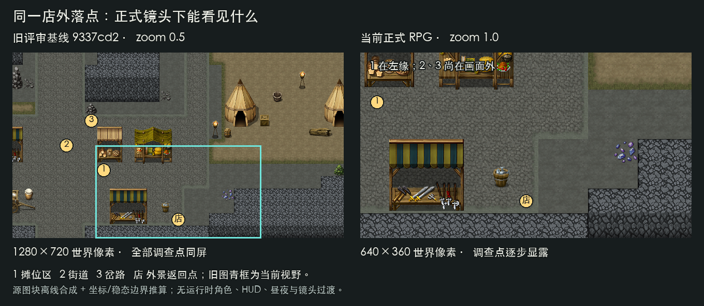
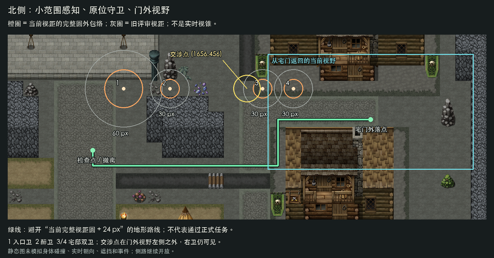
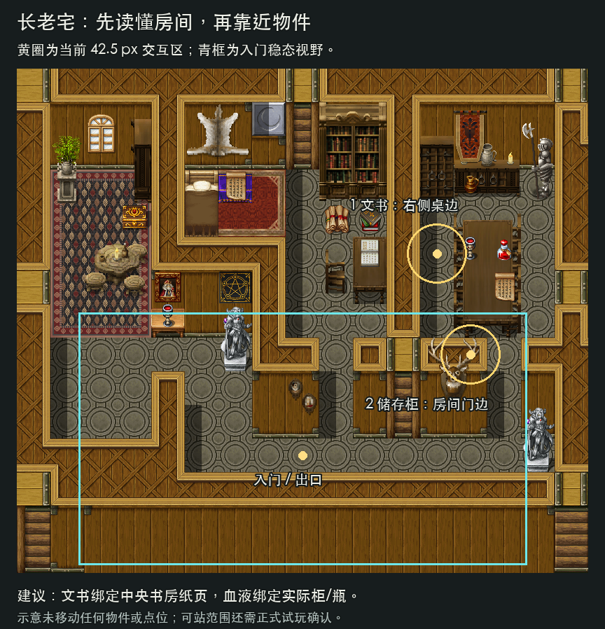

# RPG 角色新尺度下的流程与关卡优化方案（2026-10-19）

## 结论与适用范围

新的角色参数让 RPG Maker 地图更适合做近距离观察和分屏探索，但也改变了流程节奏。当前最该优化的是沿途方向、物件与交互位置的对应、守卫对实际道路的覆盖。继续把调查点拉远，或只根据角色大小等比例缩放所有关卡参数，都不适合作为下一步。

地图已有设计基础：南侧集市是安全据点，酒馆与赌场形成商业环线，中段街道承接过渡，北侧守卫与长老宅形成任务区域。当前不足在于这些空间尚未持续给玩家提供“看见线索 → 判断方向 → 主动操作 → 观察结果”的过程。建议保留地图拓扑，用当前镜头重新组织这一过程。

本版基于 `780f142` 的角色、场景与脚本，以及当前 `project.godot` 的 640 × 360 基准尺寸。它接替[上一版审查](flow_and_level_review_2026_10_19.md)中的参数、路线时间与实施优先级；旧版保留为历史。本文只提出方案，没有修改玩法、地图、剧情或角色参数，也没有运行游戏或项目测试。

## 先区分三个参数基线

原始的“大角色版本”、上一版审查收尾的 `9337cd2`、当前正式 RPG 宿主，不能混为同一组前后对照。`9337cd2` 已将角色画面与脚底缩小，但还使用 0.5 倍镜头和 240 步速；之后才拆分店内 / RPG 玩家，并同步缩小交互与视听范围。

| 项目 | 上一版审查基线 `9337cd2` | 当前正式 RPG | 设计含义 |
| --- | --- | --- | --- |
| 玩家 Visual / 阴影 / 持物缩放 | 0.5 | 0.5 | 相比上一版，身体没有再次缩小 |
| 玩家脚底胶囊完整外接尺寸 | 17 × 10 世界像素 | 17 × 10 世界像素 | 48 像素格内的身体通行尺度基本延续 |
| RPG NPC 脚底完整外接尺寸 | 14 × 8 | 14 × 8 | 不能用旧大身体的占道印象决定扩路 |
| 正式跟随镜头 zoom | 0.5 | 1.0 | 同一基准画面可见世界面积变为原来的四分之一 |
| 镜头相对脚底的纵向偏移 | -48 | -24 | 画面推算还要考虑地图边界钳制 |
| 步行 / 跑步速度 | 240 / 384 | 120 / 192 像素每秒 | 相同地图路线的恒速耗时翻倍 |
| 潜行速度 | 120 | 60 像素每秒 | 观察与移动的时间关系需一起检查 |
| RPG 交互圆半径 | 85 | 42.5 像素 | 更局部，物件和锚点的偏移更容易被察觉 |
| 选择器切换余量 / 朝向权重 | 12 / 24 | 6 / 12 | 已经同步缩放，不列作缺失功能 |
| 入口卫视距 / 其余三卫视距 | 120 / 60 | 60 / 30 像素 | 守卫站位未变，对道路的覆盖减少 |
| 听距 / 投掷距离 | 360 / 460 | 180 / 230 像素 | 教学落点必须重新匹配可投、可听的交集 |
| 发现 / 分心时间 | 0.6 / 6 秒 | 0.6 / 6 秒 | 时间没有一起缩短 |
| 投掷效果空间缩放 | 1.0 | 0.5 | 弹体速度、效果尺寸等随之缩小，相关持续时间保留 |

当前四个正式 RPG 宿主都使用独立的 `rpg_player.tscn`。店内仍使用完整尺度的 `shop_player.tscn`、240 步速和 0.5 倍镜头；本方案的地图参数调整不应全局应用到店铺。

NPC 动画先按帧画布高度归一到 128 像素，再由 RPG Visual 缩放为 0.5；这不等于每名角色的不透明身体都高 64 像素。当前 NPC 提示框已按实际画面边界生成，调试名称也已清理。普通哥布林在生成时随机选择背包外观，所以任务身份应依赖姓名、职责与位置，不能只用“背包那位”作为识别依据。

## 新尺度对原方案的直接修订

| 原判断 / 建议 | 本版处理 | 原因 |
| --- | --- | --- |
| 三处调查过于集中，考虑分散 | **改为保留位置，先形成逐步显露的短链** | 当前第一屏已看不见全部目标，继续拉远会增加找路负担 |
| 路线距离不是主要瓶颈 | **改为长距离节奏需优先观察** | 同一路线恒速耗时翻倍，熟路往返的成本更明显 |
| 守卫视距 120 / 60 可作为当前覆盖依据 | **作废，按 60 / 30 重审位置和职责** | 身体与速度缩放不代表地图和守卫间距一起缩放 |
| 宅内物件与目标对应较弱 | **保留并提高优先级** | 42.5 半径更难掩盖目标与家具之间的错位 |
| 酒馆吧台、赌场赌桌应成为主动操作对象 | **保留，增加进门后的方向与服务站位设计** | 当前镜头无法在门口看完整间室内 |
| 保留原生侧路与真实任务条件 | **继续保留** | 依照最新场景连接约定，不能用补路障代替关卡设计 |

## 地图证据：同一地图，现在分成了更多屏

### 店外第一屏已经有顺序潜力

按正式镜头稳态与地图边界推算，店外落点 `(1608, 2568)` 的当前可见范围为 `x = 1288..1928，y = 2280..2640`。摊位调查点在左缘；街道与岔路调查点尚在画面外。上一版 0.5 倍镜头的范围为 `x = 968..2248，y = 1920..2640`，三处可以同屏出现。

在 640 × 360 的基准画面下，当前可见世界约 13.3 × 7.5 格，之前约 26.7 × 15 格，每格为 48 像素。步速乘镜头倍率均为每秒 120 个基准画面像素，因此屏幕上的移动速度没有随世界步速一起减半；增加的是穿过同一座聚落的时间。

这支持“先认出近处摊位，再看到街道，最后抵达岔口”的引导。它不证明三段调查已经有不同玩法：目前仍然主要是靠近、交互、读说明。应先改每段承担的观察任务，再决定是否移动点位。

### 路线重新计时

从已保存 `Ground0..3` 的 `passage` / `star` 数据重建方向通行，计算两端都允许通过的四邻接格心路线。地图坐标未变，距离与上一版一致；时间改用当前步行 120、跑步 192 像素每秒。

| 路段 | 静态路线长度 | 当前步行估算 | 当前跑步估算 |
| --- | --- | --- | --- |
| 店外落点 → 三调查点 → 店外落点 | 1632 像素 | 13.6 秒 | 8.5 秒 |
| 店外落点 → 酒馆外 | 768 像素 | 6.4 秒 | 4.0 秒 |
| 酒馆外 → 赌场外 | 1152 像素 | 9.6 秒 | 6.0 秒 |
| 赌场外 → 店外落点 | 1440 像素 | 12.0 秒 | 7.5 秒 |
| 店外落点 → 北侧检查点 | 2352 像素 | 19.6 秒 | 12.3 秒 |
| 店外落点 → 醉卫 | 2496 像素 | 20.8 秒 | 13.0 秒 |
| 检查点 → 醉卫 | 432 像素 | 3.6 秒 | 2.3 秒 |
| 醉卫 → 宅门外 | 816 像素 | 6.8 秒 | 4.3 秒 |

第二天商业环线合计 3360 像素，约 28 秒步行；再加店外与醉卫之间的往返，合计 **8352 像素、69.6 秒步行或 43.5 秒跑步**。这是原先所列同一路线耗时的两倍，还没有计入室内移动、对白、找门和重复操作。

以上为静态格心距离 / 恒定速度推算，没有模拟身体、NPC、加减速、斜走、交互可达距离或实际玩家选择，也不是规定玩家必须沿图中路线移动。时间不足以单独证明“必须传送”，但已经足以把熟路往返列入下一轮体验验证的重点。

## P0：先完成当前尺度下的空间可读性

### 1. 保留三调查点，组织一次短距离的主动认识

建议软引导顺序为：**店门与摊位 → 公共街道 → 昏暗岔路 → 返店**。不新增硬性先后条件，玩家提前发现其他点也应被承认。

| 段落 | 让玩家形成的认识 | 本轮建议 |
| --- | --- | --- |
| 店外第一屏 | 这里有人生活，店门就在身后 | 为奶茶店设置可辨认的招牌或门面；利用已有调查标记突出摊位目标，不再堆同等醒目的提示 |
| 公共街道 | 这里是后续商业与北行的分流位置 | 用既有地形、门面或路牌建立方向记忆；调查完成后目标卡指向下一片区域 |
| 昏暗岔路 | 前方存在暂不深入的未知区域 | 将照明与可见地形的变化对齐调查位置；保留自行停步、观察和返回的控制权 |
| 返店 | 玩家能凭画面找到安全据点 | 店门身份在来回两个方向都清楚，回程不依赖再次打开全图 |

已有菱形标记、目标卡和调查完成状态继续使用。重点是画面中的对象先给方向，交互文字再解释意义。暂时不把三点搬到地图三个角落，也不为此增加新的必读剧情。街道描述与现有返回哥布林的可见范围还需一起核对，避免一面看见行人、一面读到整条街无人。

### 2. 小范围交互应绑定可站位置与可见对象

玩家脚底宽 17、高 10 像素；48 像素的一格通道在单人几何上已有余量，不需要继续按旧大角色印象普遍拓宽。NPC、转弯和交互停步会改变结果：门口、柜台前和交涉区域可优先保留两格宽的活动空间，作为局部摆位目标，不作为全图统一扩路规则。

当前交互依赖玩家身体与半径 42.5 的 Area 重叠，并非“玩家中心进入圆内”。例如四个外景返回落点都位于相应门点下方 48 像素；理想垂直几何下，圆半径加脚底半高为 47.5，落点比这一边界多出约 0.5 像素。这只提示应验证返身回门的手感，**不构成已经确认的软锁**。

建议逐项检查：返回后转身靠近是否自然出现提示；沿门的左、中、右接近能否稳定选中；开完界面再按键是否会误入相邻目标。需要调整时，局部移动门点 / 落点，或为宽门、柜台设置与物件对应的矩形服务区。保留当前 RPG 基准半径，避免为了一个入口把所有 NPC 交互重新放大。

NPC 的名字、轮廓和提示应继续跟随角色。柜台交易则允许把可站的服务区设在柜台外侧，让反馈指向老板 / 柜台，避免要求玩家贴到角色脚底才能操作。现有选择器的 6 / 12 参数与画面边界反馈已调整，本轮先核对摆位和遮挡。

### 3. 北侧按“观察、交涉、到门”安排职责

四名守卫仍处于 `y = 456` 的横带，站位与朝向没有随范围缩小而变化。当前入口卫视距 60 像素，其他三卫 30 像素，分别约 1.25 格与 0.625 格。两名宅邸卫相距 96 像素，完整视距圆之间有 36 像素间隙；实际单向视锥覆盖还取决于朝向和遮挡。

在静态地形上，避开所有当前完整视距圆并额外外扩 24 像素，检查点到宅门外仍有 22 格路线；外扩 48 像素也仍可达。图中的完整圆是感知范围的保守外包络，不是实时视锥。这只能说明开放地形提供绕行，不代表玩家绕过了任务条件。

需要特别区分：视距和步速同减半，使“视距 / 速度”等局部时间比例基本保留；0.6 秒内当前可走 72 像素、跑 115.2 像素，约 1.5 / 2.4 格。不能只因视距缩小就断言潜入更难或更容易。发生变化的是**感知范围相对未缩小的道路、守卫间距与地图地标的覆盖**。

建议分工如下：

- **入口卫承担首次观察。** 如果其职责是看守主街，就让脚位、朝向与实际可走带对应，先调整局部摆位，再按道路宽度校准专属视距。观察位应在危险区外且与守卫同屏；不统一恢复所有旧视距。
- **醉卫承担人物遭遇。** 让玩家在接近前认出对象，知道这是需要处理的关系节点。当前遭遇区已从 96 × 96 缩为 48 × 48，应核对主街与侧路接近能否找到它，而不靠扫地触发。
- **宅邸双卫承担明确交涉。** 当前交涉点 `(1656, 456)` 在双卫左侧，宅门外落点的稳态视野为 `x = 1720..2360`，该点在画面之外，右卫仍可见。侧路玩家到门后，拒绝反馈应明确指向双卫与交涉方向；必要时重排可安全站立的交涉位置，让对象和入口条件同时可读。
- **投币提供可理解的应对方法。** 教学落点同时满足玩家到落点不超过 230、落点到可受影响守卫不超过 180 像素。当前分心表现是原地转向和倒计时，不按已有巡逻、走过去捡币来设计。合法侧路应保留，投币次数不成为额外隐藏门槛。

宅门仍需要醉卫与双卫的真实支付事实，撤离仍检查真实物品与事件完成。方案要解释这些规则与开放接近方式的关系，而不是加回路障。失败已能从北侧检查点恢复整次尝试，不重复建设这一功能。

### 4. 长老宅按房间用途定位两件目标

地图为 816 × 720 像素，当前镜头无法在入口看全。入口 `(408, 552)` 的稳态画面约为 `x = 88..728，y = 348..708`：血液点在画面内，文书点尚在上方。玩家更需要在走进一间房之前看出它可能有什么。

当前文书点 `(600, 264)` 对应右侧桌边，血液“储存柜”点 `(648, 408)` 对应右室门边；中央书房中的书架、书桌与纸页没有承担文书目标。静态通行显示两点所在格都可从入口到达，问题主要是语义和摆位，不能直接写成不可达故障。

建议把文书绑定中央书房的实际纸页 / 书桌，把血液绑定右室可见的瓶子或明确柜体；物件名称、反馈轮廓、交互站位三者对应。具体坐标在实施时按可站边缘选择，不能把锚点直接放进不可走的桌子中心。

入口先给出通往书房与右室的视觉方向，允许先取任意一件。取得后的反馈持续显示两项目标状态，拿齐后明确要求返回撤离区域。左侧陈列区可作为可选观察空间，优先复用已确认的世界信息；首轮不加第三个必取物、不新增室内巡逻或限时找物。

## P1：让较长的路线有作用，让重复流程更轻

### 5. 南北旅程先做方向与阶段变化，再决定是否加快回程

北行按“南侧熟悉街区 → 中段方向判断 → 北侧安全观察位 → 人物 / 宅门交涉”组织。利用已有路口与房屋做连续地标，上一段结束能看见下一段的大致方向。主线目标显示当前要找的对象与地区，避免只有一个位于屏幕之外的精确点。

中段可选择一处现有居民区岔口，复用已确认的祭典准备活动或环境变化：首次北行建立印象，第二次经过能看出变化。具体活动和信息需按正式剧情来源设计；不沿路加多个强制对白，也不把原本直接的道路改成绕路谜题。

第二天重访醉卫原址仍值得保留，它能把第一晚的障碍变成关系记忆。应先让玩家出发前知道要带什么、到达时认出对方、交付后看见人物记录或关系反馈。随后计时观察熟路返店是否仍显冗长。

若主要耗时确实来自无变化的熟路，可以优先做一次任务成功后的可选便捷返程，或优化远行阶段的移动安排；不能仅凭估算直接全局提速。便捷返程应发生在正式取物、撤离或交付完成之后，经真实场景旅行与抵达处理收尾，不直接写“已返店”标记。第一晚观察、宅内取物和撤离过程保留。

### 6. 商业环线依靠“到对象前操作”建立空间意义

酒馆、赌场目前在抵达后自动触发关键事件。角色缩小、画面拉近后，如果门口立即接上长对白，玩家仍没机会认识吧台和赌桌，新增可走空间的价值有限。

建议酒馆入门后先恢复观察与行走，吧台或老板承担购酒与委托的主动交互；入口到服务区有清楚路线和可站位置。赌场以最近的一张明确可用赌桌开始，入座 / 确认 / 揭示结果在该对象附近反馈。保留两局固定结算与原有债务处理，不展示没有实际作用的概率或策略选项。调整触发需回到正式剧情工程，不能在 UI 层截断对白或另写剧情顺序。

三处夜间原料点已经在商业路线附近。接酒馆委托后显示真实持有量与缺口，让玩家选择顺路采集；采过的获得承认。新半径下应把采集标记与真实植物 / 材料物件对齐，不能只在道路空地放不可辨认的热点。首轮保留近路位置，不把原料移到远角落增加跑图。

### 7. 店内优化继续减少重复步骤，不跟随 RPG 参数一起改

首日六杯、第二天剧情五杯 H01，共十一杯常规同款单。这个重复性没有随 RPG 比例改变。已有三杯连续制作、逐人真实交付、柜台优先级、第二天关店指引与配方键盘操作，继续使用。

建议第一单完整教学，随后按熟练程度收起提示；三人组突出总缺口，第二天突出尚未完成的操作。可评估按当前同款缺口确认数量，复用真实扣料、入库和交付规则，减少重复点选。杯数、收入、成本和购酒所需预算保持原设计，不以新增配方或必做试错填充时长。

## 各区域应承担什么设计

| 区域 | 当前地图适合的职责 | 首轮投入 |
| --- | --- | --- |
| 奶茶店与南侧集市 | 安全据点、首次认识异世界 | 店门身份、三点逐步引导、可自然返店 |
| 中段居民区 | 路线分流、世界随阶段变化 | 一处清楚地标与一处有来源的变化，不全区塞任务 |
| 西南商业环线 | 社会交往、交易与顺路采集 | 入口方向、主动服务对象、材料缺口反馈 |
| 北侧守卫区域 | 观察与交涉、允许不同接近方式 | 感知对准道路、交涉地点可找、规则可解释 |
| 长老宅 | 依靠家具用途推断目标，自选取物顺序 | 两个目标与物件对齐、房间方向、撤离提示 |
| 工坊、仓库、军营与祭坛外围 | 世界边界和未来内容预期 | 先使外部用途可读；没有线索、资源或通行收益的支路暂作背景 |

## 建议实施顺序与后续试玩

| 顺序 | 改动包 | 完成标准 |
| --- | --- | --- |
| A | 门口 / 服务区站位、宅内物件对应、门前交涉反馈 | 从主要接近方向能找到对象，提示与物件一致，返回入口不需微调找像素 |
| B | 三调查点分屏引导、北侧守卫职责与教学落点 | 不拉远调查点；主街与侧路都能理解下一步；视锥、交涉和投币反馈对应实际规则 |
| C | 商业对象主动交互、顺路采集、店内重复操作精简 | 玩家需要认识吧台 / 赌桌；提前采集被承认；真实经济与剧情顺序准确 |
| D | 中段阶段变化与必要的熟路返程便利 | 真人记录证明重复旅程仍是主要问题，再选择最小改动 |

实际实施时按[测试分级](../../tests/AGENTS.md)选择相关验证。点位调整检查目标可达与多方向接近；感知调整检查朝向、遮挡、落点与失败恢复；剧情触发调整检查正式工程与存读恢复；制作操作调整检查扣料、库存、交付与回执。这里是后续候选，不是本次已经执行的测试。

体验观察使用 **F5 → 标题页 → 新游戏**，以四个正式 RPG 宿主的 1.0 倍镜头为准。独立 `rpg_maker_preview` 当前默认 `player_zoom = 2.0`，只看该预览会误判正式视野与角色屏幕大小。

1. 首次出店：不口头指路，观察玩家能否注意摊位、理解后续调查方向并认出返店入口。记录停顿是读内容、观察还是找不到对象。
2. 门与通道：分别从左、中、右接近主要入口，返回后再次进入；检查 NPC 附近通行和目标切换，不只验证格心路线。
3. 首夜：从主街与原生侧路各走一次；记录何处看到守卫、理解交涉、投币有效，以及是否在宅门前找不到屏外交涉点。失败后确认北侧恢复仍成立。
4. 宅内：不给目标坐标，观察是否根据书房与物件找到两目标；两种顺序都可完成，并能理解拿齐后还要撤离。
5. 第二天：分别记录对白、外景 / 室内行走、找目标和重复操作的时间；观察吧台 / 赌桌、顺路采集和醉卫关系变化是否值得走这一段。再判断返程便利的必要性。

## 证据与本次核验边界

- 正式宿主：[外景](../../src/core/settlement.tscn)、[酒馆](../../src/core/tavern.tscn)、[赌场](../../src/core/casino.tscn)、[长老宅](../../src/core/elder_house.tscn)。
- 新尺度：[RPG 玩家](../../src/gameplay/player/rpg_player.tscn)、[店内玩家](../../src/gameplay/player/shop_player.tscn)、[运动倍率](../../src/gameplay/player/player_controller.gd)、[镜头边界](../../src/gameplay/player/bounded_follow_camera.gd)、[脚底通行](../../src/gameplay/player/floor_aware_shop_player.gd)。
- 交互：[RPG 交互点](../../src/gameplay/interaction/rpg_interaction_point.tscn)、[基础交互圆](../../src/gameplay/interaction/interaction_point.tscn)、[选择器](../../src/gameplay/interaction/shop_interaction.gd)、[NPC 画面边界](../../src/gameplay/characters/settlement_character.gd)。
- 地图：[当前外景点位](../../src/levels/rpg_maker/chapter_cave.tscn)、[宅内点位](../../src/levels/rpg_maker/chapter_elder_house.tscn)、[保存地形与通行规则](../../src/levels/rpg_maker/rpg_maker_map.gd)、[开放侧路约定](../design/scene_connections.md)。
- 玩法事实：[守卫感知与分心](../../src/gameplay/stealth/day1_guard_response.gd)、[投掷与撤离](../../src/gameplay/stealth/day1_stealth_service.gd)、[第二天自动事件](../../src/resources/story/day2_stages_01_05_setup.json)、[当前第二天流程](../gameplay/day_02_flow.md)。
- 预览差异：[独立地图预览](../../src/debug/rpg_maker/rpg_maker_preview.gd)。

本次完成源文件静态核对、当前通行路线重算、镜头稳态边界计算和三张离线示意图生成。图片来自保存图块与场景坐标，没有运行时 NPC、HUD、昼夜效果或真实镜头过渡。路线时间、圆形避让和约 0.5 像素的门口边界均为推算，不替代物理、实际按键、感知遮挡或真人体验验证。

实际文档核验：本文 27 处本地文件 / 图片引用全部存在，旧记录与索引中的本地链接也已检查；三份文档符合 UTF-8、LF、单个末尾换行和无行尾空白要求。路线合计、时间公式、视野边界及静态圆形避让结果已复核，三张图片已打开检查标注可读性，`git diff --check` 通过。本次为纯文档工作，没有运行引擎或项目测试。
