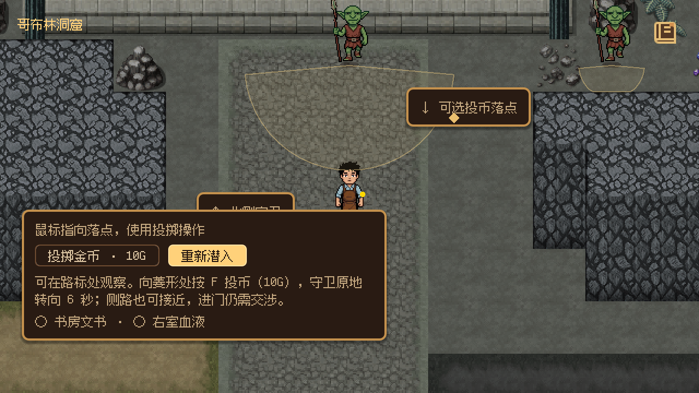
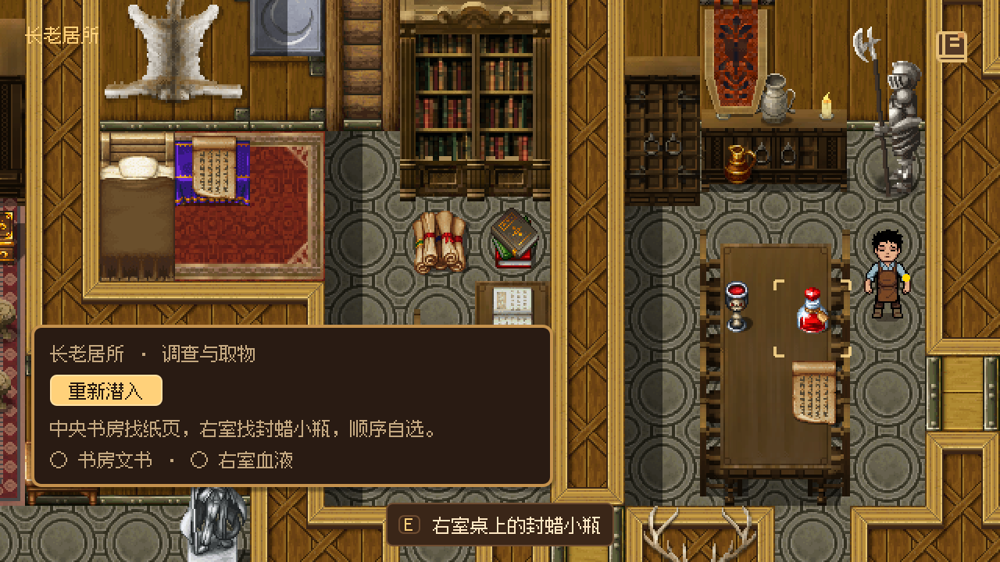
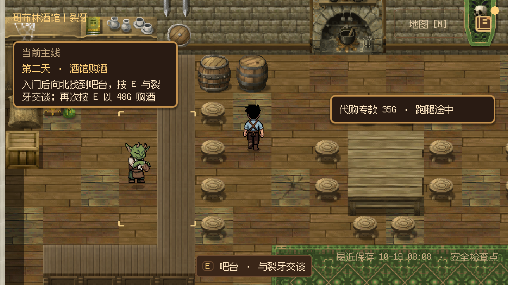
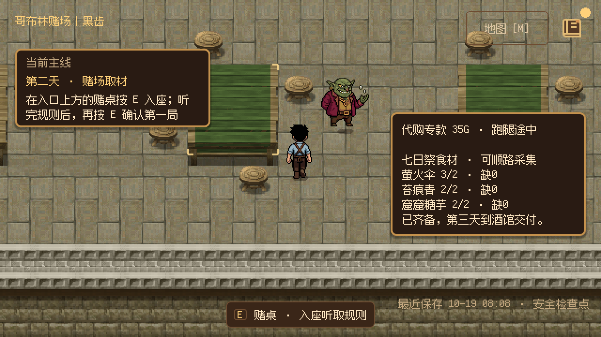
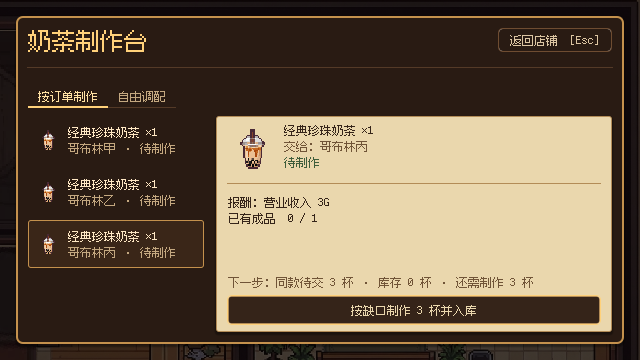

# RPG 流程优化 A–C 实施记录（2026-10-19）

按[新尺度评审方案](flow_and_level_review_rpg_scale_2026_10_19.md)实施 A、B、C 包。正式入口为 **F5 → 新游戏**，沿用 1.0 倍 RPG 镜头、120 步速及独立店内参数；D 包的中段阶段变化、熟路便捷返程仍等待真人计时，不在本次范围。

## 已落地的流程

| 包 | 玩家能观察到的变化 | 实现边界 |
| --- | --- | --- |
| A：对象与站位 | 外景返回后可自然选门；宅内书房纸页与右室药瓶各有对应角框；宅门拒绝时说明交涉方向 | 门检测圆只向外偏移 12 像素，通用半径不变；目标 Marker 同步；真实支付、文书阅读、血液库存与撤离条件保持 |
| B：调查与北侧 | 奶茶店招牌、集市方向牌；三调查点分屏逐步认识，乱序也认可；安全位置观察守卫与可选投币落点；双目标持续反馈 | 入口卫朝向道路，专属视距 96；其他三卫仍为 30；不设投币次数要求、不封侧路；整次重试复用原服务 |
| C：商业与制作 | 酒馆先走到吧台，再按 E 交谈 / 购酒 / 听委托；赌场在最近赌桌按 E 听规则、逐局确认；材料物件与缺口清楚可见；同款可一次确认制作总缺口 | 保留逐字对白、48G 购酒、两局固定结算与免债；真实扣料、入库、逐人交付沿用原事务 |

三处采集点继续靠近商业路线，萤火伞仅从墙格向下移动一格至 `(888, 1944)`。覆苔岩块、材料袋、菌丛直接裁取已导入的 `tileset_030_00.png`，各为原尺寸 48 × 48：region 分别为 `(1392, 288, 48, 48)`、`(960, 288, 48, 48)`、`(144, 336, 48, 48)`。没有生成新素材或重铺 TileMap。

醉卫遭遇区保留近身覆盖并延伸到南侧道路，避免角色碰撞把玩家挤出触发区。宅内两件物品可任意顺序取得，拿齐后仍须真实离宅、到北侧撤离区，再返回店铺。

## 接线与来源

- 酒馆站位 `(336, 264)`、矩形服务区 48 × 96；裂牙在吧台后 `(216, 312)`。柜台与 NPC 复用 `tavern` ID，第三天仍能从柜台前交付七日祭食材并得到一次 60G 奖励。
- 赌桌站位 `(648, 792)` 在桌右下通道，黑齿在 `(696, 744)`。交互 ID 为 `casino_table`，桌面角框贯穿规则与两次确认。
- [Day 2 正式工程](../story_authoring/day2_stages_01_05_project.json)修改六个事件的 trigger，再用 StoryProject 生成运行时事件与清单；29 个 Beat、稳定步骤 ID、对白、Phase、经济回执保持。Setup 移除酒馆介绍 / 委托及赌场介绍的自动启动；原远程购买 / 开局按钮移除。关店、雇佣仍由既有章节按钮处理。
- ChapterServicePoint 只声明阶段提示和可用性，仍经 ShopInteraction → StoryDirector / 原交付服务派发。没有在 UI 或 MainGame 新写剧情顺序。
- 七日祭持有量与缺口来自任务的原需求和共享库存。采集前后、消耗后、读档后都重新求值；提前采集进入原有“已经采过”对白分支。
- 按订单制作的 `craft_quantity` 是同款已接总缺口与可做数的较小值。UI 仅提交材料与杯数，TeaProduction 整批原子提交；未接订单不计入，已有成品先抵扣。三杯只需一次制作确认，仍须分别交给三人。

持续维护的说明已同步：[地图接线](../levels/rpg_maker/README.md)、[第二天步骤](../gameplay/day_02_flow.md)、[交互反馈](../gameplay/interaction_feedback.md)、[采集](../gameplay/gathering.md)、[制作](../gameplay/basic_tea_production.md)。

## 实际验证

本次采用模块与直接调用方验证。没有改变存档格式或经济事务，未运行无关全仓回归。引擎为 Windows Godot 4.7.2，画面使用 D3D12 Forward+、640 × 360 基准视口和 1280 × 720 窗口。

| 检查 | 实际结果 |
| --- | --- |
| `verify_rpg_chapter_maps.gd` | 176 项通过；原图块保持、四门左中右物理接近、目标 / 采集可达、真实感知覆盖、安全观察位与可投可听落点 |
| `verify_day1_world_flow.gd` | 48 项通过；宅内两种调查顺序、重读保护、双事实与真实物品后才显示撤离指引 |
| `verify_day1_playability.gd` | 60 项通过；实际按键、先发现岔路的乱序调查、真实步行与返店 |
| `verify_day1_stealth.gd` | 100 项通过；感知、投掷与局部重试模块 |
| `verify_order_board.gd` / `verify_order_ui.gd` | 66 / 39 项通过；总缺口、原料仅够部分、整批不足不扣料、一次制作三杯、重复确认拒绝与真实交付；UI 另做图形检查 |
| `verify_gathering.gd` | 92 项通过；原组件检查与正式三点的物理 E 采集、可站位置、当天去重、物件显隐、提前采集、消耗后缺口及快照恢复 |
| `verify_story_director.gd` / `verify_gameplay_bridge.gd` / `verify_tea_recipes.gd` | 165 / 249 项及配方检查通过 |
| `verify_two_day_flow.gd -- --ordinary-order --save-fixtures=…` | 231 项通过；从标题新游戏走完两天，含两种宅内顺序、整次潜入重试、真实购酒 / 赌局与第三天交接 |
| `verify_day2_playability.gd -- --from-save=… --captures=…`，图形 | 184 项通过；从真实营业检查点继续，用 E / Enter / Esc、实际步行采齐三处材料，到吧台与赌桌主动操作，覆盖已采集对白分支和守卫交付 |
| `verify_counter_service.gd -- --from-save=…/day3_handoff` | 19 项通过；真实第三天存档、夜晚采集、柜台前 E 提交材料、一次 60G 与重复拒绝 |
| 相关存读恢复 | wait_wine、purchased、wait_first、first_round、tavern_observe、tavern_commission、casino_observe 七个真实检查点，各在独立进程 8 项通过，共 56 项；三个新增等待现场由真实旅行与交易生成 |
| 正式工程与静态检查 | StoryProject 生成成功（29 Beat）；比较确认工程仅变更六个 trigger，35 份文本格式、196 处本地引用与 `git diff --check` 通过；最终编辑器无脚本解析错误 |

存档、检查点和过程截图均放独立验证目录，没有使用玩家存档。部分检查退出仍有对象 / 资源保留诊断：常见 2 对象 / 1 资源，配方检查为 9 / 4，编辑器为 495 / 10；断言结果与退出诊断分开记录。

通用 `verify_scene_travel.gd` 的 163 项中有 3 项“十个物理帧后移动距离”失败。在本次 A 包之前的 HEAD 对照运行，同样三项失败；本轮不扩大修复。第二天旧输入检查原先站在 NPC 下方 48 像素，超出现有半径与脚底之和约 0.5 像素；已改为真实可交互的 36 像素接近位置。旧采集宿主检查也已迁移到当前三点，不再用旧八点场景强转当前地图。

## 画面与试玩

下图均来自正式 Godot 宿主。北侧与宅内图为预置阶段的画面核对；商业图来自真实检查点继续后的图形按键 / 步行检查，制作图来自真实订单 UI 检查。对白自动推进，场景间旅行及部分靠近采用自动定位；这些结果不代替真人全程步行计时与听感验收。

手动体验用 F5 新游戏：首次出店识别招牌与三处调查，北侧从路标右下观察守卫，尝试主街与侧路；宅内先后交换取物顺序；第二天到吧台 / 赌桌按 E，先采材料再听委托；店内先接齐同款订单，再确认总缺口并逐人交付。应能看见对象、理解下一步，并由真实结果更新提示。

## Godot 4.7 依据

- [Area2D](https://docs.godotengine.org/en/4.7/classes/class_area2d.html)：检测的是区域与玩家身体的重叠，不能只用玩家中心与半径判断；验证等待物理帧。
- [CollisionShape2D](https://docs.godotengine.org/en/4.7/classes/class_collisionshape2d.html)：门口局部偏移、柜台矩形 shape 与玩家实体碰撞分别配置。
- [AtlasTexture](https://docs.godotengine.org/en/4.7/classes/class_atlastexture.html)：用 region 原尺寸引用已导入图集，保持通行 TileData 与源图块不变。
