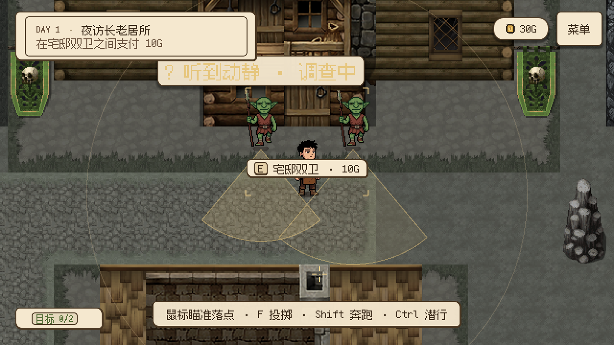

# 宅邸双卫移至真实门口（2026-10-24）

此前双卫实际位于长老门以西约四五个地图格的道路上，任务却称其为门口守卫。醉酒守卫的上一轮修复没有检查双卫与真实入口的空间关系，本次补齐。

| 对象 | 原位置 | 当前位置 |
| --- | --- | --- |
| 宅邸左卫与恢复锚点 `mansion_lure` | `(1704, 456)` | `(1944, 456)` |
| 宅邸右卫与恢复锚点 `mansion_gate` | `(1800, 456)` | `(2040, 456)` |
| 双卫支付点 `mansion_payment` | `(1752, 504)` | `(1992, 504)` |
| 真实入口 `elder_enter` | `(2000, 408)` | 不变 |

双卫现在分立门前两侧，中间保留通路。原图、碰撞形状、身份、感知职责、支付金额和出场条件不变，关卡角色位置与恢复锚点同步更新。

支付区移近入口后，与门的交互范围发生重叠。新增局部 `mansion_payment_point.gd` 只消费既有 `day1.s05.guard_payment_completed` 事实：付款后禁用支付交互，让真实门接管 E；支付仍由原剧情和交易系统结算，重建场景时也不会恢复一个已支付交互点。

正式剧情工程的 `step_10077` 放行提示改为“从双卫中间向北上台阶，按 E 进入长老居所”，不再要求向东寻找门。使用 `edit_story_project.gd --save` 生成运行时 Story 与 Beat 清单散列，未改变事件顺序、对白、条件或时长；场景交互说明同步更新。

## 实际验证与试玩

- 修改前，工程与产物一致性检查通过；修改正式工程后重新生成，30 个 Beat 检查通过。
- `verify_mansion_guards.gd` 无头专项及 OpenGL 实际渲染通过（图形模式 31 项）。验证双卫紧邻并分列真实入口、站位可通行、支付点位于两人之间、从醉酒守卫附近实际沿地板路径走到支付点、按 E 支付只扣 10G、付款后支付点不抢焦点、从两人中间走到门前按 E 进屋、实际出屋后双卫恢复新位置且不重复扣款。
- 门图位于墙体格，玩家从其南侧可行走的台阶范围按 E，不传送进门的墙体格冒充步行验证。
- `verify_drunken_guard.gd` 与 `verify_two_day_flow.gd` 通过，覆盖醉酒守卫送货与两天完整流程。
- 编辑器导入退出码 0；测试／编辑器退出仍有资源清理诊断。未运行全项目回归，本次为局部站位、提示和支付点可用性调整。

F5 接受第一天委托，夜间与醉酒守卫交涉后，按当前目标到长老门前。两名守卫应站在门两侧；在两人中间偏南处按 E 支付，随后向北上台阶按 E 进屋。

位置与锚点按 [Godot 4.7 Node2D](https://docs.godotengine.org/en/4.7/classes/class_node2d.html) 的局部／全局坐标约定处理；验收比较真实场景中的 global_position，而不只核对静态配置。
