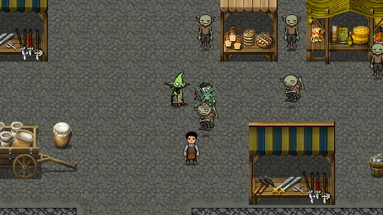
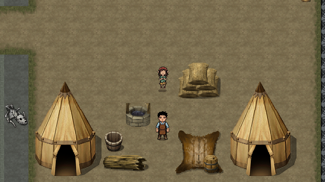
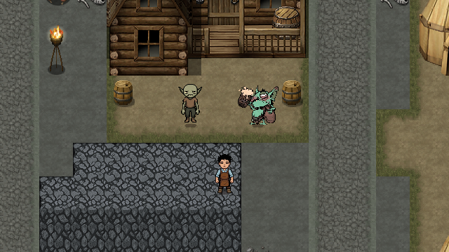

# 两天新稿、聚落补充与试玩反馈修复

2026-10-20，Godot `4.7.2.stable.official.ed1daf0bf`，Windows / Compatibility。正式入口为 F5 → 新游戏。按[最新两天与补充稿](../design/story_source_update_2026_10_19.md)及[反馈原件](../design/source/playtest_feedback_2026_10_20.xlsx)实施；附件中的备注作为需求资料核对。

## 正式流程

| 内容 | 当前实现与边界 |
| --- | --- |
| 第一天来客 | 人类顾客后接待五位哥布林：`goblin_customer → goblin_a → goblin_c → goblin_d → goblin_e`。每人实际接单、制作、交付、离店，上一位离店后下一位入场。六杯 H01 每杯 3G，合计 18G。旧 `goblin_b` ID 保留兼容，新流程不发布该订单。 |
| 胖哥布林新增试饮 | 普通订单赞叹后，按新稿播放哥布林食材提议和赠品；进入 `day1.s04.wait_taste` 交还控制。玩家制作并交付 `day1_trial_milk_tea` 才续播供料承诺、信仰与委托。试饮不收费，显式奖励为 0G。 |
| 试饮用料 | 沿用三槽系统：植脂末奶茶底、萤火伞、纯正哥布林老火烧各一次。赠送后两种各两次用量；试饮消耗各一次。误耗且没有成品时，菜单提供“补领缺少的试饮用料”，只补缺少的异世界用料。 |
| 第二天购菇与 S06 | 专款直购、个人钱包实购、雇佣代购返回均记录真实购买。仅第二天允许共享新稿对白及「醒菇薄荷特调」发现，沿用已有一次性 150G 奖励。免费采集和第三天取得原料不能补发配方；已发现配方后续仍可查看、制作。 |
| 专款结算 | 35G 与个人钱包分开。亲自代购支付 30G、余 5G 退委托人；雇佣支付 30G 货款和 5G 跑腿费，当晚返回。保留原八字段专款存档结构，旧第三天返回的存档仍可读。 |
| 救治与交接 | 第二、三天均可救治，独立于 S06 发现资格。两个交接入口共用真实完成事实，避免重复扣料；只消耗醒神菇一次用量，整份五次用量尚余四次。 |
| 雇佣菜单 | 去掉标题“暂未开放”；临时跑腿委托可用，长期雇佣按钮维持原能力边界。 |

正式来源为三个 `*_project.json`，使用 `tools/story/edit_story_project.gd -- <工程> --save` 生成运行时数据及散列。新增等待阶段的 phase、恢复摆位、安全检查点均已同步，未把演出顺序放进宿主脚本。

- [首日来客工程](../story_authoring/day1_stages_01_02_project.json) / [步骤映射](../story_authoring/day1_stages_01_02_bridge.json)
- [首日后四阶段工程](../story_authoring/day1_stages_03_06_project.json) / [步骤映射](../story_authoring/day1_stages_03_06_bridge.json)
- [第二天工程](../story_authoring/day2_stages_01_05_project.json) / [步骤映射](../story_authoring/day2_stages_01_05_bridge.json)

## 聚落补充与素材

九组 NPC 原文均已接入：集市母子、赌场侍卫三选项、赌场诗人、酒馆买醉者、酒馆外哲人与醉鬼、祭坛两人、仓库双卫、村庄小孩、军营军人。接委托开放探索后，靠近对应人物按 E 交谈；原文的内心和叙述分别显示，做鬼脸的叙述没有改成新台词或借用不相符的动作。

母亲使用成年女哥布林美术的独立实例 `market_mother`，与祈祷同伴分别注册；男孩为 `market_boy`，女孩为居民区的 `village_child`。母子位于集市，小孩位于东侧居民区，站位和接近路径已按原地图通行查询核对。

祭坛同伴 `prayer_woman` 的外观当日晚按反馈回退：立绘与像素小人统一回到 `祈祷者(1).zip` 女，up 方向改用背向待机，妇女2 只留作归档。细节与复现命令见[祭坛同伴外观回退](../assets/characters.md#祭坛同伴外观回退2026-10-20-晚)。

三名小贩各有原文三条商品介绍，附近菜单提供对应实购入口，沿用既有报价。六种原料均有免费采集点，采集提交成功后才显示原文获得描述；同日不能重复采集。新增三点使用对应原料图标，原有三点保留。

本轮六个 ZIP 共保留 46 张原 PNG，涵盖八类可复用角色；其中两酒鬼正式显示使用最后提供的 `酒鬼（改后(1).zip`，旧版原图留在 source，修订版位于 source/revised。每个原件的归档条目、路径及 SHA-256 见各角色 `source/sources.json`。附件未附独立许可证，来源记录按用户提供素材保存。

统一按实际透明包围框等比、最近邻生成 64px 帧画布，保留源图。成年人最高 58px，男孩 44px、女孩 50px，脚底对齐。女孩原图把多个方向混在 4×2 网格中，按方向分别选帧；男孩的弹弓、坐姿和抛石子保留为独立动作。缺少方向行走的长者和酒鬼只用于静止场景，不把待机当成完整行走素材。详细映射和复现命令见[人物接入](../assets/characters.md#2026-10-20-聚落补充角色)。

## 潜行可通过性

室外正式守卫配置调整为 96–120 世界像素视距、40°半视锥；主街听觉从 264 缩至 120，入口与主街发现宽限 2 秒，双卫 1.8 秒，入口投币分心 5 秒。HUD 提示 Ctrl 安静潜行和 R 重试。保留先前移除的浮动路标及宅内潜行结果；宅内文书、血液调查与出门仍正常。

`verify_chapter_stealth_route.gd` 用真实移动输入、碰撞、投币和付款完成下列路线：店门 → 主街东侧 → 北侧观察位 → 投币引开入口卫 → 醉卫交涉 → 双卫付款 → 入宅调查文书和血液 → 出门步行返回观察位撤离。测试没有用传送完成通路。

71G 开始，只投一枚金币（10G）并支付两笔 10G，撤离后余 41G。重试恢复任务开始时的 71G、守卫和两房间事实；另实投七枚金币耗至 1G，再重试仍恢复 71G。玩家可从失败或资源不足的尝试重新开始。正式流程的整次恢复沿用已有任务快照机制。

试玩时按住 Ctrl 绕视锥，鼠标瞄落点、F 投币；到醉卫及双卫处完成交涉，宅内按 E 调查。失败或用光金币时按 R，观察余额与任务状态回到本次潜入起点。

## 实际验证

以下各批独立计数，不相加。日志及真实检查点位于 `.godot/supplement_*`，不入库。

| 检查 | 实际结果 |
| --- | --- |
| 两天正式流程，headless | 359 项通过；从新游戏到第三天交接，含新增逐位来客和试饮等待。 |
| 两天流程，真实图形上下文 | 526 项通过；生成 33 个真实自动存档与流程截图。 |
| 独立新进程恢复 | 33 / 33 个检查点通过，比较完整状态；覆盖新增逐位顾客和试饮边界。 |
| 首日真实按键 / 步行 | 108 项通过。 |
| 潜行实走及耗尽重试 | 36 项通过。 |
| 专款代购 / S06 | 84 / 188 项通过；含日期、真实购买、独立救治、重复发现及奖励防重。 |
| 营业、采集与订单模块 | 调度 191、反馈 75、采集 107、订单板 116、订单 UI 45、正式地图 216 项通过。 |
| 最后补入儿童与修订酒鬼 | 四项定向复查全部通过：补充内容 1001、两天主线 359、首日按键 / 步行 108、潜行 36 项。补充内容包含第一、二天实际宿主。 |

首次完整 `tests/run_all.py` 执行 107 项：68 PASS、31 FAIL、6 SKIP、2 HANG。随后修复并定向复查本次受影响的调度、订单、采集、首日和潜行测试。剩余旧测试与 `d1231020` 未修改代码隔离对照：所查 25 项中原代码也有 24 项失败，包括旧五单 / 10G 假设、旧宿主、图鉴、地图快照、UI 结构与钱包测试夹具；开发工具一项在基线通过，首次失败未稳定复现。退出资源未释放诊断单独记录，不写成完整回归全绿。

未执行 Release 导出和人工完整两天通关。图形截图与脚本驱动的真实输入检查已执行。

本轮核对的官方接口入口：[Area2D](https://docs.godotengine.org/en/4.7/classes/class_area2d.html)、[SpriteFrames](https://docs.godotengine.org/en/4.7/classes/class_spriteframes.html)、[AnimatedSprite2D](https://docs.godotengine.org/en/4.7/classes/class_animatedsprite2d.html)。当前网络请求这些页面返回 403，未将在线查阅记为成功；具体帧资源、碰撞重叠和播放行为以 Godot 4.7.2 的实际检查为依据。
