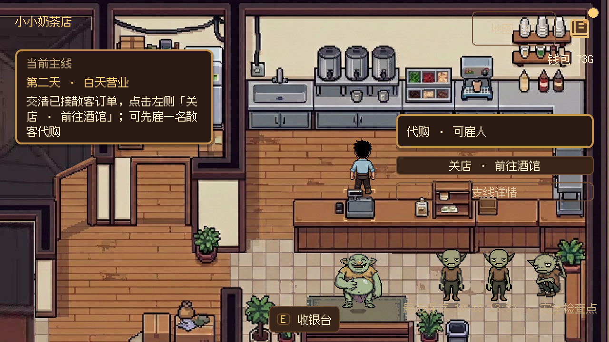
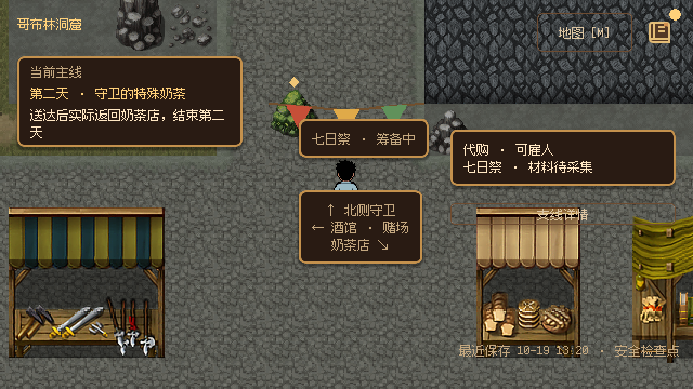
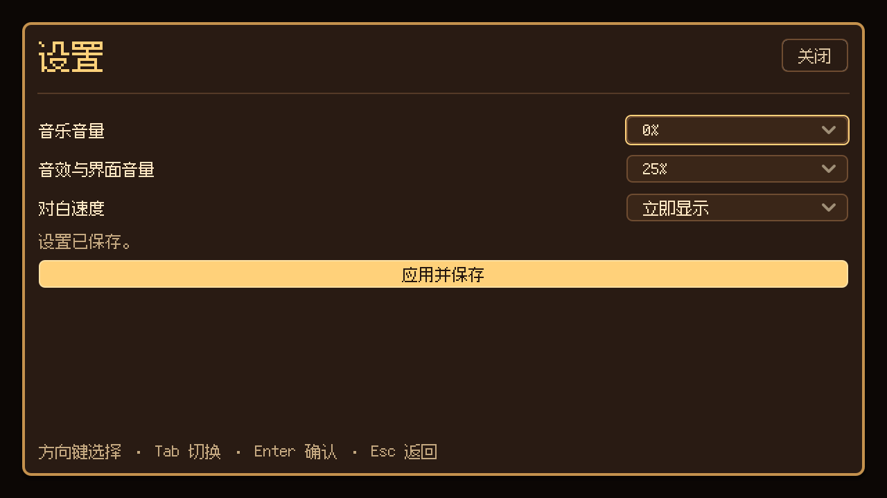

# 前两天体验补完（2026-10-19）

> 后续 UI 已按用户反馈收敛为单行目标与右上角菜单；下文右侧摘要／展开描述是本轮历史结果，现行行为见[轻量常驻 HUD 与统一菜单](compact_game_menu_2026_10_19.md)。

基于已打通的前两天与[流程优化 A–C](flow_optimization_abc_2026_10_19.md)，按本次体验评估依次补完六项，再整理制作入口与基础设置。正式入口仍为 F5 → 新游戏／继续游戏。

## 实际改动

1. **屏幕信息。** 右侧支线默认只显示代购与七日祭摘要；已完成的专款不常驻展示，雇佣选项收进支线详情，关店与取消已接试饮仍直接可见。进入酒馆或靠近采集点时展开材料详情；展开区域可滚动，键盘焦点自动进入可视区。
2. **第二天自由实验。** 散客 C 增加独立可选试饮：植脂末奶茶底、带辛辣风味，可使用第一天赠送的老火烧。自行选料、确认永久报价、制作、交付，按真实报价付款并显示评价；原有 H01 订单保留。顾客会等到已接试饮结算后再离场，未交清前不能雇走该顾客或关店。可主动取消试饮，避免原料耗尽阻塞主线。未接取不影响营业与最低购酒预算。
3. **熟路变化与返程。** 第二天开始，商业岔路出现祭典彩旗与筹备标识，不改变 TileMap 或碰撞。守卫招待完成后，原位置附近出现“直接返店”；也可继续步行。便捷返回经过 SceneTravel、真实出生入口与返店事实，不跳过第一晚撤离或守卫交付。
4. **关键演出。** 首夜增加任务标题；血液特调保留原台词和旁白，只拆开原对白的第一句与异常段，在异常发生处接入原有撞击声、轻震与主角惊讶表情。守卫试饮接入瓶声、表情和人物记录解锁声。没有补造专用倒地动画。
5. **赌场。** 两次主动开局分别展示赌约／开局与真实败局／胜局，免债后再显示赌约解除。沿用 TitleCard，停留 0.9–1.0 秒、前后各 0.4 秒淡变；没有新骰子规则、随机输赢或额外扣款。
6. **章末收获。** 真实返店并完成第二天后，显示实际交付订单数、当前余额、自创饮品与人物记录数、既有谜团。关闭后继续第三天已有委托，明确后续主线尚未开放；确认标记进入现有快照，后续继续游戏不重复展示。
7. **制作入口。** 直接使用“订单制作／已知配方／自由实验”三个页签，隐藏旧的内层重复页签。固定订单默认订单制作、只有自由饮品待制时默认自由实验、没有订单时默认已知配方；手册配方回填仍有效。
8. **基础设置。** 标题与暂停共用设置页。音乐及音效／界面音量支持 0／25／50／75／100%，对白支持慢／标准／快／立即显示。点击应用才保存，关闭放弃未应用选择。`user://preferences.cfg` 独立于游戏存档，新游戏不会清空；暂停内返回设置保持暂停，直接解除暂停也会清理嵌套设置页。

剧情内容仍以三份正式结构化工程为准。本轮修改后两份工程并通过 StoryProject 重新生成 JSON 与 Beat 清单；对白没有增删字句。GameState、库存、经济快照版本及主线价格不变，新增的是正式可选任务与现有 flags 中的回顾确认标记。

## 验证

Windows Godot 4.7.2；图形检查使用 OpenGL Compatibility、640×360 逻辑视口、1280×720 窗口。全部业务与恢复检查使用隔离目录，没有操作玩家正式存档。

| 检查 | 本轮结果 |
| --- | --- |
| 两份正式编排工程生成与产物一致性 | 16／29 Beat 通过 |
| 完整两天流程 | headless 304 项、最终图形 415 项通过；含原有可选 H01 与章末回顾 |
| 冷恢复 | 从最终图形流程取得 20 个自动存档，分别在新进程恢复，169 项通过 |
| `verify_two_day_polish.gd` | 图形 47 项通过；覆盖真实试饮、取消、顾客等待／离场、五张赌场结果卡、便捷旅行、章末回顾、暂停设置与输入恢复 |
| 第二天真实按键／步行 | 243 项通过；包含键盘展开支线并雇佣、三种制作入口、吧台／赌桌交互、守卫交付与真实返店 |
| `verify_player_preferences.gd` | headless／图形各 11 项通过；配置恢复、错误值保护、新游戏保留、静音、立即显示与标题返回焦点 |
| 订单／制作／营业 | OrderBoard 66、OrderUI 39、TaskDelivery 69、FreeRecipes 295、BusinessScheduler 188 项通过 |
| 地图／UI／对白 | RPG 地图 179、UIManager 47、Dialogue 170 项通过 |

后续的最终界面收尾增加了支线雇佣折叠与滚动；图形专项及第二天真实输入检查再次验证这一变更。完整流程与冷恢复记录证明各自运行时的版本，未为纯显示收尾重复全部两天流程。

以下结果单列，不计为通过：

- AudioManager 为 64 项中 4 项声音数量断言失败。临时去掉本次 `PlayerPreferences.apply_audio()`、恢复提交前的 AudioManager 源码后，同四项仍失败；恢复后的文件只保留本次音量接入。旧夹具未计入后来启用的场景音景，本轮不扩大修复。
- UI Theme 为 245 项中旧 `inventory_body.tscn` 缺共享主题一项失败；本次新增的回顾页主题遗漏已修复，重新检查只剩上述既有项。该旧问题也记录于[上一轮体验打磨](experience_polish_2026_10_19.md)。
- 部分模块退出仍有 ObjectDB／资源存活诊断；图形完整流程未报脚本错误。未执行无关全仓回归、Release 重新导出、真人完整阅读／步行计时或人工听感，不据自动化断言宣称主观体验已验收。

## 试玩

1. F5 标题打开设置，修改并应用；重启后检查保留。游戏中 P → 设置，Esc 应返回暂停，再 Esc 恢复游戏。
2. 第二天营业时在订单板接散客 C 的可选试饮，到“自由实验”选择奶茶底与老火烧、确认报价并制作，再交给散客 C。可先交原 H01 验证顾客继续等待，也可取消试饮。
3. 出店经过商业岔路看祭典布置；酒馆／采集附近查看支线详情；赌场逐局按 E，观察开局、胜负与免债展示。
4. 完成守卫招待，选择“直接返店”或步行回店。应播放章末，显示真实成果；关闭回顾后可办理第三天已有委托。

图形截图与运行日志保存在忽略目录 `.godot/two_day_polish/`。测试入口分别为 `verify_two_day_flow.gd`、`verify_two_day_polish.gd -- --fixtures=<真实检查点目录>` 与 `verify_player_preferences.gd`，带 `--capture` 可生成专项画面。

## 画面

## Godot 4.7 依据

- [ConfigFile](https://docs.godotengine.org/en/4.7/classes/class_configfile.html)：偏好独立保存，保存错误保留已生效值。
- [AudioServer](https://docs.godotengine.org/en/4.7/classes/class_audioserver.html)：按 Music、SFX、UI 总线控制音量／静音。
- [Button.autowrap_mode](https://docs.godotengine.org/en/4.7/classes/class_button.html#class-button-property-autowrap-mode)：长章节按钮按固定侧栏宽度换行。
- [Control](https://docs.godotengine.org/en/4.7/classes/class_control.html)：焦点、原生选项框与现有 UIManager 模态栈；标题不显示后台焦点控件。
