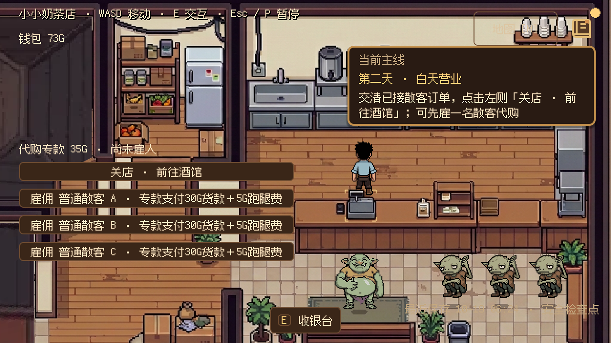
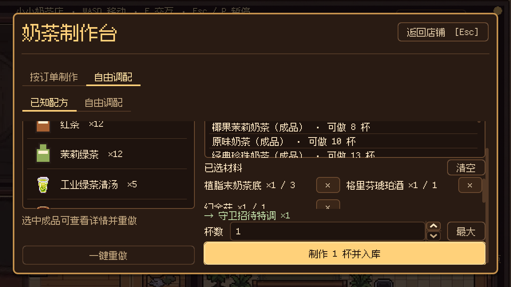
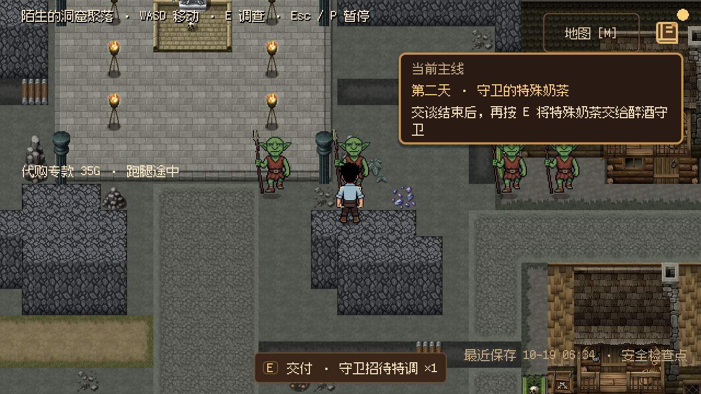

# 第二天完整流程与试玩

核对日期：2026-10-19，Godot 4.7.2。正式入口为 F5 → 新游戏，或标题页“继续游戏”。第一晚章末结束后自动进入第二天早晨；已处于第二天安全检查点的存档可以直接继续。

第二天已接通五阶段主线目标、柜台交付与配方键盘操作；最新[流程优化 A–C](../development/flow_optimization_abc_2026_10_19.md)将酒馆 / 赌场改为到对象前按 E 主动推进，增加顺路采集反馈和同款缺口批量制作。完整整合背景见[两天整合记录](../development/two_day_integration_2026_10_19.md)。

## 玩家步骤

左上角主线卡随真实进度更新。J 打开任务手册，M 查看聚落地图；对白使用 E / Enter / 空格推进，弹窗用 Esc 关闭。关店与雇佣使用章节按钮，酒馆 / 赌场操作在世界中的吧台 / 赌桌进行。

| 阶段 | 操作 | 可观察结果 |
| --- | --- | --- |
| 早晨委托 | 听取胖哥布林的代购委托 | 35G 专款独立保管，主线切到白天营业 |
| 白天营业 | 收银台按 E 接单，制作台按单制作，携杯回柜台按 E 交付；依次接待七日祭、长老、使者、传闻四组客人 | 前三组各一杯 H01，最后一组两杯，分别交给指定顾客；制作不自动交付 |
| 手动关店 | 可先点击雇佣散客代购；完成全部剧情订单并交清已接散客订单后，点击左侧“关店 · 前往酒馆” | 进入夜晚，目标提示前往酒馆；接待五杯本身不会自动关店 |
| 酒馆购酒 | 进门后先行走观察，向北到吧台前按 E 与裂牙交谈；再次按 E 购买，购酒后再按 E 听委托 | 实付 48G，获得一份琥珀酒（五次用量）；七日祭委托承认已采材料并显示持有量与缺口 |
| 两局赌场 | 到西南赌场，靠近入口上方最近的赌桌按 E 听规则，再分别按 E 确认两局 | 第一局产生十杯债务，第二局取得材料并免除债务；结果在同一赌桌附近揭示 |
| 守卫特调 | 离开赌场返回店里，制作台按 E，在“已知配方”选择“守卫招待特调”，制作一杯 | 配方使用植脂末奶茶底、格里芬琥珀酒、幻金菇；成品进入共享库存 |
| 送达与返店 | 带杯出店，到长老居所支路的醉酒守卫处按 E 交谈，结束后再按 E 交付，最后实际返回奶茶店 | 招待不收钱；章末独白后进入第三天早晨 `day3.handoff` |

柜台优先选择可交付顾客，其次为收银台；没有订单的陪同者不再挡住接单。此规则仅用于柜台同组目标，面向制作台仍选择制作台。

夜晚三处材料点有对应的覆苔岩块、材料袋和菌丛，采后物件与标记一起消失。七日祭接取后显示当前持有份数和缺口；消耗共享库存会重新增加缺口，第三天仍在酒馆柜台前按 E 交付，奖励 60G。初日三人组或第二天最后两人组可先接齐同款订单，再一次确认制作当前缺口，交付仍逐人进行。

没有已接饮品订单时，制作台默认打开“已知配方”，因此守卫尚未接受交付时也能先制作特调。仍有其他饮品订单时，可从外层“自由调配”进入内层“已知配方”。列表用鼠标或方向键选择，Tab 移到按钮、Enter 确认；内容较长时滚动查看，焦点移到确认按钮会自动将它滚入可见区域。

制作特调不会跳过守卫交谈，也不会完成交付。交付后必须走回店门触发返店，不能仅靠等待推进日期。代购为可选委托，雇佣从专款支付，第二天雇佣者次日返回；第三天完整剧情仍未制作。

## 主线与存档

新增 `day2.main.morning / business / tavern / casino / guard` 五项任务，全部读取现有剧情、交付与旅行事实，没有新增推进剧情的伪造开关，也没有修改对白、经济数值或存档格式。

旧版第二天存档缺少这些任务的终态记录时，既有目录绑定机制会依据保存的完成事实补记；原有任务结果、金钱、库存、回执和剧情阶段保持一致，单纯继续游戏不重写检查点文件。新版生成的存档按完整快照精确恢复验证。

## 实际验证

最新批次：完整两天流程 231 项、第二天实际按键 / 步行图形检查 184 项通过；包括提前采集分支、主动吧台 / 赌桌与真实守卫交付。第三天吧台材料交付 19 项通过。其他检查、图示、存读恢复与边界见[实施记录](../development/flow_optimization_abc_2026_10_19.md)。下表保留此前批次结果，不与最新结果合并计数。

存档与截图使用独立 `/tmp` 目录，未操作玩家存档。图形环境为 macOS / Compatibility，逻辑视口 640×360、窗口 1280×720。

| 检查 | 结果 |
| --- | --- |
| `verify_day2_playability.gd`，headless／图形 | 128／163 项通过；从改动前真实存档继续，覆盖四组五杯、真实键盘接单／制作／交付、雇佣、关店、购酒、两局、特调、守卫交谈门槛和返店换日；图形另含 35 张截图 |
| `verify_two_day_flow.gd -- --ordinary-order --save-fixtures=…` | 218 项通过；从新游戏经过第一天、潜入与自动换日进入第二天，含可选散客订单，生成 20 个真实检查点 |
| `verify_two_day_persistence.gd`，逐个独立进程恢复新版检查点 | 20 个检查点、169 项通过；精确比较完整状态，覆盖第二天各等待边界、第三天交接和第四天过期 |
| `verify_day1_playability.gd`，headless | 60 项通过；收银台交互、首单键盘操作、实际步行调查与返店 |
| `verify_order_board.gd`／`verify_order_ui.gd` | 63／41 项通过；陪同客让出收银台、可交付顾客优先、制作台选择及订单 UI |
| `verify_task_system.gd`／`verify_task_panel.gd` | 196／92 项通过；新增目录、投影与任务显示仍兼容 |
| `verify_day2_procurement.gd`，本轮改动前基线 | 53 项通过；本轮随后用第二天实际按钮流程覆盖雇佣与次日返回 |
| headless 编辑器导入、格式与链接 | 无脚本解析错误；`git diff --check` 与本次文档相对链接检查通过 |

部分任务／UI／恢复测试退出时仍报告 ObjectDB 与资源未释放；两天流程及部分恢复为 2 对象／1 资源，代购交接／过期为 4／2，订单 UI 为 12／5，编辑器导入为 495／10。与既有基线一致，未在本次定位；断言通过与退出诊断分开记录。旧版 `wait_special` 存档曾因新增四项主线终态不满足“字典完全相等”而触发一次严格比较失败；逐字段检查确认只有这些补记，未放宽原精确恢复测试，新版 20 个检查点全部按原断言通过。

下图分别为五杯营业后的关店指引、滚动到确认按钮的特调配方，以及守卫交谈后可交付状态。守卫图已随长老区三段路障删除更新，现行通行约定见[场景连接约定](../design/scene_connections.md)。







复测先生成真实营业检查点，再从中继续，避免直接伪造第二天状态：

```sh
godot --headless --path . --script res://tests/verify_two_day_flow.gd -- --ordinary-order --save-fixtures=/tmp/goblin_day2_flow
godot --headless --path . --script res://tests/verify_day2_playability.gd -- --from-save=/tmp/goblin_day2_flow/wait_festival
```

第二条去掉 `--headless` 并增加 `--captures=/tmp/goblin_day2_captures` 可生成画面。精确恢复验证入口为 `tests/verify_two_day_persistence.gd -- <检查点目录>`。

输入验证通过真实 UIManager、E 交互、Enter 按钮确认和 Esc 关闭；测试会将角色定位到交互点附近，且加速对白，没有覆盖真人全程步行与主观听感。未运行无关模块全仓回归或正式 Release 导出。

## 官方 API 依据

本次核对 [Godot 4.7 TabContainer.current_tab](https://docs.godotengine.org/en/4.7/classes/class_tabcontainer.html#class-tabcontainer-property-current-tab)：容器根据当前页管理子控件可见性，默认页通过容器 API 切换，避免手动显示子页与容器选择冲突。已知配方沿用原生控件输入，模态取消、焦点和玩家输入锁继续交给 UIManager。
