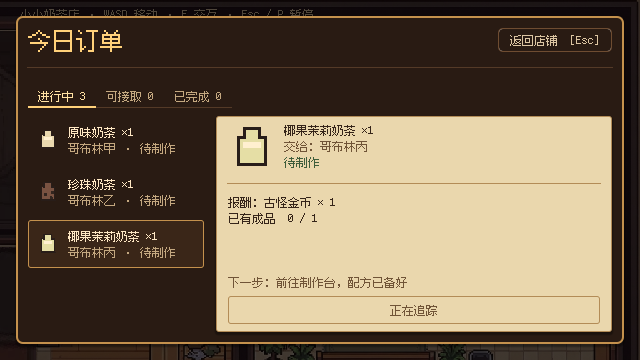
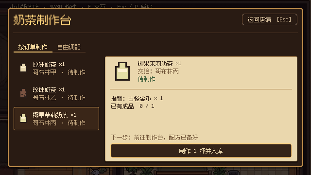
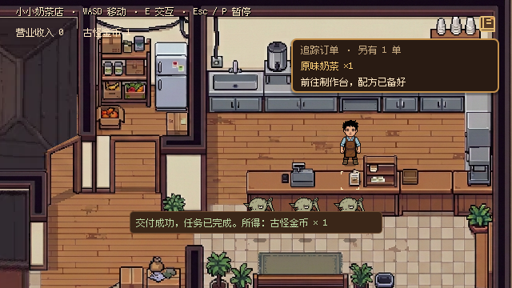

# 订单板、按单制作与交付追踪

当前实现以 640×360 为逻辑布局基准，订单板和制作台共用暖纸订单笺；正式入口为 `src/core/main.tscn`，独立主题画廊为 `src/debug/ui/ui_kit.tscn`。本文更新至 2026-10-19，原三单制作队列仅保留兼容用途。

## 玩家流程

1. 到订单板按 E 查看。查看只记录 `shop.orders_viewed`，不会接单，也不会提前揭示剧情订单。
2. 从“可接取”选择一张订单点“接取订单”，或直接点顶部“一键接单（N）”按顺序接取当前全部可接饮品订单。接取后立即进入“进行中”并追踪这单；剧情已明确接取的订单直接显示进行中。奶茶订单板只列饮品订单，物资委托留在任务日志。
3. 到制作台按 E，有已接饮品订单时默认进入“按订单制作”。选中追踪订单，配方自动带入，确认“制作 1 杯并入库”。成功后杯子轻弹、显示实际制作结果和“制作完成 · 已入库”；已有足够成品时按钮为“返回店铺，去交付”，经原模态关闭流程返回，下一步明确接收人和 E 键。缺料、配方未解锁或库存满时不能提交，订单笺显示具体原因。
4. 无已接饮品订单时，制作台直接显示“已知配方”，可制作先备料、后交谈的剧情特调。有订单时也可直接切换“已知配方”，它提供材料、配方、杯数和最大数量，见[初级制作](basic_tea_production.md)；“自由实验”是三槽动态配方与加冰，见[自由配方](free_tea_recipes.md)。配方列表、页签和确认按钮均沿用原生键盘导航。
5. 携带成品接近指定顾客，提示变为“E 交付 · 饮品”。按一次 E 完成真实交付与结算，短提示显示实际所得，店铺钱包短暂显示本次金额变化；失败显示原因，操作保持原子性。读档／新游戏清除金额动效，不将余额恢复表现为新收入。
6. 在收银台按 E 会一次结算全部“进行中且已备好”的奶茶订单，走与 NPC 交付相同的 `TaskDelivery.try_submit()` 原子结算，不会重复发钱；没有可结算订单时照旧回落到收银台自身的交互优先级。交付结果同时进入奶茶订单页与任务日志。

订单可自由安排顺序。制作只增加共享库存，不完成交付，也不为某张订单预留成品。一杯饮品可以让多张订单同时显示可交付；交出后其他订单立即重新计算。物资委托显示持有量与缺口，不进入按单制作列表。



## 界面与输入

- 订单板默认打开“进行中”，无进行中订单时打开“可接取”。页签只有“进行中”和“可接取”两个：完成、失败、取消的奶茶订单不再占列表，而是归档到菜单的“奶茶订单”页。左侧约 176 像素列表只展示饮品、顾客和状态；右侧显示报酬、持有量、缺口、下一步和固定主按钮。
- 选择与库存刷新保留当前订单及列表滚动位置。鼠标选择，方向键切换列表，Tab 访问页签和主按钮，Enter 确认；Esc 返回店铺。P 暂停覆盖当前弹窗，恢复后回到原焦点。
- HUD 复用 TaskHUD，一次显示一张追踪订单及其他进行中数量。非交付主线正常优先显示。手册任务详情读取同一订单投影。
- 追踪订单完成或失效后，显示其他可交付订单，其次显示待准备订单；主动选择的有效订单优先。
- 柜台内可交付顾客优先，其次为收银台；没有点单的陪同顾客也让出收银台操作。此优先级只用于同一柜台交互组，不覆盖附近制作台的空间选择。
- 木框、暖纸、深棕文字与黄铜按钮来自 `ui_tokens.gd` 和生成的 Theme variations。饮品图标复用现有库存素材。ModalShell 和 UIManager 继续负责关闭、焦点和输入锁。



## 服务与状态契约

`Systems/OrderBoardModel` 是场景内可丢弃的只读投影，`configure(catalog, journal, state, inventory, production, delivery)` 注入已有服务；`get_entries()`、`get_entry(order_id)`、`get_task_entry(task_id)` 和 `get_tracked_entry()` 返回深拷贝，变化通过 `changed` 通知。投影组合真实任务可见性、接取事实、库存、配方、奖励与回执，界面不解析拼接文案或维护独立进度。

顶层状态为 `available / active / completed`；进行中阶段为 `prepare / missing_materials / recipe_locked / collect / ready`。完整条目还包含需求及持有量、缺口、配方材料、可制作性、顾客名称和下一步提示。

UI 经信号提交请求，由 MainGame 调用 `TaskDelivery.accept_order()`、`TeaProduction.craft()` 或修改 `GameState` 的 `ui.tracked_order_id`。显式接取重复返回 `ERR_ALREADY_EXISTS`；剧情接取事实仍有效。手动追踪随现有快照保存；自动候选在读取时计算，不在场景装配、整体恢复或交易通知中偷偷写入状态。

`TaskDelivery.deliver_to(target_id, preferred_order_id = "")` 优先提交已接取且可交付的指定订单，否则按目录稳定顺序选择可交付订单。未接订单不阻挡已接订单；没有可交付订单时给出当前已接订单的具体缺口。指定顾客的剧情路由仍先执行。

共享会话仍通过现有 GameState、WarehouseInventory 和 WalletTransactions 原子结算，完成以 `delivery.<order_id>.completed` 回执为准，失败不扣物、不发奖。旧快照与 TeaProduction 固定队列接口保留；正式订单不依赖队列下标或全局制作杯数判定单笔完成。Day 1 前两阶段的全局杯数目标已替换为同源的接取／备齐／交付展示。

## 试玩与验证

2026-10-19 的改前／改后截图、37 项订单图形检查和两天回归见[体验打磨记录](../development/experience_polish_2026_10_19.md)。下方较早的验证记录保留其原始时间与环境。

F5 新游戏沿用 Day 1 剧情。进入三名哥布林订单阶段后，按“丙→甲→乙”接取、制作和交付，观察库存、任务和报酬；关闭订单板后 HUD 应提示当前下一步。F6 `src/core/main.tscn` 可运行真实店铺；F6 UI Kit 可查看独立订单笺。

自动界面验证使用真实店铺，并设置三单阶段检查点。运行：

```sh
godot --headless --path . --script res://tests/verify_order_board.gd
godot --path . --script res://tests/verify_order_ui.gd -- --capture
```

第二条需要图形环境，截图输出到 `.godot/order_*.png`。覆盖显式接取、键盘确认、自由顺序制作、真实 E 交付、非模态反馈、追踪切换、Esc 与 640×360／1280×720 布局。状态测试还覆盖共享成品、同顾客多单优先级、未接单跳过、缺料、配方锁定、物资委托、奖励容量拒绝、快照恢复与重复结算。

图形实测使用 Godot 4.7.2、Windows D3D12 Forward+。相关完整回归覆盖任务、制作、交付、库存、钱包、共享会话、UI 管理、场景切换、Gameplay Bridge 和 Day 1。部分 headless 测试退出时存在资源释放诊断；测试断言与这些退出诊断分开记录。未执行正式 Release 导出。

2026-10-18 本次实测记录：

| 检查 | 结果 |
| --- | --- |
| `verify_order_board.gd` | 57 项通过 |
| `verify_order_ui.gd`，图形模式及截图 | 33 项通过，已检查 640×360 与 1280×720，含长列表和固定下一步／主按钮 |
| `verify_task_delivery.gd`、`verify_task_system.gd`、`verify_task_panel.gd` | 69／196／92 项通过 |
| `verify_tea_production.gd`、`verify_tea_recipes.gd`、`verify_milk_tea_shop.gd` | 通过 |
| `verify_warehouse_inventory.gd`、`verify_wallet_transactions.gd` | 199／108 项通过 |
| `verify_business_session.gd`、`verify_game_state.gd`、`verify_handbook.gd` | 48／124／44 项通过 |
| `verify_ui_manager.gd`、`verify_ui_theme.gd`、`verify_ui_kit.gd` | 47／190／6 项通过 |
| `verify_main_game.gd`、`verify_game_entry.gd`、`verify_scene_travel.gd` | 74／66／163 项通过 |
| `verify_gameplay_bridge.gd`、`verify_interaction_feedback.gd`、`verify_chronicle.gd` | 249／46／64 项通过 |
| `verify_day1_stages_01_02.gd`、`verify_day1_chapter_systems.gd`、`verify_day1_world_flow.gd` | 225／95 项通过；世界流程通过 |
| `verify_story_authoring.py --godot <Godot 路径>` | 4 个引用拒绝用例通过，随后既有 cinematic 顾客移动超时；在修改前 `b2c7766` 独立 worktree 复现相同失败，未调整无关剧情 |



## Godot 4.7 依据

- [Container 布局](https://docs.godotengine.org/en/4.7/tutorials/ui/gui_containers.html)：分栏、纸笺正文滚动和固定按钮由 Container 组合。
- [焦点与导航](https://docs.godotengine.org/en/4.7/tutorials/ui/gui_navigation.html)：显式列表上下邻居，沿用原生按钮和模态焦点管理。
- [主题类型变体](https://docs.godotengine.org/en/4.7/tutorials/ui/gui_theme_type_variations.html)：订单纸张、印章和按钮集中到共享 Theme。
