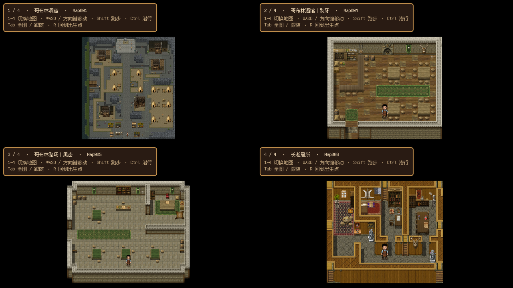
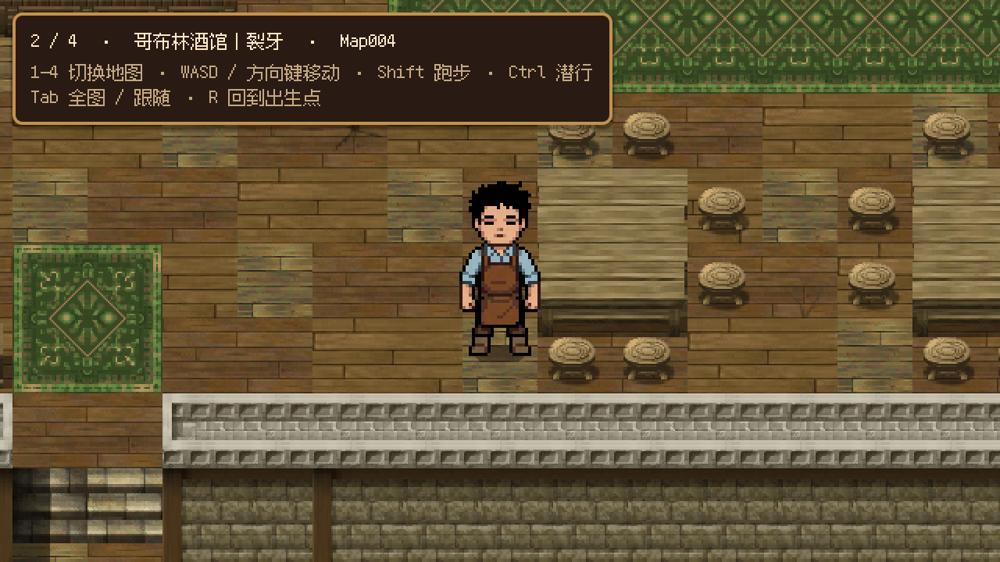

# RPG Maker 地图移植与编辑

## 正式地图接线（2026-10-19）

2026-10-20 更新：长老房内移除 `StealthSetup` 和两名宅内巡守，宿主按既有可选配置逻辑跳过潜入服务、警戒表现及潜行 HUD。房内可正常调查文书、取得血液并出门；室外潜入、付款门禁和撤离条件保留。下文巡守站位与室内重试为历史接线记录。

### 长老宅碰撞与反馈修正

`map_006.tscn` 根节点的 `solid_regions` 以原生格坐标显式补充木墙面、墙顶、雕像和圆桌的实心范围。`rebuild_passability()` 同时据此生成物理阻挡和通行查询；共享 TileSet 和保存的 TileMapLayer 美术不变。中央巡守沿 `(408, 360)` 至 `(408, 312)` 行走，东室巡守沿 `(600, 312)` 至 `(600, 360)` 行走，避免出生在墙内或堵住右室入口。

双卫交互先显示“贿赂守卫（支付 10G）／暂时离开”。离开可以再次交涉；确认后由原交易服务扣款，余额不足不放行。宅门同时要求 S05、夜晚、已接受委托以及醉卫／双卫付款事实。古文书交互展示用户原图，关闭后才记录阅读，可重复打开且不重复发物。

专项入口为 `tests/verify_elder_feedback.gd`；图形模式附加 `-- --capture` 将地图、贿赂选择和文书截图保存到 `.godot/elder_feedback/`。下文保留各批次接线与移植时的记录。

本轮使用 Godot 4.7.2：地图模块 216 项、方向通行夹具 14 项、StoryDirector 165 项、两天真实流程 339 项、房间渐隐 227 项通过。专项图形检查在 HEAD `abf4323c` 加本次改动的隔离副本中通过 51 项；并行修改中的解析错误修复后，当前共享工作区再次通过 51 项，包含实际浴室步行。截图确认文书等比显示及区域标注。工程与生成产物一致，未执行全项目回归、Release 导出或人工全程试玩。旧 `verify_story_interaction.gd` 的两项容量断言在该 HEAD 的未修改副本同样失败。共享工作区的其他并行修改未纳入本轮提交。

接口依据为 Godot 官方 4.7 源码文档：[TextureRect](https://github.com/godotengine/godot/blob/4.7-stable/doc/classes/TextureRect.xml) 的 `EXPAND_IGNORE_SIZE` 与 `STRETCH_KEEP_ASPECT_CENTERED`（避免原图最小尺寸撑大弹窗，并保持比例），以及 [TileMapLayer](https://github.com/godotengine/godot/blob/4.7-stable/doc/classes/TileMapLayer.xml) 的 `get_cell_tile_data()`（空格返回 null，通行仍从保存格子派生）。文档站返回 HTTP 403，核对使用同版本官方仓库的类文档。

### RPG 流程优化 A：可站位置与对象反馈

外景四扇门的检测圆向门外偏移 12 像素，半径仍为 42.5；返回落点及其左右 24 像素都可直接选中入口。宅邸双卫交涉位置移到两卫之间的南侧 `(1752, 504)`，角框指向两名守卫。未满足门控时，宅门提示向左交涉及醉卫 / 双卫的真实支付条件，酒馆和赌场提示各自的开放方向。

长老宅文书的站位为中央书房桌左 `(456, 264)`，角框对应桌上纸页；血液站位为右室桌右 `(744, 264)`，角框对应封蜡小瓶。剧情 Marker 与交互点同步；原有物品、调查回执与任意取物顺序保持。

A 包实际验证：Godot 4.7.2 `verify_rpg_chapter_maps.gd` 163 项、`verify_day1_world_flow.gd` 45 项通过；正式长老宅宿主图形检查确认纸页角框和提示对应。上述结果不替代真人全程步行验收。

通用 `verify_scene_travel.gd` 为 163 项、3 项失败；改动前 HEAD 同样在三次外景落地的十个物理帧移动距离断言失败，未在此扩展修复。两次运行均另报告 2 个对象 / 1 个资源退出保留诊断。

### RPG 流程优化 B：方向、观察与撤离

店外保留三调查点，奶茶店招牌与集市路标提供来回方向；摊位和街道调查解释下一片区域。目标卡按尚未完成的调查显示方向，提前调查同样认可，街道不再描述为没有行人。

入口卫与对应 Marker 移到主街 `(1176, 456)`，朝南、专属视距 96；其余三卫仍为 30，发现 / 分心保持 0.6 / 6 秒。安全观察位为 `(1176, 600)`，检查点和撤离区仍为 `(1176, 648)`；可选投币落点 `(1272, 504)` 可从观察位投到并被入口卫听到，不新增投币次数条件。醉卫遭遇区向南覆盖可站道路，侧路继续开放。

外景与宅内的潜入 HUD 持续读取文书 / 血液事实，拿齐后还检查真实库存，再显示关卡配置的撤离方向。室内隐藏无用的投币按钮，仍可整次重试。方向文案保存在关卡配置，HUD 不管理剧情推进。

B 包实际验证：地图模块 169 项、宅内两种顺序 48 项、潜入模块 100 项、乱序调查的真实按键 / 步行 60 项通过；正式宿主图形检查了招牌、守卫视锥 / 落点和右室药瓶反馈。步行测试使用独立 user://verification 存档目录。

### 接线基线

最新 A–C 实施与画面见[流程优化记录](../../development/flow_optimization_abc_2026_10_19.md)。酒馆服务站位 `(336, 264)` 在吧台外侧，矩形可用区为 48 × 96 世界像素；裂牙及其 Marker 在吧台后 `(216, 312)`。柜台复用 tavern ID，第二天交谈 / 购酒 / 委托与第三天真实交付共用既有路由。赌场使用最近赌桌右下的可站位置 `(648, 792)`，角框指向桌面，黑齿在旁边 `(696, 744)`。

酒馆内另有 3 名不带交互的背景客人，全部复用 `rpg_common_goblin` 的背包 / 无背包变体：吧台边 `(360, 360)` 朝左、北侧方桌 `(600, 216)` 朝下、南侧角落 `(408, 552)` 朝右；只有角落客人带半径 18、速度 20 的小幅游走，其余静止，三者 `gives_interaction_point` 均关闭。数量少于赌场里分散在各处的 9 名赌客，柜台与 S04 买醉者仍能一眼看清。

两室进门先恢复观察与移动，关键事件由对象 E 交互请求；三处采集点提供对应物件，萤火伞下移一格至 `(888, 1944)` 避开墙格。原始四张地图的所有 TileMapLayer、通行数据、地形侧路不变。本轮地图模块 176 项、完整两天 231 项与第二天图形操作 / 步行 184 项通过；下文接线与移植批次的旧结果仅证明当时状态。

正式外景宿主沿用 `src/core/settlement.tscn`，三个新室内为 `src/core/tavern.tscn`、`casino.tscn`、`elder_house.tscn`。它们加载 `chapter_*.tscn` 继承场景，以用户确认的[拓扑和规则](../../design/two_day_flow_integration_plan.md)添加出入口与剧情点；原始四张地图格子保持不变。

F6 打开外景宿主可行走，正式章节门控决定哪些室内开放。S03 三观察点已迁入集市附近。室内也装配真实交互、交付、章节和地图能力；地图在室内显示对应建筑的外景入口，仍须剧情解锁。经济和后续章节未发布前，不把地图接线当作两天正式通关。

`verify_rpg_chapter_maps.gd` 覆盖原格保持、方向通行、命名出生点、真实目标预检、已知地图区域、室内宿主和章节门控；本次 Godot 4.7.2 headless 检查 99 项通过，原有最小房间宿主 14 项通过。图形与完整两天验收尚未执行。运行时证书读取诊断来自本机沙箱；编辑器退出另报告设置目录不可写及已有资源保留诊断。

## 原始移植记录

2026-10-18 从 `D:/taptapgamejam/map/Project1` 当前保存的 MZ 数据移植。地图使用 Godot 4.7 原生 TileMapLayer，可在编辑器逐格修改；运行时不依赖 RPG Maker 或外部源工程。

## 地图与试玩

打开 [rpg_maker_preview.tscn](../../../src/debug/rpg_maker/rpg_maker_preview.tscn)，按 **F6**。`1–4` 切图，WASD / 方向键行走，Shift 跑步，Ctrl 潜行，Tab 切换全图 / 跟随，R 回到出生点。独立宿主使用项目真实玩家、原尺寸素材、240 世界像素/秒的普通速度和唯一跟随相机。

| 按键 | 地图 | 格数 / 世界像素 | 可编辑场景 | 试玩出生格 |
| --- | --- | --- | --- | --- |
| 1 | 哥布林洞窟 | 50×55 / 2400×2640 | [map_001.tscn](../../../src/levels/rpg_maker/map_001.tscn) | (24, 53) |
| 2 | 哥布林酒馆｜裂牙 | 19×17 / 912×816 | [map_004.tscn](../../../src/levels/rpg_maker/map_004.tscn) | (9, 13) |
| 3 | 哥布林赌场｜黑齿 | 25×21 / 1200×1008 | [map_005.tscn](../../../src/levels/rpg_maker/map_005.tscn) | (12, 17) |
| 4 | 长老居所 | 17×15 / 816×720 | [map_006.tscn](../../../src/levels/rpg_maker/map_006.tscn) | (8, 11) |

原点是地图左上；图块原生 48×48 世界像素。出生坐标位于格中心。源项目的 `startMapId=0` 无有效起点，所以转换工具在各图最大可达区域中选择靠近下方中央的位置，并保存为可编辑 `Spawn` Marker。旧说明中的 Map006 整村大地图已与当前文件不符；本次以实际数据库为准。

观察路线：洞窟从南侧沿路进入建筑与帐篷之间；酒馆从南侧餐桌沿通道走向吧台；赌场从南侧牌桌走向中央与北侧柜台；长老居所从南侧通道向房间内部行走。墙、水域和家具阻挡按源通行标志生效；长老居所的部分方向墙仍可沿许可方向移动。人物保持当前约 118 世界像素站立高度，未拉伸地图或缩放角色。





当前源地图没有事件、传送门、视差背景或自动播放 BGM/BGS。已迁入地图与完整素材；跨图切换仅在独立试玩宿主中提供，正式剧情地图连接和业务事件尚未接入。主游戏入口保持现有标题菜单。

## 在 Godot 中继续编辑

直接打开上表的地图场景，选择 TileMapLayer 绘制并保存；再打开试玩宿主 F6 检查。

- `Ground0..3`：源四层中的普通图块。它们均在人物下方。
- `Upper0..3`：各源层的星号遮挡图块，始终覆盖人物。新绘制的星号格应放在对应 Upper 层；普通格放对应 Ground 层。
- `Shadows`：16 种四分格阴影，可独立修改。
- `TableEdges`：桌子南缘派生的半格图块。更改桌子后使用下方同步工具；不会在启动时自动重画。
- 根节点 metadata 的 `regions` 保留源区域编号（格坐标 → ID），当前未绑定玩法；`Spawn` 可直接移动。

外部图块资源位于 [src/resources/tilesets/rpg_maker](../../../src/resources/tilesets/rpg_maker/)。图块组 28、30、31 共 **16,053 个可选图块**，覆盖这三个图块组完整可用调色板，包含原地图未使用的内容。图集以原尺寸裁片拼接，水面与瀑布动画保留；当前没有自动推断邻接形状的 Godot Terrain 规则，需要选择对应边角形状。

每格 TileData 的 `rpg_tile_id` 是源 ID，`passage` 的 1/2/4/8 位表示下/左/右/上阻挡，`star` 表示前景穿透。地图启动时只读取**已保存的图块**生成通行与边界碰撞；空格 / 星号跳过，从上往下第一个普通格决定方向。运行中改格后可显式调用 `rebuild_passability()`。覆盖贴地装饰可能改变通行，修改时要核对其 TileData。

地图根节点的 `solid_regions: Array[Rect2i]` 是关卡独有的实心修正，单位为原生格，优先于图块的方向通行标记；空数组沿用源规则。编辑相关墙面或家具时同步这些范围，再重建并检查任务点的可达性。

桌沿单独同步，先生成新文件检查：

```powershell
godot --headless --path . --script tools/map/sync_rpg_maker_table_edges.gd -- --input=res://src/levels/rpg_maker/map_004.tscn --output=res://src/levels/rpg_maker/map_004_review.tscn
```

确认后需要原位更新时，将 output 指向输入场景并显式添加 `--replace`。工具只重建 TableEdges，保留其他手工格子、出生点和 metadata；不会读取旧 JSON 覆盖地图。

## 完整素材与来源

[原始素材快照](../../../assets/rpg_maker/source/README.md) 包含 **1,453 个原文件 / 151,030,287 字节（约 144 MiB）**：全部 img、audio、effects、fonts、icon、movies、imported-assets、当前 data 和工程标识。原名、字节与许可证保留，清单逐文件记录 SHA-256。未复制旧备份、QA 截图和整套 RPG Maker 引擎。

原素材在 `assets/rpg_maker/source/project1/`，可用文件管理器查看；`.gdignore` 使 Godot 不扫描未使用的整包素材。要新增当前三套调色板之外的资源，从快照选取原图复制到对应用途的正式素材目录，按该模块规范设置导入并记录来源。当前运行只引用 [派生图集](../../../assets/map/rpg_maker/README.md) 和 Godot 资源。源快照及转换 catalog 已从导出范围排除。

## 从快照重新转换

需要 Python 3.12+、Pillow，以及 Godot 4.7。以下命令在仓库根目录运行，`godot` 替换为本机可执行路径；本次使用 `D:/taptapgamejam/tools/godot-4.7.2/Godot_v4.7.2-stable_win64_console.exe`。

```powershell
python tools/map/archive_rpg_maker_assets.py --source D:/taptapgamejam/map/Project1 --output assets/rpg_maker/source --verify
python tools/map/prepare_rpg_maker_maps.py --source assets/rpg_maker/source/project1 --tables assets/rpg_maker/source/autotile_tables.json --output assets/map/rpg_maker_review
godot --headless --editor --path . --import
godot --headless --path . --script tools/map/bake_rpg_maker_maps.gd -- --catalog=res://assets/map/rpg_maker_review/catalog.json --output=res://src/levels/rpg_maker_review --tilesets=res://src/resources/tilesets/rpg_maker_review
```

转换器要求新 output 目录；Godot 烘焙工具默认拒绝覆盖已存在的任何输出，只有显式 `--replace` 才允许。示例先生成独立 review 路径，避免覆盖团队已经编辑的正式地图。重新采集变更过的 MZ 原工程时同样使用新的快照路径；归档工具拒绝覆盖不同内容。

## 验证与边界

本次采用模块验证，未改公共玩家接口或正式剧情入口，因此未跑全项目回归，也未构建 Release 发行包。

- 全部 1,453 原文件逐个大小 / SHA-256 核验通过；缺失与内容冲突保护通过。
- 用**原项目 rmmz_core.js 的实际 Tilemap 绘制方法**独立产生参考矩形，四图各六个动画时刻，共 24 次整图逐像素比较通过，涵盖自动图块、桌沿、阴影与星号层。
- Godot 模块检查 **63 项通过、0 失败**：验证外部共享 TileSet、源格和已保存场景、动画帧数 / 速度、阴影 / 桌沿 / 区域、四向阻挡、真实玩家移动、修改格子后的通行、保存重开、四图切换及唯一跟随相机。
- 四图已使用 Godot 4.7.2 / D3D12 Forward+ 实际运行并截图；检查全图、原生比例与遮挡。酒馆另有 Compatibility 渲染冒烟通过。
- 重复执行 bake 且不加 `--replace` 被正确拒绝，已有四场景与四个外部 TileSet 的八个哈希不变。
- 临时副本重导入保留八个场景 / 资源原 UID 和外部 TileSet 引用；桌沿同步验证更改桌格后只更新派生边缘，其余九层、Spawn、metadata 保持，原位更新保留场景 UID。
- 最终编辑器导入正常退出，无错误或警告。初次导入曾出现现有 Phantom Camera 更新检查的 `Dictionary → Array` 错误（`addons/phantom_camera/scripts/panel/updater/update_button.gd:62`）；该插件与 HEAD 完全一致。当次退出还报告未释放对象 / 资源，未定位其原因。地图烘焙、模块检查与实际试玩均正常退出，本次未修改插件。

可重复运行：

```powershell
python tests/verify_rpg_maker_render.py --source D:/taptapgamejam/map/Project1 --catalog assets/map/rpg_maker/catalog.json --node node
godot --headless --path . --script tests/verify_rpg_maker_map.gd
godot --path . res://src/debug/rpg_maker/rpg_maker_preview.tscn -- --rpg-map=4 --rpg-overview --rpg-capture=D:/absolute/output.png
```

原引擎只用于本地像素比较，不随 Godot 游戏执行。关键官方接口：[TileMapLayer](https://docs.godotengine.org/en/latest/classes/class_tilemaplayer.html)（静态格子保存与坐标转换）、[TileSetAtlasSource](https://docs.godotengine.org/en/latest/classes/class_tilesetatlassource.html)（图集区域、动画帧与 padding）、[TileData](https://docs.godotengine.org/en/latest/classes/class_tiledata.html)（通行自定义数据）。本次核对 4.7 对应文档。
