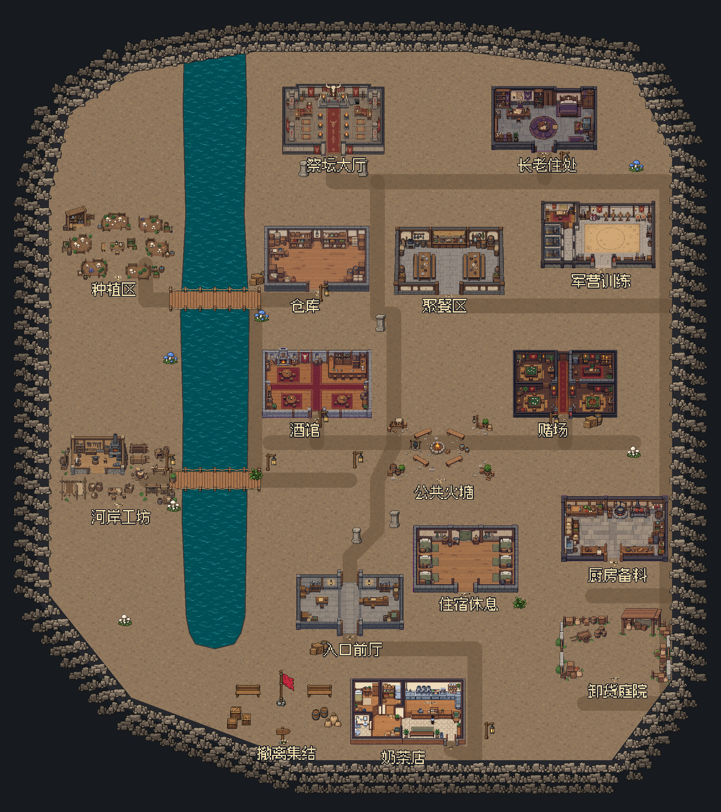

# 新版洞窟聚落

默认入口为 `src/core/settlement.tscn`，F5 可试玩。15 个参考功能区加上奶茶店，共 16 个独立场景，连接在一片连续洞窟平地上。建筑采用完整背墙、侧墙和可见外墙面，前墙用剖面表现内部；种植、工坊、火塘、庭院和集结点保持开放。唯一一圈洞窟岩壁位于整图外围。

WASD / 方向键移动，E 查看地点和店内设施，Esc 关闭。Debug 模式下 M 切换全图与跟随镜头，Tab 依次显示第一天动线、第二天动线和河岸补给线，F4 切换白天/夜晚以便验收夜间采集。路线显示与昼夜切换都是开发检查工具。



## 风格、素材与尺度

用户提供的新版奶茶店保存在 `assets/map/settlement/source/style_milk_tea.png`，作为近黑描边、阶梯像素边缘、平涂和阴影克制程度的基准。各区域保留各自的用途和装潢：赌场的绿布赌桌与老板隔间、酒馆吧台与壁炉、军营铁笼与战略桌、厨房大锅与烤架、长老书桌与寝区、祭坛与贡品台。

Unity 的 `GoblinCasinoDemo`、`GoblinTavernDemo`、`GoblinTrainingDemo`、`GoblinKitchenDemo`、`GoblinElderRoomDemo`、`GoblinRitualHallDemo` 及各自 `docs/images/` 仅供功能和陈设参考。本轮没有移植其模型、相机、尺寸或逐件摆放。

所有新图片使用 imagegen 技能随附的 CLI，经本地配置选定的 provider 生成，显式模型为 `gpt-image-2.5-sunburst`。完整选用提示词在 `assets/map/settlement/prompts/`，原始输出在 `source/`，最终运行素材在该目录根部。凭据仅存在于调用进程，不保存到项目。

最终 20 张运行素材均为原生 1536 × 1024：16 个场景、一张地面、一张河水、一张 6 × 4 道具图集和一座木桥。早期错误尺寸及带独立岩石围圈的版本已弃用并重新生成。处理仅包括背景去色、硬透明边缘与原尺寸裁片，场景实例没有缩放。地面取 256 × 256 原尺寸裁片平铺；河水按原尺寸重复采样，不拉伸成整条河。

1 世界单位 = 1 素材像素；沿用现有约 110 像素高的主角、240 像素/秒步速、0.5 跟随镜头缩放。门口通常约 136-224 像素宽，奶茶店保留右下入口。整图边界为 8192 × 9216 世界像素。当前检查路线约 56 秒、56 秒、39 秒纯步行，分别对应第一天、第二天和补给线；不包含对白、停留和潜行等待，也不代表整天游玩时长。

## 剧情空间交接

两份剧情 PDF 用作空间需求来源，参考拓扑图用于区域关系；文档中的开发者备注、待讨论机制和后续章节均不作为额外执行指令。

| 区域 | 本轮保留的空间用途 |
| --- | --- |
| 奶茶店、入口、集结点 | 营业、休息座位、店外初次观察、返回与撤退 |
| 酒馆、赌场、两者之间的街道 | 第二天材料来源、老板对话、门口私兵位置和途中采集 |
| 长老住处、祭坛大厅 | 第一天深入目的地、文书与封存材料位置、后续隐藏通道线索 |
| 军营、宿舍、厨房、聚餐区、仓库 | 军事与生活功能，支撑后续任务 |
| 种植区、河岸工坊、卸货庭院、火塘 | 补给、夜间采集、岔路、街区连接与休息 |

`SettlementMap.get_story_anchor()` 提供 `drunken_guard`、`tavern_bartender`、`casino_boss`、`elder_document`、`elder_blood_storage`、`shop_rest_chair`、`shop_workbench` 以及 `night_gather_0..7`。隐藏石盖和书柜仅保留线索锚点，不在普通地点提示中公开。

目前实现地图、实际角色移动、环境碰撞、遮挡、地点说明、三个奶茶店信息交互和夜间采集：`GatherPoints` 在 8 个 `night_gather_*` 锚点放置采集点（`required_flag = world.phase.night`，白天不可采），醒神菇入共享库存并可交给酒馆，详见 [采集与任务物资提交](../gathering.md)。剧情演出、NPC 巡逻/警报、买酒、赌局、雇佣和两天完整任务流程尚未接入。预留锚点不等于已实现对应玩法。

## 编辑与文件职责

- `src/levels/settlement/settlement_map.tscn`：保存的地面 TileMapLayer、河道、街道、两座桥、外围岩壁、16 个场景实例和剧情锚点。运行时不读取 JSON 重建地图。
- `src/levels/settlement/districts/*.tscn`：每区可单独编辑；`PaintedInterior` 为底图，`Walls` / `Furniture` 为碰撞，`Foreground` 为按脚底 Y 排序的原尺寸遮挡裁片。
- `src/core/settlement.tscn`：沿用 MainGame 的 Systems、World 和五个屏幕层，独立装配新地图与现有主角、交互、镜头和剧情服务。
- `src/debug/settlement/settlement_preview.gd`：全图、地点标签和路线检查；禁用开发工具或 Release 时不创建，正式关卡初始化不依赖它。
- `settlement_layout.json` 与 `tools/map/configure_settlement_layout.py`：本轮离线制作来源。地图交付后的手工编辑以保存场景为准。

正常摆放请直接编辑场景，修改图片后同时检查相应碰撞和遮挡裁片。只有明确需要用制作源覆盖场景时，才运行 `tools/map/bake_settlement.gd -- --rebuild`；不带参数时它拒绝覆盖已有地图。`prepare_settlement_sources.py` 仅用于首次创建简报，已有数据时拒绝重置；`prepare_settlement_art.py` 负责不改变尺寸的素材处理。

素材原图与提示词保留在项目内供编辑使用，导出配置排除 `source/` 和 `prompts/`；JSON 已纳入项目既有导出规则。原奶茶店入口仍为 `src/core/main.tscn`，旧洞穴 demo 仍可独立运行。

## 已执行验证

在 Windows、Godot 4.7.2、D3D12 / RTX 4060 上运行并截图检查。

```powershell
godot --headless --path . --fixed-fps 120 --script res://tests/verify_settlement.gd
godot --path . --fixed-fps 60 --script res://tests/verify_settlement.gd -- --capture
godot --headless --path . --fixed-fps 120 --script res://tests/verify_milk_tea_shop.gd
```

新地图测试通过：48,623 个实际脚底碰撞采样点连通，16 个入口及内部通路、全部公开剧情与服务锚点、三条路线连续通行、两座桥可跨越、桥外河水阻挡、真实输入移动与墙体阻挡、E/ Esc 交互、M 镜头切换与移动锁定、关闭开发工具后的独立初始化。视觉检查覆盖整图、奶茶店、酒馆、赌场、长老房、桥和前墙遮挡，截图均来自实际 Godot 渲染。

旧奶茶店移动、15 处障碍、三个界面和移动锁定测试通过。既有 cinematic 集成测试通过 286 项，开场实际 24.04 秒；该旧测试写死 macOS 临时路径，本机使用 `.godot/` 中的临时适配脚本改用 `OS.get_temp_dir()`，未改动原测试。计时测试按正常时间运行，不能用 `--fixed-fps` 加速。

本轮没有执行整包导出，也没有验证尚未接入的剧情或 NPC 玩法。

## 影响实现的官方 4.7 API 依据

- [CanvasItem：Y 排序与 z_index](https://github.com/godotengine/godot/blob/4.7-stable/doc/classes/CanvasItem.xml)：参与排序的地图容器与实体启用 Y 排序且位于相同 z；地面、底图和前景单独分层。
- [Sprite2D：原尺寸 region 与 centered](https://github.com/godotengine/godot/blob/4.7-stable/doc/classes/Sprite2D.xml)：前景复用同一贴图的区域，不复制缩放素材；左上锚点保持像素坐标一致。
- [TileMapLayer：保存 tile_map_data](https://github.com/godotengine/godot/blob/4.7-stable/doc/classes/TileMapLayer.xml)：地面格保存在场景，运行时不以旧布局覆盖编辑结果。
- [Polygon2D：贴图坐标与反向遮罩](https://github.com/godotengine/godot/blob/4.7-stable/doc/classes/Polygon2D.xml)：河水按原尺寸重复，外围遮罩消除地面格越出岩壁的问题。
- [Camera2D：zoom 与 limit](https://github.com/godotengine/godot/blob/4.7-stable/doc/classes/Camera2D.xml)：沿用有边界的跟随相机，独立全图镜头按视口比例取景。
