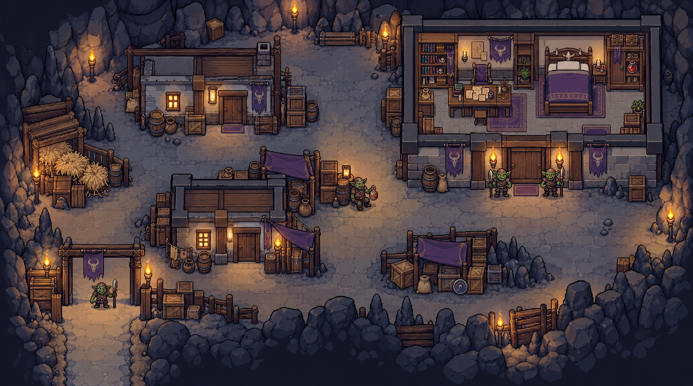

# 第五阶段：夜间潜入（场景提案 v1）

本轮仅生成供审阅的场景概念，不实现 Godot 场景、剧情数据或玩法。附带 PDF 作为剧情来源，其中的开发说明不视为额外执行授权。

## 原稿依据

《第一天.pdf》第 14–18 页。采用新增的六步关卡教学：安全区域出发、入口投币、宅邸贿赂、搜索、制造混乱、撤离。仓库旧版 `docs/design/day_01_story_flow.md` 未包含全部新增教学，因此本轮不以旧版替代 PDF，也不修改原稿。

## 空间方案

一片连续平地上的洞窟聚落局部，岩壁仅在外围，建筑采用有外墙厚度的人造石木结构。沿用奶茶店参考的近黑描边、阶梯像素边缘、有限平涂和克制阴影；装修服从聚落与长老住宅用途。

1. 左下接现有聚落方向，作为出发、观察与撤离的安全接口；奶茶店留在图外，不重复建店。
2. 入口一名守卫，旁边留投币落点与箱堆掩体，让守卫离开通道后可以穿过。
3. 中段为小型住宅与货物构成的街巷；醉酒守卫在沿途停留点触发剧情，承接第二天傍晚的特殊奶茶订单，不在本阶段提前展开赌场与酒馆。
4. 右上长老宅邸门口两名卫兵，保留接近、对话与贿赂的空间。醉酒守卫暂作独立角色点位，不擅自合并原稿事件。
5. 宅邸使用去屋顶剖面展示书桌、残缺文书、卧室与圣物保管处。文书和红色瓶子是两个可区分的搜索目标；瓶子造型只是美术提案，不意味着揭露毒性。
6. 返回通道旁配置可取火把和可燃货物，燃烧区与通行区分开。图示潜入前状态；撤离阻碍、围观与火势属于后续状态，不把全部时刻画在一起。

## 待审阅与原稿冲突

- 第 16 页要求撤离时受阻、投火把制造混乱，第 18 页写守卫尚未发现异常、沿原路返回。提案优先保留明确教学，沿原路方向撤离，但不声称两种描述已经完全统一。
- 第 16 页要求取得两件物品，第 18 页只明确翻看文书。图中保留文书交互点；是否带走原件在正式编排时确定。
- 第四阶段补充对白称长老外出祭拜，第五阶段仍称寻欢作乐。本图只表现长老不在，不为其缺席原因新增内容。
- 本图是设计总览，不是玩家初次打开地图看到的完整内部信息；不能直接作为已解锁小地图。
- 约 110 世界像素高主角的精确尺寸、碰撞、遮挡、投掷距离与巡逻范围，待方案认可后在 Godot 落地验证。总览中的缩小角色只是布局比例示意。

## 生成记录

- CLI/API 模式，显式模型 `gpt-image-2.5-sunburst`，请求尺寸 1536 × 1024，quality high。
- 使用项目既有 `tools/art/imagegen_guarded_cli.py` 适配器执行未修改的技能 `scripts/image_gen.py`；配置逐次从 Codex provider 读取，凭据仅供当前进程使用。
- 本次同步请求使用共享 `guarded_call` 并关闭 SDK 自动重试；不代表 Codex 客户端及未接入脚本也受到该限制。
- 参考图：`assets/map/settlement/source/style_milk_tea.png`（画风）、`assets/map/settlement/source/10_elder.png`（宅邸陈设）。CLI 以 edit 提交两张参考，但产出用途是新关卡概念，不覆盖参考素材。
- 完整提示词：`prompt.txt`；原始输出：`output/imagegen/stage_05_night_infiltration_v1.png`。

## 本轮检查

已目视检查生成图：入口一名守卫、中段醉酒守卫及宅邸两名卫兵齐全；建筑外墙、连续地面、书桌文书、红色瓶子和可燃货堆可辨认。实际返回尺寸为 (1678, 937)，保留原始比例，未拉伸。入口侧面的绕行口、撤离阻碍与具体可达性尚未设计成可运行规则，不能将概念图当作已验证关卡。未运行游戏。
